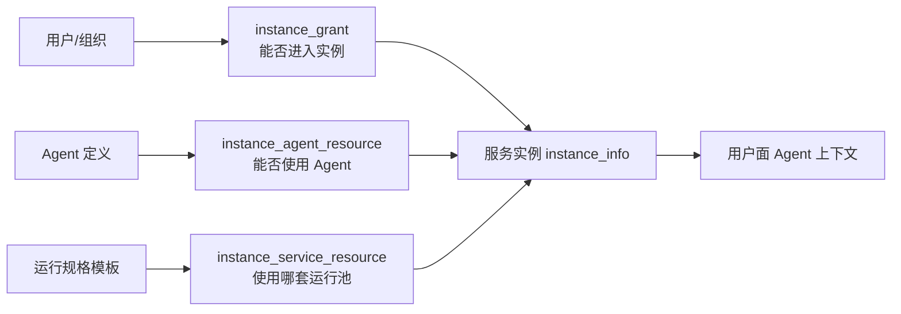

# Manager 第三、四步配置流程与 UCD 优化分析

## 结论先行

旧版集群详情页的配置边界是合理的：用户先选定一个真实集群，再在同一上下文中完成准入、Agent 资源和运行时资源配置。当前新版把这些对象拆成全局目录页、实例页和 Agent 使用范围页，数据模型没有问题，但用户必须自己在页面之间拼接一条完整链路，容易在“创建模板”“绑定模板”“授权用户”之间迷路。

建议保留现有全局资源目录，同时增加一个以服务实例为中心的「集群配置工作台」。Agent 详情页的“配置使用范围”保留为快捷入口，但保存后跳回该集群工作台，并明确显示下一步、前置条件和最终检查结果。

## 一、旧版页面的实际操作结构

已登录并检查线上旧版页面：

`/manager/instances/3dc7817c-c788-4d73-8802-767296591468/cluster-config`

旧版在一个集群上下文中提供：

- 集群准入：组织、用户两个页签，配置谁能登录该集群；
- 集群配置：Agent、运行时、专家包、基础配置等页签；
- 状态监控、配额管理、成本统计、业务审计；
- Agent 页内有“添加 Agent”，表格直接显示资源名称、Agent 模板、授权范围、启用状态；
- 运行时页内有“添加运行时”，表格直接显示运行时模板、授权范围、优先级、启用状态；
- 集群卡片和页签可以显示“未配置”提示。

这个结构的优点是“集群”始终是当前对象，用户不会忘记配置正在作用于哪个运行环境。缺点是集群配置页内的 Agent 和运行时都是表格加弹窗，缺少一条明确的完成路径，也没有把“准入 → Agent 授权 → 运行资源 → 检查”解释成一个整体。

## 二、真实后端关系

### 1. 服务实例

服务实例保存在 `instance_info`，代表一套已部署的 JiuwenSwarm 运行环境。

主要接口：

```text
GET  /api/v1/instances/
POST /api/v1/instances/
GET  /api/v1/instances/{jiuwenclaw_id}
POST /api/v1/instances/health-probe
```

它保存 Gateway、Runtime、User Web 等地址和探活状态。实例在线只说明管理面能够访问相关服务，不等于某个 Agent 已经可以执行。

### 2. 容器模板和运行规格

容器模板是容器镜像及容器包装方式；运行规格是引用容器模板、定义 Pod、并发、超时和池行为的 Runtime Profile。

目录接口：

```text
GET/POST/PATCH/DELETE /api/v1/container-templates
GET/POST/PATCH/DELETE /api/v1/service-config-templates
GET /api/v1/service-config-templates/agentserver-discovery
```

目录模板本身不是实例生效关系。要把运行规格挂到某个实例，使用：

```text
GET/POST/PATCH/DELETE
/api/v1/instances/{jiuwenclaw_id}/service-resources[/{resource_id}]
```

这会写 `instance_service_resource`。其中 `ref_template_id` 指向运行规格模板，`match_expr` 表示适用范围，`priority` 决定同一实例内的选择顺序，`enabled` 控制是否参与运行。

### 3. 集群准入

准入保存在 `instance_grant`，表达某个用户或组织是否可以进入某个实例。

```text
GET/POST/PATCH/DELETE /api/v1/instances/{jiuwenclaw_id}/users[/{user_id}]
GET/POST/PATCH/DELETE /api/v1/instances/{jiuwenclaw_id}/orgs[/{group_id}]
```

`enabled`、`login_policy` 和 `expires_at` 会影响最终准入。用户和组织目录本身由身份服务维护，Manager 维护的是“主体 ↔ 实例”的授权关系。

### 4. Agent 资源授权

Agent 绑定保存在 `instance_agent_resource`。它把 Agent 定义挂到一个实例，并通过 `match_expr` 决定哪些用户、组织或 bot 条件命中。

```text
GET/POST/PATCH/DELETE
/api/v1/instances/{jiuwenclaw_id}/agent-resources[/{resource_id}]
```

创建 Agent 资源时，后端会尝试把目标状态同步到 Gateway，然后再写 Manager 数据。保存成功代表资源授权写入并尝试下发，不代表用户已经具备实例准入，也不代表运行池一定健康。

### 5. 用户面最终可见性

用户面大致需要同时满足：

```text
有效 instance_grant
AND 有效 instance_agent_resource
AND Agent match_expr 命中用户或组织
AND Agent 定义启用
AND 目标实例有可用的运行资源和组件
```

因此两条链路必须在同一个实例汇合：



## 三、当前流程的 UCD 问题

### 1. 全局对象和实例对象混在同一条引导里

模型、容器模板、运行规格是“可复用目录对象”；准入、Agent 资源、运行时资源是“某个实例上的生效关系”。用户从全局目录页进入后，很难判断自己是在“准备材料”还是在“让某个集群生效”。

### 2. “配置使用范围”承载了多个概念

当前 Agent 页面可进入一个绑定向导，但它主要创建 `instance_agent_resource`。用户可能误以为这一步同时完成了用户准入、组织准入和运行资源绑定。

### 3. 保存反馈不是最终可用性反馈

页面可以显示“绑定配置已保存”，但用户还要知道：

- 目标实例是否允许该用户或组织进入；
- Agent 授权条件是否命中；
- 是否有启用的运行资源；
- Gateway、Runtime、User Web 是否正常；
- 修改配置是否触发 Runtime 刷新或冷启动。

### 4. 下一步缺少稳定落点

用户从 Agent 页面完成一次保存后，下一步应该回到哪个实例、哪个页签、做哪项检查，目前没有稳定答案。这正是“点完以后不知道干什么”的根因。

## 四、可选的 UCD 方案

### 方案 A：以集群为中心的配置工作台（推荐）

保留现有目录和表格，在实例详情增加一个明确的工作台入口：

```text
服务实例列表
  → 选择实例
  → 集群配置工作台
       ├─ 服务连接
       ├─ 运行资源
       ├─ 访问授权
       ├─ Agent 授权
       └─ 检查并完成
```

工作台顶部显示当前实例名称、实例 ID、连接状态和总体进度；中间显示配置状态和已绑定资源；右侧显示下一步任务。每个任务直接打开当前实例下的正确页签或弹窗。

优点：最符合现有数据模型，也最接近旧版可用结构；不需要把全局目录和实例生效关系混成一个表单。

### 方案 B：以 Agent 为中心的发布向导

从 Agent 定义进入：

```text
选择 Agent
  → 选择服务实例
  → 配置准入
  → 配置 Agent 授权
  → 选择运行资源
  → 检查并发布
```

优点是适合“我刚创建了一个 Agent，想马上让它可用”的场景；缺点是实例管理员通常需要批量维护多个 Agent，反复从 Agent 进入会增加操作成本。

### 方案 C：全局配置中心加关联抽屉

保留现有全局目录页，在每个模板行上增加“应用到实例”操作，打开右侧抽屉选择实例、授权范围和优先级。

优点是模板和生效关系靠得近；缺点是单个模板操作会变重，批量管理和实例视角仍然不足。

## 五、推荐方案的页面原型

低保真原型包含两个视图：

1. **集群配置工作台**：以实例为上下文，展示访问授权、Agent、运行资源和状态检查；
2. **Agent 配置向导**：从 Agent 进入时先选择实例，之后每一步都回到该实例上下文。

原型中把三个容易混淆的概念直接写成：

- “谁能进入集群”；
- “谁能使用哪个 Agent”；
- “Agent 使用哪套运行资源”。

这样可以把后端表名隐藏起来，同时保留必要的技术解释。

## 六、建议的最终操作路径

### 面向首次配置

```text
1. 准备模型、技能和其他资源模板
2. 创建 Agent 定义
3. 接入服务实例
4. 在实例工作台配置运行资源
5. 在实例工作台配置访问授权
6. 在实例工作台绑定 Agent，并选择授权范围
7. 执行检查并进入用户面验证
```

### 面向日常管理员

```text
服务实例
  → 集群配置工作台
  → 访问授权 / Agent / 运行资源
```

### 面向单个 Agent 发布

```text
Agent 定义管理
  → 配置使用范围
  → 选择服务实例
  → 返回该实例工作台
```

## 七、建议替换的用户术语

| 当前术语 | 更易理解的名称 | 解释 |
| --- | --- | --- |
| 运行环境 | 运行环境与资源池 | 既包含实例，也包含真正运行 Agent 的资源池 |
| 服务实例 | 已部署运行环境 | 强调它是可实际运行的环境 |
| 容器模板 | 容器镜像与启动方式 | 用户更容易理解模板作用 |
| 运行规格 | Agent 运行池方案 | 强调它是可调度的运行池 |
| 集群准入 | 进入集群的权限 | 直接说明授权结果 |
| Agent 资源 | Agent 使用授权 | 说明它决定谁能使用 Agent |
| 使用范围 | 访问与授权 | 同时覆盖进入实例和使用 Agent |
| 配置使用范围 | 配置 Agent 使用授权 | 避免被理解为普通筛选范围 |
| 检查准入与运行条件 | 检查能否真正使用 | 更接近用户最终目标 |

## 八、实施顺序建议

原型确认后，建议按以下顺序开发：

1. 先做实例工作台信息架构和状态汇总，不改变后端接口；
2. 把现有准入、Agent 资源、运行时资源页签接入工作台的下一步跳转；
3. 为 Agent 绑定保存结果增加“返回实例工作台”的稳定落点；
4. 增加最终检查接口或前端聚合检查，明确区分“已保存”和“可运行”；
5. 最后再考虑把多个弹窗合并成分步向导，避免一开始把稳定的旧功能全部重写。

