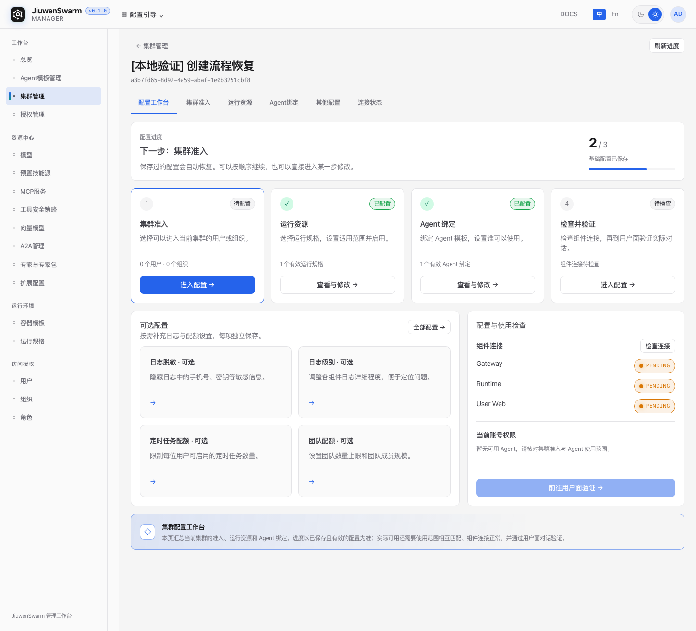
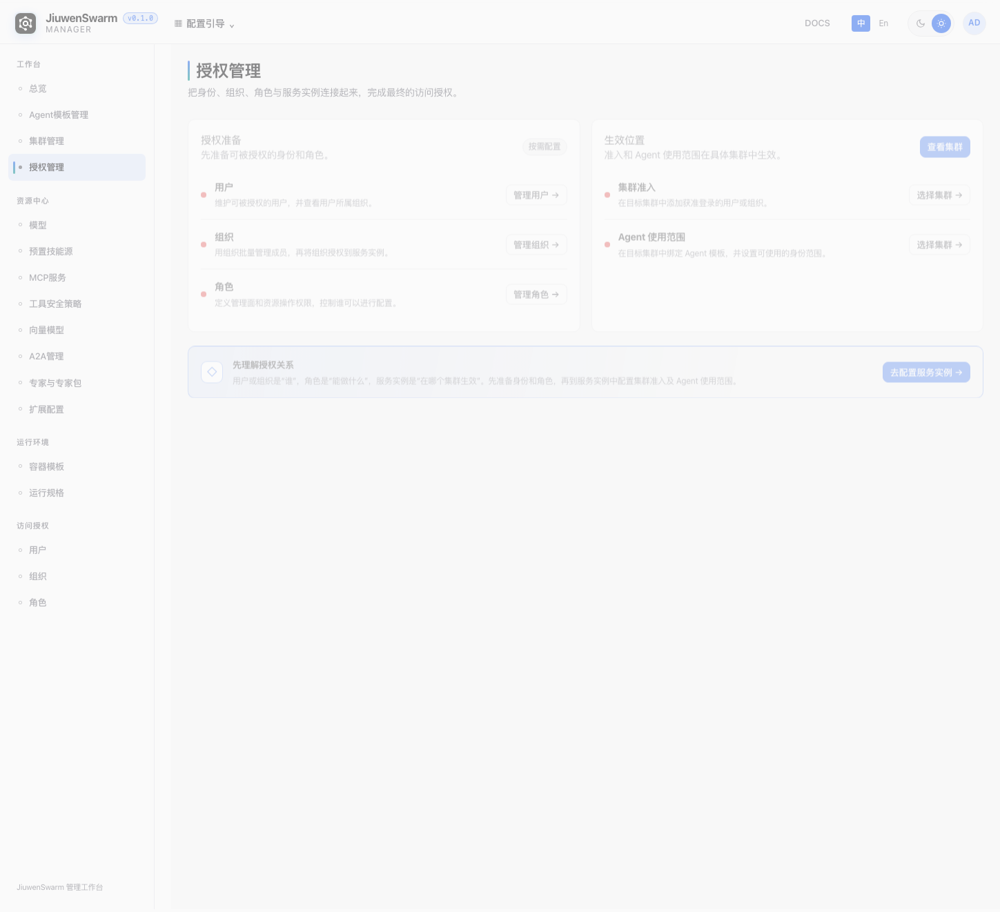

# Manager 修改恢复与验证记录

日期：2026-11-03（Asia/Shanghai）。分支：`codex/feature-manager-redesign`。检查起点：`ffefa5fb`。

## 发现与原因

- 最近工作没有全部丢失：开始检查时，Manager 有 41 个已跟踪文件的未提交修改、11 个未跟踪的新文件，共 52 个。工作台样式、账号权限检查、准入上下布局、模板选择弹框和配额分区等仍在磁盘上。
- Git reflog 在 `36be56c5`、`ffefa5fb` 后未发现 reset 或切换分支记录；当前仅有一个工作树，4 个旧 stash 均不包含这些 Manager 修改。不能把“尚未提交”直接等同于“没有保存到磁盘”。
- 检查中本地 5273 服务曾停止。重新启动后，浏览器依赖请求实际返回 `504 Outdated Optimize Dep`。运行 SSR 测试前后发现默认 `.vite/deps` 缓存不再包含开发服务正在使用的文件；测试以 `configFile:false` 启动 Vite，与原开发服务共用默认缓存目录。现在开发服务改用 `node_modules/.vite-manager-dev`。运行测试后重新登录并遍历页面成功。
- 旧演示集群、演示专家目录及授权示例一直存在于源码，是本次需要清理的内容。用户此前截图的生成时刻没有可回放的网络记录，不能断言每一次旧界面都由缓存问题造成。

## 保留下来的前几轮修改

| 要求 | 当前实现与核验 |
| --- | --- |
| Agent 模板与定义统一 | 保留 `/agent-templates` 主入口、旧路由重定向、目录 CRUD、资源引用与集群返回关系 |
| 六个集群页签 | 工作台、准入、运行资源、Agent 绑定、其他配置、连接状态共用集群上下文 |
| 子页不再显示进度和下一步 | 五个详情页没有进度条、下一步或继续配置按钮 |
| 工作台内容去重 | 左侧为可选设置；右侧仅组件连接、当前账号权限、用户面验证入口 |
| 准入上下布局和明显管理入口 | 组织与用户上下排列；无候选对象展示主按钮，有候选对象展示目录管理入口 |
| 模板选择与返回草稿 | 运行规格、Agent 绑定使用统一选择器；离开目录、返回、刷新保留名称与模板选择 |
| 统一内容标题 | 运行资源保留“当前集群的运行资源”；Agent 绑定、连接状态使用共同紧凑标题，删除重复外层标题 |
| 引导交互 | 鼠标离开自动收回，状态保存在浏览器；不恢复已删除的固定、收起、退出控制 |
| 表格与小屏布局 | 共享表格最小高度、页脚布局；搜索框限宽且按钮同排；其他配置采用整页滚动 |
| 配额页去掉内部分栏 | 团队和用户空间配额以策略、用量上下分区呈现；未开放能力仍明确标记 |
| 统一提示、术语、资源导航 | 保留资源页底部统一说明和前几轮已应用文案，不回滚为早期文案表中的旧术语 |

## 本轮补齐

- 授权页标题改为“授权管理”，删除“授权关系示例”；删除伪造的测试/生产集群和“3 项已就绪”状态。
- 删除内置演示集群数据、演示页组件、模拟进度、演示专用导航和禁用判断。真实接口错误显示错误，空列表显示空状态。
- 删除演示专家目录；保留用户已要求的模板专家绑定预览和真实 Hub 目录，明确后端尚未接入。旧浏览器草稿中标为演示的资源会被过滤。
- 移除演示模板生成脚本；确认没有集群绑定及其他模板引用后，通过本地 API 删除脚本生成的演示 Agent 与停用模型两条记录。已有三个经正常 API 创建的本地调试集群及其配置保留。
- 可选配置四张卡片采用等宽、等高的两列网格，小屏单列；左右主卡片在并排时拉伸到相同高度。

## 验证证据

- `npm run build` 成功；`npm test`：96 项通过（删除了已退役模拟集群专用的一项测试），`git diff --check` 通过。
- 真实本地 Manager/Identity 登录成功；集群六个页签无页面脚本异常。授权示例与合成集群不再出现。
- 1449 × 1314 视口下：四张可选卡片宽度均为 316.47px、高度均为 150px；左右面板高度均为 407.25px。
- 运行资源搜索框约 318px、Agent 搜索框 320px，刷新与添加按钮同排。
- 1024 × 700 视口下，其他配置使用整页滚动，内容不再被限制到很小的内层滚动框。
- 运行规格与 Agent 目录往返后，名称草稿与选中模板一致；刷新后仍恢复。本轮验证没有提交新的准入或资源绑定。
- 运行测试后再次执行浏览器回归成功，验证开发缓存隔离。
- 构建仍有既有大包、动态/静态混合导入和 Browserslist 提示；部分 SSR 测试在沙箱内产生既有 HMR 端口警告，测试结果均通过。

验证采用本地离线开发模式，未启动 Gateway、Runtime 或用户面，因此没有验证 Agent 执行与真实对话。浏览器自动化跳过外部字体网络请求，功能与布局使用当前本地页面验证。

## 备份与运行

原始 52 文件备份位于仓库下 `.manager-dev/recovery-20261103-172130/`：

- `manager-before.tar.gz`：修改前文件副本。
- `before.patch`：相对检查起点的差异。
- `manifest.json`：文件 SHA256 清单。
- `manager-before-demo-cleanup.db`：删除演示模板前的 SQLite 备份。

数据库、日志和备份不进入 Git。源码、新组件、样式、测试与本记录纳入本轮恢复提交；仓库中其他模块的用户改动不纳入。

本地入口：`http://127.0.0.1:5273/manager`。启动命令：`bash applications/manager/dev/local.sh --offline`。服务日志、构建和浏览器回归结果保存在 `.manager-dev/`。

