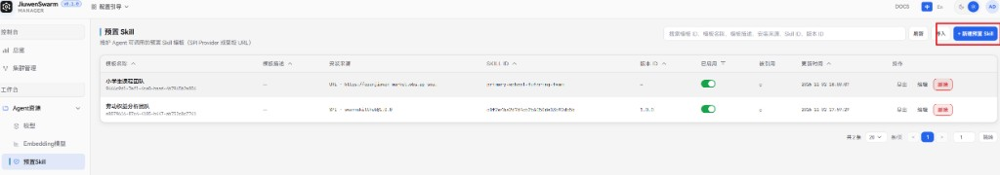
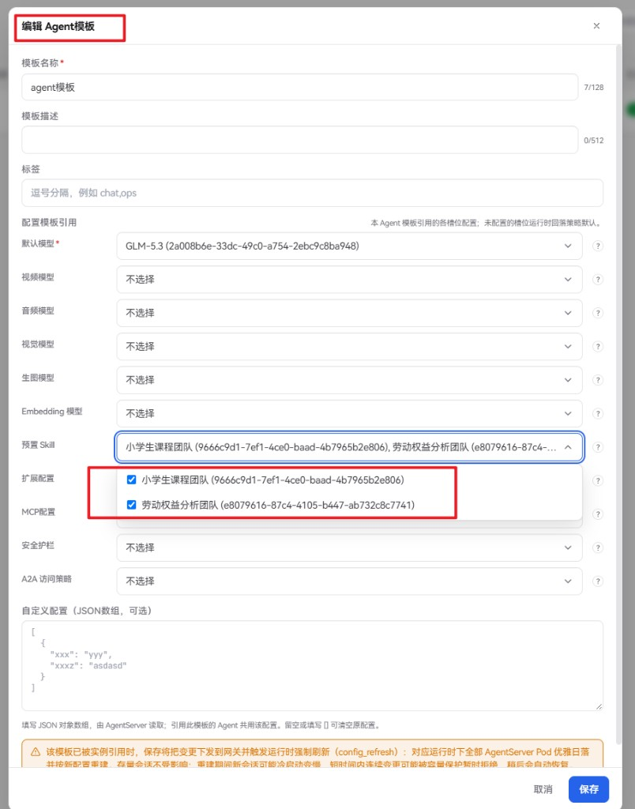
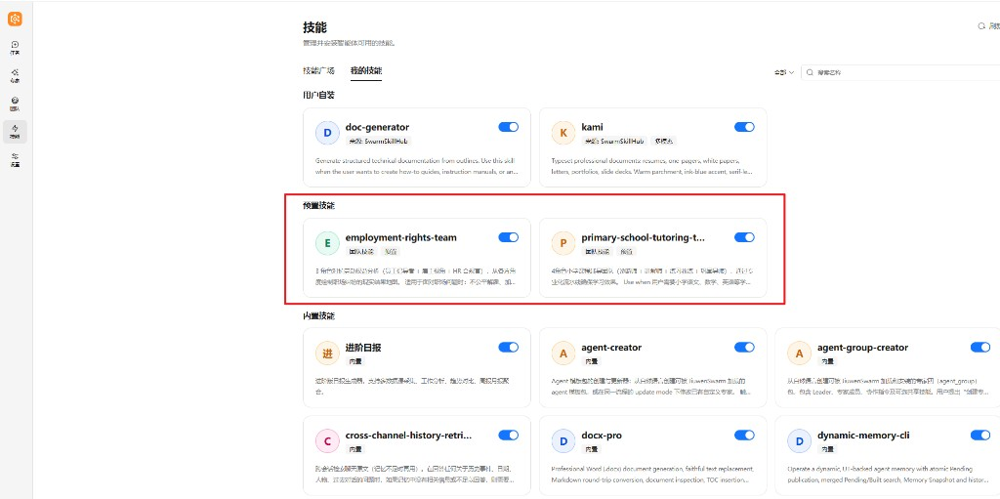
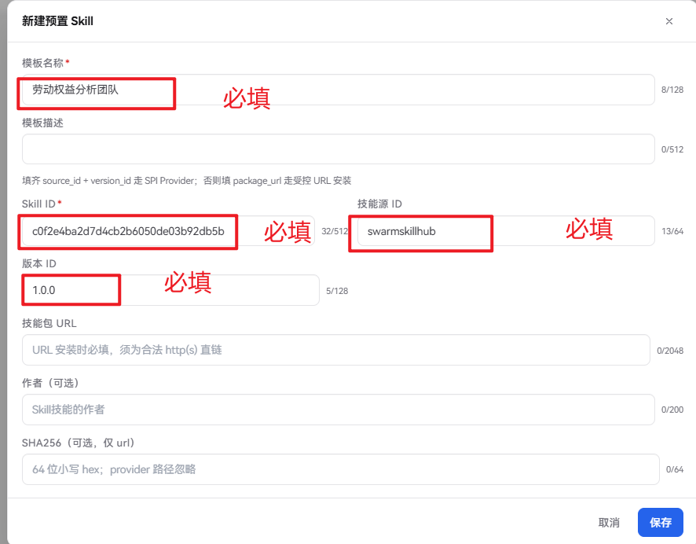
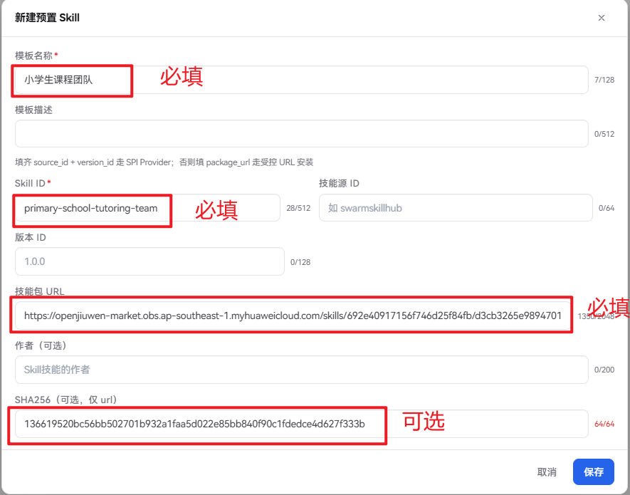

# 预置 Skill

本文介绍企业版管理面中的**预置 Skill**：它是什么、与其他技能来源的区别，以及如何配置下发、在用户面生效。

## 功能

**预置 Skill**是由管理员在管理面统一维护、再下发给指定 Agent 的技能模板。运行时会按 Agent 模板中的引用清单，自动将对应技能同步到用户工作区，并标记为预置来源。

与其他技能来源的对比：


| 来源           | 谁决定可用                  | 用户侧表现                                      |
| ------------ | ---------------------- | ------------------------------------------ |
| **预置 Skill** | 管理员在管理面配置并绑定到 Agent 模板 | 自动出现在「我的技能 → 预置」；不可编辑、卸载、发布；可启停            |
| **内置技能**     | 产品打包随版本提供              | 在技能广场以「预置/内置」展示并可安装；与管理面下发的预置 Skill 不是同一来源 |
| **用户自装**     | 用户从技能广场或本地导入           | 可安装、卸载、启停、按需管理                             |


典型用途：

- 为企业内所有（或指定）Agent 统一下发合规、办公、检索等标准能力包
- 用 SPI Provider（技能源 ID + 版本）或受控 URL 管理安装来源，避免终端用户自行拉取不可信技能包
- 变更模板后由运行面按清单对齐：新增项安装、清单外预置项移除

## 使用流程概览

完整生效链路如下：

1. 在管理面 **Agent 资源 → 预置Skill** 新建并启用模板
2. 在 **Agent 模板** 的模板引用中勾选需要的预置 Skill（可多选）
3. 将该 Agent 模板配置到集群，并授权给组织或用户
4. 用户登录用户面使用对应 Agent 时，运行时自动同步预置技能
5. 用户可在技能页查看、启停预置技能，并在对话中调用


## 管理面配置


### 入口与列表

左侧导航：**Agent 资源 → 预置Skill**（路径 `/skill-prebuilt-templates`）。

列表支持搜索、按启用状态筛选、排序，以及导入 / 导出模板。

### 新建预置 Skill



点击 **新建预置 Skill**，填写以下信息：


| 字段                 | 说明                                                                                   |
| ------------------ | ------------------------------------------------------------------------------------ |
| **模板名称**           | 必填，管理面展示用名称                                                                          |
| **模板描述**           | 可选，说明用途                                                                              |
| **Skill ID**       | 必填；SPI 须与技能源侧一致（如 `c0f2e4ba2d7d4cb2b6050de03b92db5b`）；URL 方式可自定义（如 `search/weather`） |
| **技能源 ID + 版本 ID** | 二者同时填写时走 **SPI Provider** 安装（如 `swarmskillhub` + `1.0.0`）                            |
| **技能包 URL**        | 未走 SPI 时必填，须为合法 `http(s)` 直链；走 URL 安装                                                |
| **作者**             | 可选，会随模板下发并写入安装账本                                                                     |
| **SHA256**         | 可选，仅 URL 安装时用于完整性校验（64 位小写十六进制）；SPI 路径忽略                                             |


安装来源二选一：填齐技能源 ID 与版本 ID 走 SPI；否则必须提供合法的技能包 URL。

保存后模板默认启用。列表中可通过开关随时启用 / 禁用。

### 编辑、禁用与删除

- **编辑**：修改名称、描述、Skill ID、安装来源等；被 Agent 模板引用时，保存后会按引用关系推送到相关网关
- **禁用**：禁用后，新建或刷新引用时该模板不再出现在可选列表；已下发侧以 Agent 模板实际引用与同步结果为准
- **删除**：若仍被 Agent 模板引用，需先解除引用再删；删除前请确认无副作用
- **被引用**：列表「被引用」列显示引用该模板的 Agent 模板数量，可跳转至 Agent 模板页查看


### 导入与导出

页面提供模板级迁移能力，方便在不同管理面环境之间搬迁配置：

- **导出**：在某一行点击 **导出**，将该条预置 Skill 模板下载为 Manager 标准的 `.xlsx` 文件
- **导入**：点击页头 **导入**，选择此前由本页（或其他环境同类页面）导出的 `.xlsx`；系统会先预检，已存在且一致的配置会复用，不会覆盖现有项

导入的是管理面模板配置，不会直接替用户安装技能包；仍需在 Agent 模板中引用后才会下发。

### 绑定到 Agent 模板



预置 Skill 模板本身不会自动对所有用户生效，必须挂到 **Agent 模板** 的「预置 Skill」引用中：

1. 打开 **Agent 模板**，新建或编辑目标模板
2. 在模板引用中找到 **预置 Skill**
3. 勾选一个或多个已启用的预置 Skill 模板（该槽位支持多选）
4. 若暂无选项，可通过引导链接跳转到预置Skill页先创建
5. 保存 Agent 模板，并确保该模板已配置到集群且对目标组织 / 用户授权

之后用户使用该 Agent 时，运行面会按清单同步预置技能。

## 用户面使用



用户登录用户面、进入已授权的 Agent 后：

1. 打开左侧 **技能** → **我的技能**
2. 在企业版下可看到独立的 **预置** 分组 / 筛选
3. 预置技能由管理员下发，界面不提供编辑、卸载、发布
4. 用户可按需 **启用 / 禁用** 单个预置技能；禁用后对话中不再主动使用该技能
5. 在对话中用自然语言提出需求，Agent 会按已启用技能与说明自动选用

说明：

- 预置技能与用户自装技能同名时，预置同步不会覆盖或改写用户自装实体
- 管理员从 Agent 模板移除某预置项后，对应预置技能会在下次同步时从工作区移除
- 用户自行安装的技能不受预置清单移除影响


## 示例

以下在 **Agent 资源 → 预置Skill** 点击 **新建预置 Skill** 时填写。安装来源二选一：SPI 或 URL。两种方式保存后，都还需在 Agent 模板中勾选该预置 Skill 才会下发。

### SPI 方式

适用于已接入技能源（SPI Provider）的场景。

SPI（Skill Source Provider）是运行面的技能源扩展接口：把远端技能市场适配成统一的搜、取下载地址、下载、验签能力。管理面预置 Skill 走 SPI 时，只填写**技能源 ID（**`source_id`**）+ Skill ID + 版本 ID**；真正安装时由运行面按 `source_id` 找到已注册的 Provider，调用 `get_artifact` 取得技能包 ZIP 直链等信息，再下载并安装到工作区。

是否需要开发 SPI 扩展包，取决于技能源是否已经接入：


| 场景                             | 是否需要开发 SPI 扩展包 | 说明                                                  |
| ------------------------------ | -------------- | --------------------------------------------------- |
| 使用已接入的技能源（如内置 `swarmskillhub`） | 否              | 管理员在预置 Skill 中填写技能源 ID、Skill ID、版本 ID 即可            |
| 对接尚未接入的第三方技能市场                 | 是              | 需开发者编写 SPI 扩展包并随 AgentServer 部署加载；仅靠管理面填写预置字段无法完成对接 |


对接第三方技能市场时，开发者大致需要：

1. 编写扩展包（`extension.yaml` + `extension.py`）
2. 实现 `SkillSourceProvider`（至少 `search`、`get_artifact` 等）
3. 实现 `SkillSourceExtension` 工厂（声明 `provider_type`，用 `create_provider(config)` 按配置造实例）
4. 在 `register_extensions` 中注册工厂，并随 AgentServer 部署加载

补充：

- `provider_type`：工厂类型（一类市场协议/实现）；同一工厂可绑定多个源实例
- `source_id`：具体源实例 ID；预置 Skill 的「技能源 ID」填此值，运行时据此选择 Provider
- 同一协议可复用同一工厂，用不同 `source_id`、endpoint 等配置区分多个源
- 管理面还可通过 `skill_sources` 下发额外源；`provider_type` 未注册时无法使用

配置示例：


| 字段           | 示例值                                    |
| ------------ | -------------------------------------- |
| **模板名称**     | 劳动者权益分析团队（必填）                          |
| **模板描述**     | —（可选）                                  |
| **Skill ID** | `c0f2e4ba2d7d4cb2b6050de03b92db5b`（必填） |
| **技能源 ID**   | `swarmskillhub`（必填）                    |
| **版本 ID**    | `1.0.0`（必填）                            |
| **技能包 URL**  | —（不填）                                  |
| **SHA256**   | —（不填）                                  |




### URL 方式

适用于没有 SPI 技能源、直接提供技能包直链的场景。Skill ID 可自定义。


| 字段                 | 示例值                                                                               |
| ------------------ | --------------------------------------------------------------------------------- |
| **模板名称**           | 小学生课程团队（必填）                                                                       |
| **模板描述**           | —（可选）                                                                             |
| **Skill ID**       | `primary-school-tutoring-team`（必填，可自定义）                                           |
| **技能包 URL**        | `https://artifacts.example.com/skills/primary-school-tutoring-team-1.0.0.zip`（必填） |
| **技能源 ID / 版本 ID** | —（不填）                                                                             |
| **SHA256**         | `136619520bc56bb502701b932a1faa5d022e85bb840f90c1fdedce4d627f333b`（可选）            |


技能包 URL 须为可直接下载 zip 的合法 `http(s)` 直链（打开即下文件，不是网页预览页），例如把 zip 上传到对象存储（OBS / OSS / COS / S3 / MinIO）或 CDN / 静态文件托管后得到的下载地址；填写 SHA256 时可校验包完整性。

**SHA256 生成方式**：对 ZIP 计算摘要，填 **64 位小写 hex**。

```bash
sha256sum your-skill.zip          # Linux / macOS
Get-FileHash .\your-skill.zip -Algorithm SHA256   # Windows
```



## 注意事项

- 优先使用可信的 SPI 技能源或内网受控 URL；URL 安装建议填写 SHA256
- SPI 方式下 Skill ID、源 ID、版本 ID 需与技能源侧元数据一致；URL 方式下 Skill ID 可自定义
- 仅创建预置模板而不绑定到 Agent 模板，不会下发到用户
- 变更预置内容或 Agent 模板引用后，等待配置刷新推送到运行面；编辑保存时界面会提示刷新成本相关说明

