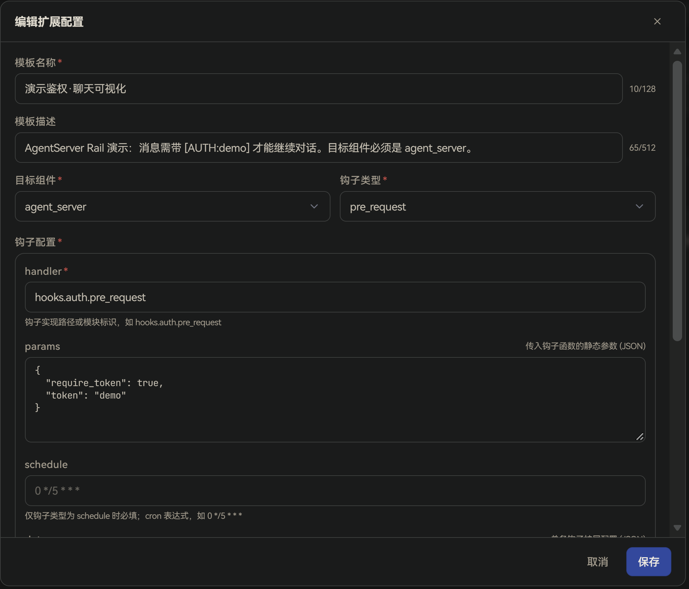
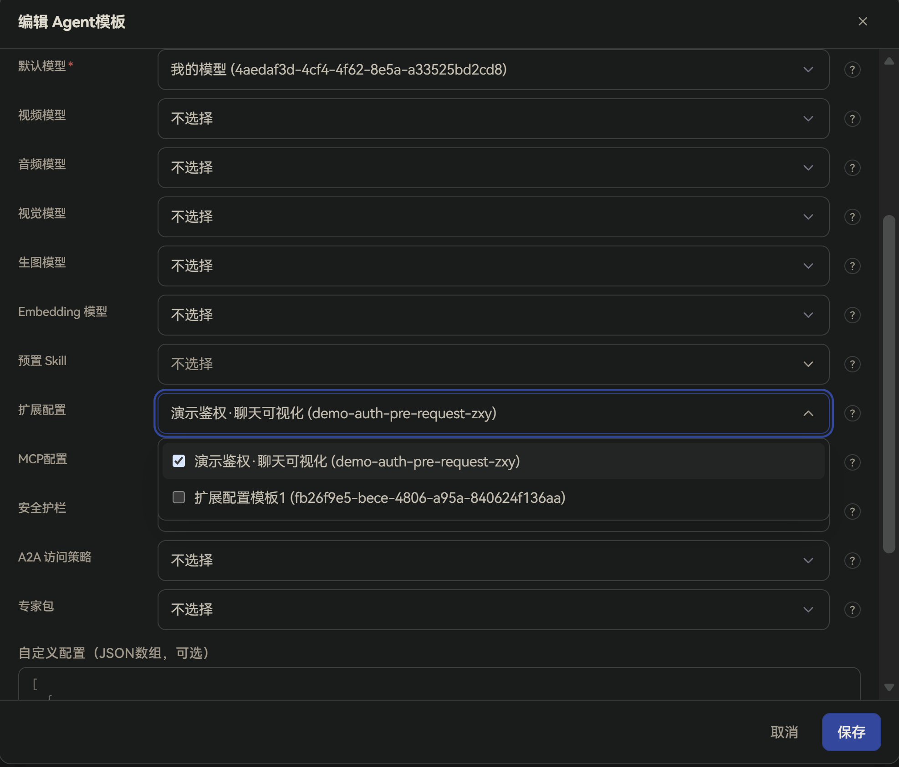
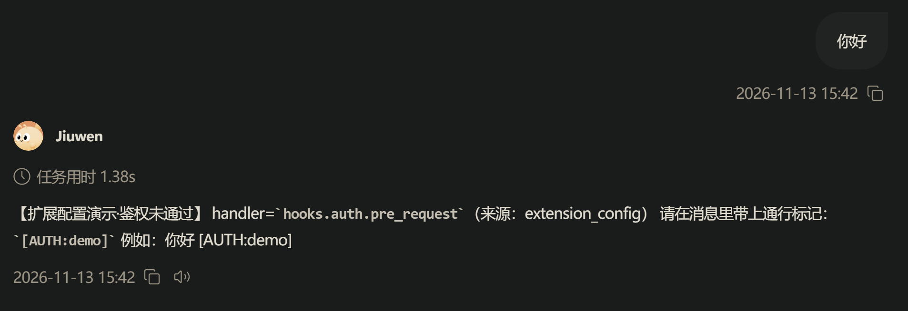
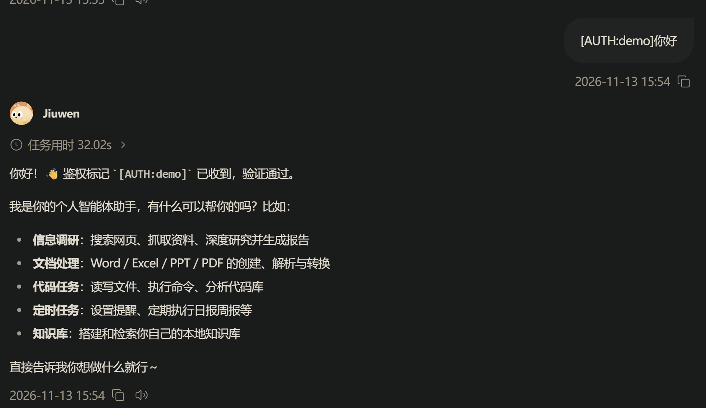

# Extension Configuration

## Overview

**Extension Configuration** is the set of “hook” and custom-parameter templates maintained by administrators on the management plane.

A **hook** can be understood as logic that runs automatically at a fixed point in request handling (for example when a request arrives, after it finishes, on failure, or on a schedule). That logic is executed by a `handler` (a hook implementation path pointing to a function/module already present in code). Parameters go in `params` / **Custom config**. An extension configuration does not take effect by itself. It must be referenced by an **Agent template**, then that Agent template must be assigned to a cluster before the configuration is delivered to the runtime plane.

Each extension configuration must specify a **target component** (who runs it) and a **hook type** (when it runs):

| Target component | Description |
| ---- | ---- |
| **gateway** | Delivered to the Gateway. The gateway is the entry point for user requests—suitable for unified auth, parameter validation, request-level logging, and similar. |
| **agent_server** | Delivered to the Agent runtime service (AgentServer). Suitable for injecting business extensions into the chat / tool-call path. |

| Hook type | When | Typical uses |
| ---- | ---- | ---- |
| **pre_request** | Before request handling | Parameter validation, permission checks |
| **post_request** | After request handling | Logging, result transformation |
| **error** | When a request fails | Error recovery, alerting |
| **schedule** | Cron-triggered | Data cleanup, status sync |

Unlike **Models**: slots such as “Default Model” on an Agent template usually accept only one entry, while the **Extension Configuration** slot can reference **multiple** entries. The runtime plane filters by target component: AgentServer only receives enabled configs with `component=agent_server` (or an empty component); `gateway` configs are used by the gateway.

Typical uses:

- Administrators centrally attach enterprise auth, audit, cleanup, and similar hooks; end users do not need to—and cannot—fill in hook paths or parameters themselves.
- The same extension configuration can be reused by multiple Agent templates; updating it once syncs to all clusters that reference it.
- Different Agent templates can attach different extensions—for example gateway-side auth with `gateway + pre_request`, and a cleanup job for a business Agent with `agent_server + schedule`.

## Workflow overview

End-to-end activation:

1. On the management plane, go to **Workbench → Agent Resources → Extension Configuration** and create an extension configuration.
2. In **Workbench → Agent Templates**, under **Template references**, select one or more enabled extension configurations for the **Extension Configuration** slot.
3. Assign that Agent template to a cluster and grant it to organizations or users.
4. After users sign in to the user plane, conversation requests load these extension configurations from the template; users do not configure them themselves.

## Management plane configuration

### Create an extension configuration

Go to **Workbench → Agent Resources → Extension Configuration**, click **Create Extension Configuration**, fill in the fields below, then click **Save**:

| Field | Description |
| ---- | ---- |
| **Template name** | Required. Display name on the management plane; shown when selecting extension configuration in an Agent template. Up to 128 characters. |
| **Template description** | Optional. Usage notes, up to 512 characters. |
| **Target component** | Required. Delivery target: `gateway` or `agent_server`. Default is `gateway`. |
| **Hook type** | Required. When to run: `pre_request`, `post_request`, `error`, or `schedule`. Default is `pre_request`. |
| **Hook config → handler** | Required. Hook implementation path or module id, for example `hooks.auth.pre_request`. Must point to an implementation that is already deployed and loadable on the runtime plane. |
| **Hook config → params** | Optional. Static parameters passed to the hook, as a JSON object, for example `{"require_token": true, "allowed_roles": ["user", "admin"]}`. |
| **Hook config → schedule** | Required only when hook type is `schedule`. A valid cron expression (5/6/7 fields), for example `0 */5 * * *` (every 5 minutes). Leave empty for other hook types. |
| **Hook config → data** | Optional. Extra fields for this hook, as a JSON object; leave empty or use `{}` for none. |
| **Custom config** | Optional. User-defined settings as a JSON object, for example `{"auth_header": "Authorization"}`; leave empty for none. |

### Edit, disable, and delete

- **Edit**: Click **Edit** on a row to change the template. If referenced by Agent templates on a cluster, saving pushes the change to the gateway and takes effect.
- **Disable**: Use the **Enabled** switch in the list. When disabled, the extension configuration no longer appears in Agent template pickers; Agents that already referenced it also stop receiving it (the runtime plane filters out `enabled=false` entries).
- **Delete**: Click **Delete** on a row. Only entries with **References** = 0 can be deleted; deletion fails while Agent templates still reference them.

### Bind to an Agent template and assign to a cluster

Extension configuration must be bound to the **Extension Configuration** slot of an **Agent template**, then that template must be assigned to a cluster, before it is delivered to the runtime plane.

1. **Bind extension configuration**: Go to **Workbench → Agent Templates**, create or edit the target template, add the **Extension Configuration** slot under **Template references**, select one or more enabled entries, and save.

   

2. **Assign to a cluster**: Follow the **Configure cluster settings** section in [Quick Start](../../../Getting%20Started/Quick%20Start.md) to add the Agent template to a cluster and grant access.

## User plane usage

After users sign in to the user plane, the system loads extension configurations from the Agent templates they are authorized to use—no user-side setup. During chat or tool calls, the runtime plane runs the attached hooks at the matching target component and hook type.

Notes:

- The enterprise user plane does not let users add or edit extension configuration; the hook list is delivered by administrators through Agent templates.
- After an administrator changes extension references on an Agent template, or an extension configuration that a cluster already uses, the system refreshes related runtime components with the new configuration (the “runtime plane refresh” mentioned in the docs). After rebuild/refresh completes, sessions can use the new configuration.

## Notes

- `handler` must point to a real implementation that exists on the runtime plane and can be loaded by the target component. A wrong path can still be saved, but the hook will not run as expected.
- When hook type is `schedule`, provide a valid cron expression; invalid field count or values cause save to fail on the management plane.
- One Agent template may reference multiple extension configurations: separate gateway-side vs AgentServer-side uses by target component—do not mark a gateway-only hook as `agent_server` (or the reverse).
- `params`, `data`, and **Custom config** must be valid JSON objects.
