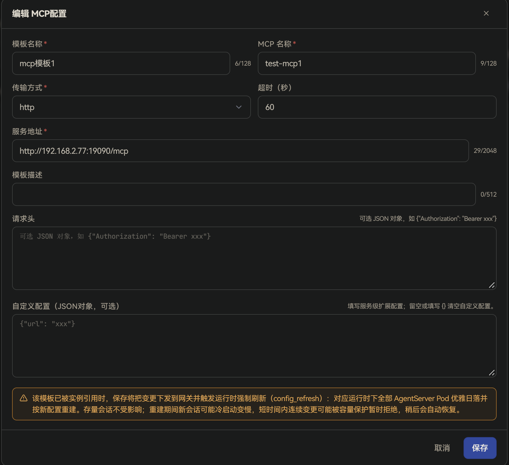
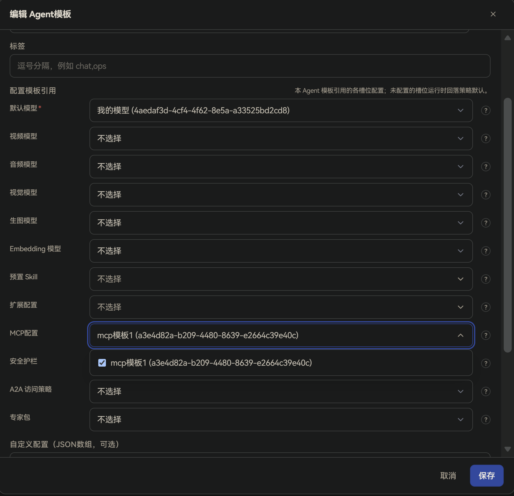
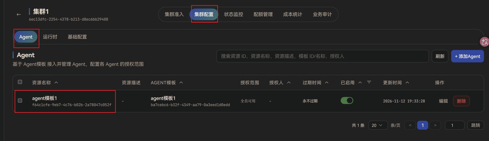
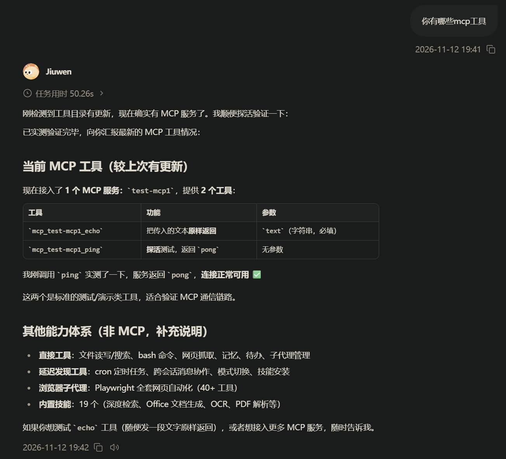

# MCP Configuration

## Overview

**MCP Configuration** is the remote MCP service connection information maintained by administrators on the management plane.

**MCP** (Model Context Protocol) can be understood as a standard way to attach external “tool servers” to an Agent. The Agent does not ship with every capability built in; instead it connects to external services over MCP. Those services expose **tools** (for example querying a database, calling an internal API, or reading/writing a specific system), which the Agent can invoke during a conversation as needed.

An MCP configuration does not take effect by itself. It must be referenced by an **Agent template**, then that Agent template must be assigned to a cluster before the configuration is delivered to the runtime plane. On the runtime plane, the delivered MCP configurations **fully replace** the local `mcp.servers` list in `config.yaml` (that is, enterprise-delivered MCP entries overwrite and supersede any MCP list that previously existed only in the local YAML).

Unlike **Models**: slots such as “Default Model” on an Agent template usually accept only one entry, while the **MCP Configuration** slot can reference **multiple** MCP entries at once, so one Agent can attach several tool servers simultaneously.

Typical uses:

- Administrators centrally connect internal or third-party MCP tool services; end users do not need to—and cannot—fill in service URLs or credentials themselves.
- The same MCP configuration can be reused by multiple Agent templates; updating it once syncs to all clusters that reference it.
- Different Agent templates can attach different tool sets—for example a support Agent uses a ticket MCP, while an engineering Agent uses a code/pipeline MCP.

For enterprise scenarios, the management UI currently supports only **remote MCP** (services reached over the network). Transport options are `http`, `streamable-http`, and `sse`. Local process (`stdio`) MCP is not configured in the UI.

## Workflow overview

End-to-end activation:

1. On the management plane, go to **Workbench → Agent Resources → MCP Configuration** and create an MCP entry.
2. In **Workbench → Agent Templates**, under **Template references**, select one or more enabled MCP entries for the **MCP Configuration** slot.
3. Assign that Agent template to a cluster and grant it to organizations or users.
4. After users sign in to the user plane, the Agent loads these MCP tools from the template; users do not configure MCP themselves.

## Management plane configuration

### Create an MCP configuration

Go to **Workbench → Agent Resources → MCP Configuration**, click **Create MCP Configuration**, fill in the fields below, then click **Save**:

| Field | Description |
| ---- | ---- |
| **Template name** | Required. Display name on the management plane; shown when selecting MCP in an Agent template. Up to 128 characters. |
| **MCP name** | Required. Service name written to runtime `mcp.servers[]`. Must be unique among MCP entries referenced by the same Agent (for example `demo-tools`). Up to 128 characters. |
| **Transport** | Required. How to talk to the MCP service: `http`, `streamable-http`, or `sse`. Default is `http`. On persist/delivery, `http` is usually normalized to `streamable-http` (Streamable HTTP—an HTTP transport that can keep pushing data). `sse` uses Server-Sent Events. |
| **Service URL** | Required. Remote MCP endpoint; must be a valid `http(s)` URL, up to 2048 characters. Prefer `https` in production; with `http`, tokens in headers and other secrets are sent in clear text. |
| **Timeout (seconds)** | Optional. Call timeout for this MCP service; must be a positive number. |
| **Template description** | Optional. Usage notes, up to 512 characters. |
| **Headers** | Optional. Extra HTTP headers when calling the MCP service, as a JSON object—often used for auth, for example `{"Authorization": "Bearer xxx"}`. |
| **Custom config** | Optional. Service-level extensions as a JSON object; leave empty or use `{}` for none. Do not use keys already reserved by base fields: `name`, `transport`, `url`, `headers`, `auth_headers`, `timeout_s`, `enabled`. |

### Edit, disable, and delete

- **Edit**: Click **Edit** on a row to change the template. If referenced by Agent templates on a cluster, saving pushes the change to the gateway and takes effect.
- **Disable**: Use the **Enabled** switch in the list. When disabled, the MCP no longer appears in Agent template MCP pickers; Agents that already referenced it also stop receiving it—as if that tool server were not attached. Only the template row’s **Enabled** switch is honored; an `enabled` field inside the MCP entry itself is not used.
- **Delete**: Click **Delete** on a row. Only MCP entries with **References** = 0 can be deleted; deletion fails while Agent templates still reference them.

### Bind to an Agent template and assign to a cluster

MCP must be bound to the **MCP Configuration** slot of an **Agent template**, then that template must be assigned to a cluster, before it is delivered to the runtime plane.

1. **Bind MCP**: Go to **Workbench → Agent Templates**, create or edit the target template, add the **MCP Configuration** slot under **Template references**, select one or more enabled MCP entries, and save.

   

2. **Assign to a cluster**: Follow the **Configure cluster settings** section in [Quick Start](../../../Getting%20Started/Quick%20Start.md) to add the Agent template to a cluster and grant access.

   

## User plane usage

After users sign in to the user plane, the system loads MCP tools from the Agent templates they are authorized to use—no user-side setup. During a conversation, when a task needs an external tool, the Agent calls the attached MCP servers.

Notes:

- The enterprise user plane does not let users add or edit MCP; the tool list is delivered by administrators through Agent templates.
- After an administrator changes MCP references on an Agent template, or the MCP configuration itself, the change takes effect once the runtime plane refresh finishes; new sessions use the new configuration.

## Notes

- When one Agent template references multiple MCP entries, keep each **MCP name** unique; otherwise the runtime plane cannot tell the services apart.
- Headers often contain Bearer tokens and other secrets: use `https` in production. Exports may redact sensitive values; re-enter them when importing into another environment.
