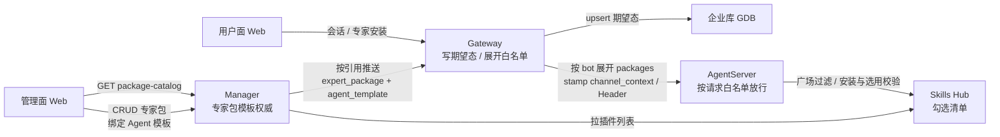
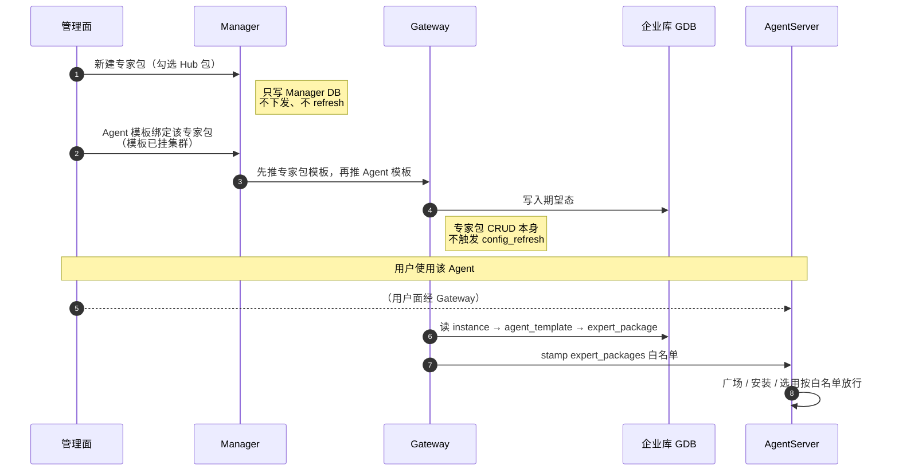

# 专家包设计


## 1. 需求与边界

企业版由管理员在管理面维护一套 Hub 包组合（专家 / 专家团），经 Agent 模板「专家包」槽绑定后，随 Agent 配置到集群并授权；被授权用户在用户面只能安装并选用这一套里的包。


| 要点 | 说明 |
|------|------|
| 权威 | Manager 表 `expert_package_template`；被 Agent 模板引用后才推 Gateway GDB |
| 生效条件 | 挂到 Agent `template_ref.expert_package`，且该 Agent 已配置到集群并授权 |
| 生效方式 | Gateway 按当前 bot 展开白名单，随请求 stamp；**不**做写接口即装包，**不**因本模板 CRUD 触发 `config_refresh` |
| 槽位基数 | `expert_package` 为**单值槽**，至多引用一条专家包模板 |
| 包内容 | `packages[]` 为 Hub 标识：`kind` ∈ `{agent_template, agent_group}` + `asset_id`（可选 `version`） |

与其它专家来源：

| 来源 | 谁决定 | 用户侧 | 企业版约束 |
|------|--------|--------|------------|
| 专家包（本设计） | 管理员 + Agent 模板 | 广场 / 选用列表只出现本套 | 请求级白名单；不在套内不可装不可用 |
| 用户自建 / 本地包 | 用户 | 可装可用 | 走「用户自有」放行，不受本套增减影响 |
| 产品隐藏 Hub 包 | 产品约定 | 企业版目录不展示 | 写入专家包模板时拒绝 |

非目标：不替代 Hub 安装与版本管理；单独建专家包模板不推下游、不装包；不与预置 Skill 共用安装路径；不做进程内热更新（本能力也不需要重建 AgentServer）。


## 2. 整体方案


### 2.1 架构图

> 本图只画专家包相关交互。配置下发通用链路见[管理面配置下发生效设计](./管理面配置下发生效设计.md)。




### 2.2 业务流程图

主路径：新建专家包 → Agent 模板绑定 → 用户侧按白名单安装与选用。




## 3. 数据模型


### 3.1 表 `expert_package_template`

Manager DB 与 Gateway GDB 同构（权威在 Manager，运行面读 GDB）。推送时丢弃 Manager 侧 `revision`（乐观锁令牌只留在管理面）。


| 字段 | 类型 | 说明 |
|------|------|------|
| `id` | INTEGER PK | 库内自增主键 |
| `template_id` | VARCHAR(100) UNIQUE | 对外稳定 ID；Agent `template_ref.expert_package` 引用本字段 |
| `template_name` | VARCHAR(128) | 管理面展示名 |
| `description` | VARCHAR(512) | 可选说明 |
| `packages` | JSON | Hub 包列表，至少 1 项；见下表 |
| `enabled` | BOOLEAN | `false` 时：Agent 模板下拉不出现；已下发场景展开白名单时跳过该行 |
| `revision` | INTEGER | **仅 Manager**；内容变更 / 启停均自增；编辑内容须带 `expected_revision` |
| `created_at` / `updated_at` | DATETIME | 时间戳 |

`packages[]` 项：

| 字段 | 说明 |
|------|------|
| `kind` | `agent_template`（专家）或 `agent_group`（专家团） |
| `asset_id` | Hub 资产 ID；1–128；禁止 `.` / `..` / 路径分隔符；禁止隐藏资产 |
| `version` | 可选，≤64；落库保留；**出站白名单展开时丢弃**，运行面按 `{kind, id}` 判定 |

落库校验：

- `packages` 按 `(kind, asset_id)` 去重；至少保留一项。
- `asset_id ∈ HIDDEN_HUB_ASSET_IDS` → 拒绝（与用户面企业版目录同一份隐藏集合）。


### 3.2 Agent 模板槽位

| 槽位 key | 引用表 | 基数 |
|----------|--------|------|
| `expert_package` | `expert_package_template.template_id` | **单值** |

展开链（Gateway，按请求）：

```text
instance_agent_resource(enabled, resource_id=bot_id)
  → agent_template(enabled, template_id=ref_template_id)
  → template_ref.expert_package → expert_package_template.template_id[]
  → 启用中的专家包行.packages
  → 规范化为 [{kind, id}]（id = asset_id；去重；找不到的标识跳过）
```


### 3.3 出站约定

| 载体 | 键 / 头 | 载荷 |
|------|---------|------|
| E2A `channel_context` | `expert_packages` | `[{kind, id}, …]` |
| AgentServer HTTP | `X-Jiuwenswarm-Expert-Packages` | 同上 JSON 的编码；体积上限 16KiB |

企业版由 Gateway **覆盖**客户端自带字段；未绑定时发空列表。个人版不读库、不 stamp。


## 4. 管理面能力


### 4.1 CRUD 与乐观锁

| 操作 | 行为 |
|------|------|
| 新建 | 生成 `template_id`；`revision=0`；只写 Manager |
| 列表 / 详情 | 附带 `reference_count`（被多少 Agent 模板的 `expert_package` 槽引用） |
| 更新内容（名称 / 描述 / packages） | 必须带打开时的 `expected_revision`；不一致 → **409** `stale_template` |
| 仅启停 | 可不带 `expected_revision`；仍 bump `revision` |
| 删除 | `reference_count>0` 拒绝；先删下游引用集群上的行，再删 Manager |

并发：DB 更新带 `revision=current` 条件；失败再读库仍存在则 409。


### 4.2 可选专家 / 专家团清单

管理面新建 / 编辑页通过 Manager `GET …/package-catalog` 拉取可选的专家与专家团，页面按「专家」「专家团」两栏展示（对应 `agent_template` / `agent_group`）。产品约定隐藏的项在目录层过滤，写入模板时再次校验。清单服务地址由 Manager 环境变量 `TEAM_SKILLS_HUB_BASE_URL` 决定（空则默认 `https://swarmskills.openjiuwen.com`），与部署包注入一致，见[《集群部署指南》](../../../快速开始/集群部署指南.md) §3.1。


### 4.3 导入导出

单行专家包模板可导入 / 导出。导入后仍须在 Agent 模板中选中才会下发。业务 ID 与冲突策略见独立导入导出实现（与其它模板资源一致）。


## 5. 同步与生效


### 5.1 何时推送

| 时机 | 行为 |
|------|------|
| 新建专家包（未引用） | 只写 Manager |
| Agent 模板绑定 / 改槽且该 Agent 已挂集群 | 增量推嵌套依赖（含专家包）+ Agent 模板 |
| 改已引用的专家包（含启停、改 packages） | PATCH 到引用可达 Gateway；**不** `config_refresh` |
| 删除（无引用） | DELETE 下游后删 Manager；**不** `config_refresh` |
| 集群 bootstrap / 全量 sync | 普通模板先于 Agent 模板落库 |

与预置 Skill 的差异：专家包白名单在**下次业务请求**由 Gateway 读 GDB 现算并 stamp，AgentServer 不必为专家包模板变更重建进程。


### 5.2 请求级白名单契约

1. Gateway 按 §3.2 展开 → 写入 `channel_context.expert_packages` / HTTP 头。
2. AgentServer 绑定本次请求白名单后：
   - 广场卡片：只展示白名单内（及用户自有）包；
   - 安装 / 选用：不在白名单且非用户自有 → 拒绝；
   - 企业版隐藏 Hub 包：目录与组合均不可见 / 不可写入。
3. 管理员从已下发组合中去掉某包并保存后：下次请求白名单不再含该包；用户刷新后广场与选用列表消失，已安装者亦不可再选。
4. 禁用专家包行：展开时跳过；已绑定 Agent 的用户侧等同「本套空」。


### 5.3 冲突与约束

| 场景 | 行为 |
|------|------|
| 仍被 Agent 模板引用 | 不可删专家包模板 |
| 内容编辑 revision 过期 | 409，须重新打开再存 |
| 写入隐藏 Hub 资产 | 400 |
| 空 packages | 400 |
| 用户自有本地包 | 不受专家包白名单增减影响 |
| 客户端伪造 expert_packages | Gateway 覆盖，不信任客户端 |


## 6. 落点与验收


| 层 | 路径 |
|----|------|
| Manager | `manager_server/.../expert_package_template.py`、`hub_package_catalog.py`、`push_template_to_gateway.py`；路由 `/expert-package-templates`、`/package-catalog` |
| Manager Web | `ExpertPackageTemplatesPage.tsx`、`ExpertPackageTemplateModal.tsx`；引导文案 `docs/guides/expert_package.md` |
| Gateway | `manager_config/.../expert_package_template.py`（写库跳过 refresh）；`bound_packages.py` / `outbound_packages.py`；`agent_client._stamp_expert_packages` |
| 公共约定 | `agent_gateway.common.expert_packages` / `jiuwenswarm.common.schema.expert_packages`（键名、头、体积、隐藏 ID） |
| AgentServer | `enterprise/capabilities/experts/request_packages.py`（`allows` / `filter_cards` / `require_allowed`） |

- [ ] 未绑定 Agent 时用户面广场无该套 Hub 包
- [ ] 绑定并推送后，使用该 Agent 的请求 stamp 含组合内 `{kind,id}`
- [ ] 专家包 CRUD 不触发 AgentServer `config_refresh`；改包后下一请求白名单即变
- [ ] 隐藏 Hub 资产不可勾选、不可写入
- [ ] 内容更新缺 / 错 `expected_revision` → 409
- [ ] 仍被引用时不可删；禁用后展开跳过该行
- [ ] 客户端自带 expert_packages 被 Gateway 覆盖


## 7. 参考


- [管理面配置下发生效设计](./管理面配置下发生效设计.md)
- Gateway 接口：[专家包模板](../接口文档/gateway接口文档.md)
- 产品文档：[专家包](../../核心功能/统一管理平台/Agent资源/专家包.md)
