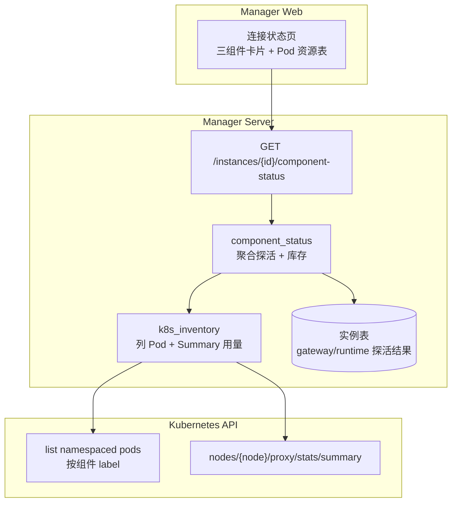

# 连接状态组件监控设计


## 功能说明

管理面「集群连接状态」页需要同时展示业务组件的**连通状态**与**运行资源**，覆盖：

1. **Gateway / Runtime / AgentServer** 三类组件的在线状态。
2. 各组件在业务命名空间内的 **Pod 清单**（名称、Phase、Ready、重启次数）。
3. 各 Pod 的瞬时 **CPU / 内存用量**，以及 spec 中的 **limit**（便于对照）。

约束：

- **不依赖 metrics-server**（多数裸 K8s / 精简集群未安装，`metrics.k8s.io` 易 404）。
- 用量走 kubelet 自带 **Summary API**（经 API Server `nodes/proxy`），依赖面最小。
- 按需拉取（打开连接状态页触发），并做短 TTL 缓存，避免对 kubelet 造成持续压力。
- 权限或 Summary 失败时**降级展示**：探活状态与 Pod 列表仍可用，用量显示为 `—` 并带错误提示。


## 整体方案


### 架构图




### 双通道数据模型

| 通道 | 数据来源 | 用途 |
|------|----------|------|
| 探活状态 | 实例表已有字段：`gateway_status` / `runtime_status` 及 `*_last_alive`（既有 HTTP probe） | Gateway、Runtime 连通态 |
| AgentServer 状态 | 无独立探活；按该组件 Pod Ready/Phase **聚合** | 全 Ready→`online`；部分 Ready→`pending`；Failed/全不 Ready→`offline`；列 Pod 失败→`unknown` |
| 库存 + 用量 | K8s 只读 API：列 Pod + kubelet Summary | Pod 明细与 CPU/内存 |

Runtime 若关闭探活开关，状态返回 `skipped`，不阻断库存展示。


### 组件与 Label

| 组件 | Label Selector | 说明 |
|------|----------------|------|
| gateway | `app=jiuwenswarm-gateway` | Deployment |
| runtime | `app=jiuwenswarm-agent-runtime` | Deployment |
| agentserver | `jiuwenswarm-component=agentserver` | 覆盖静态 StatefulSet 与 Runtime 动态创建的 Pod（动态 Pod 的 `app=` 标签不稳定，故不用 `app=`） |

命名空间取自实例表 `namespace`（缺省 `default`）。


### 用量采集：kubelet Summary

1. 先按三个 selector 列出目标 Pod，收集 `spec.nodeName` 去重。
2. 对每个节点请求一次：

   ```text
   GET /api/v1/nodes/{nodeName}/proxy/stats/summary
   ```

3. 在返回的 `pods[]` 中按 `podRef.namespace` + `podRef.name` 匹配本命名空间 Pod。
4. 字段映射：
   - CPU：`cpu.usageNanoCores` → millicores 展示（如 `48m`）；缺失时累加 containers。
   - 内存：优先 `memory.workingSetBytes`，否则 `usageBytes` → Mi/Gi。
   - limit：汇总各普通容器 `resources.limits.cpu/memory` 并格式化（与 Pod 级用量对齐）。
5. **进程内缓存**：key = `{node}|{namespace}`，TTL ≈ 20s，降低短时间内重复打开页面的 Summary 次数。

前端展示为 **`用量/limit`**（如 `48m/1`、`704Mi/2Gi`），悬停 title 带占用百分比。  
**前提**：Pod 必须配置了 `resources.limits`；未配置时只能显示用量，无法算比例。

实现注意：`kubernetes_asyncio` 对 node proxy 默认 preload 可能把 JSON 转成单引号 Python repr，需 `_preload_content=False` 读原始字节再 `json.loads`。


### 为何不用 metrics-server

| 方案 | 依赖 | 说明 |
|------|------|------|
| `metrics.k8s.io` | 需安装 metrics-server | 未安装即 404，用量全空 |
| kubelet Summary | 仅需 API Server 代理到 kubelet + RBAC | 裸集群也能看用量；本方案采用 |

说明：`nodes/proxy` 的 `get` 在 RBAC 上无法限到 `/stats/summary` 路径，权限面大于「只读用量」；产品选择以最小依赖优先，模板仅授予 `nodes/get` + `nodes/proxy/get`，Pods 列表用命名空间 Role。


## 接口设计


### `GET /instances/{jiuwenclaw_id}/component-status`

路由：`manager_server/routers/instance_routers.py`  
聚合：`manager_server/core/instance/component_status.py`

**响应 `data` 结构（示意）**：

```json
{
  "jiuwenclaw_id": "jc-xxx",
  "namespace": "wx",
  "k8s_error": null,
  "components": [
    {
      "type": "gateway",
      "status": "online",
      "last_alive": "2026-11-26T12:00:00Z",
      "pods": [],
      "pods_error": null,
      "metrics_error": null
    }
  ],
  "gateway_host": "http://...",
  "runtime_host": "http://..."
}
```

降级：

| 情况 | 行为 |
|------|------|
| Summary 403/失败 | Pod 列表正常；`metrics_error` 提示；CPU/内存为 `null`（前端显示 `—`） |
| Pods list 失败 | `pods_error`；AgentServer 状态可能为 `unknown` |


## K8s 客户端

`k8s_inventory._build_api_client`：

1. `MANAGER_DEPLOY_KUBECONFIG`
2. `MANAGER_DEPLOY_TOKEN` + `MANAGER_DEPLOY_API_SERVER`（默认校验证书；CA 来自 `MANAGER_DEPLOY_SSL_CA_CERT` 或 in-cluster SA CA；仅 `MANAGER_DEPLOY_INSECURE_SKIP_TLS_VERIFY=true` 可跳过）
3. in-cluster ServiceAccount


### RBAC

- **Role / RoleBinding**（部署命名空间）：`pods` `list`
- **ClusterRole / ClusterRoleBinding**（Summary）：`nodes` `get`、`nodes/proxy` `get`

模板：

- `deploy/openshift/templates/manager-server.template.yaml`
- `deploy/jiuwenswarm-ee/templates/manager-server.template.yaml`


## 前端展示

- 页面：`manager_web` 实例详情「连接状态」面板。
- 文案说明用量来自 **kubelet Summary** 瞬时采样；失败时用量为 `—`。


## 关键代码

| 模块 | 路径 |
|------|------|
| 库存 + Summary | `applications/manager/manager_server/src/manager_server/infrastructure/k8s_inventory.py` |
| 状态聚合 | `applications/manager/manager_server/src/manager_server/core/instance/component_status.py` |
| HTTP 路由 | `applications/manager/manager_server/src/manager_server/routers/instance_routers.py` |
| 前端面板 | `applications/manager/manager_web/src/pages/instance/instanceDetailPanel/instanceDetailPanel.tsx` |


## 性能与运维注意

1. **按需 + 缓存**：仅打开连接状态页时请求；同节点 Summary 约 20s 内复用。
2. **节点规模**：用量请求次数 ≈ 目标 Pod 所在不同节点数。
3. **镜像依赖**：正式镜像需打包 `kubernetes_asyncio`。
