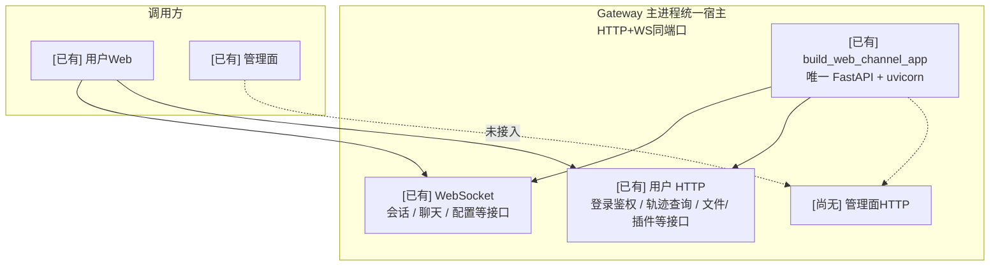
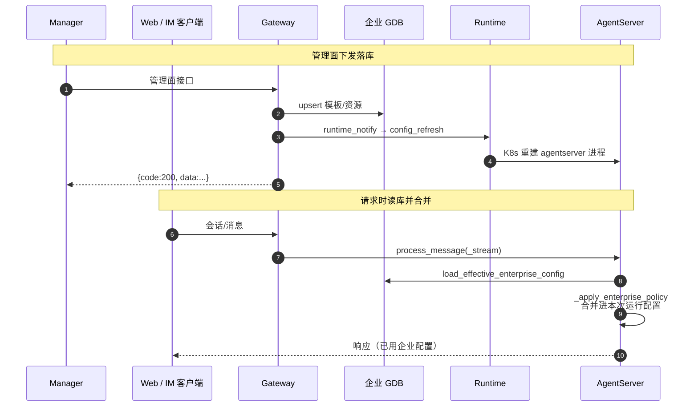
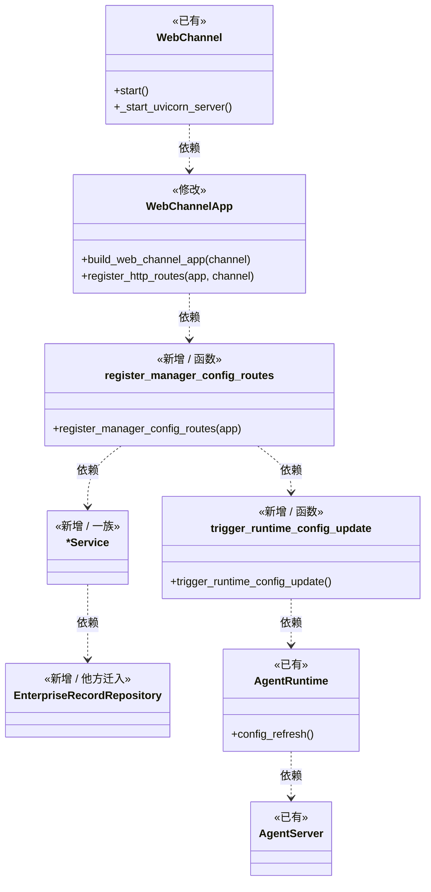
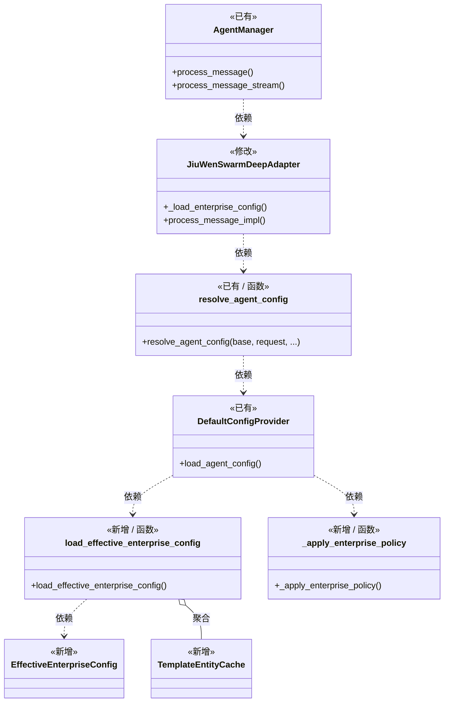

# 管理面配置下发生效设计


## 需求背景

企业版要求配置权威在管理面（Manager），配置下发到数据库，agentserver读取数据库里的配置生效，具体包括：

1. 配置下发：Manager将配置数据推到Gateway，写入企业库（GDB）。
2. 配置生效：写库后调用Runtime接口重启AgentServer Pod，使新配置生效。请求打到AgentServer时，再从企业库查出对应配置，合并进本次运行配置。不做进程内热更新。
3. Gateway HTTP 端口统一：管理面下发接口不再以扩展方式单独起8775端口，而是挂到Gateway已有的WEB_PORT（默认 19000）上，与既有WS/HTTP共用同一端口，只是路由不同。


## 能力现状





**关键启动链**：

```text
jiuwenswarm-gateway
  → app_gateway.main
  → WebChannel.start()
  → _start_uvicorn_server()
  → build_web_channel_app(channel)   # 唯一 FastAPI + uvicorn
       ├─ WebSocket: add_api_websocket_route（WEB_PATH 默认 /ws、/ws/git）+ iter_websocket_routes（plugin WS）
       └─ HTTP: register_http_routes + mount_application_plugin_http_routes
```


## 整体方案


### 架构图

> 节点前缀：`[新增]` = develop 无、本次合入新增；`[修改]` = develop 已有、本模块需修改；`[已有]` = develop 已有、本模块不改。  

```mermaid
flowchart TB
  subgraph ClientBlk["客户端"]
    ImClient["[已有] IM 通道<br/>飞书 / 企微 / 钉钉"]
    WebClient["[已有] Web 通道<br/>浏览器聊天页"]
  end

  subgraph MgrBlk["Manager"]
    Mgr["[已有] 管理面"]
  end


  subgraph GWBlk["Gateway"]
    GWHttp["[修改] 统一宿主<br/>新增挂载管理面路由"]
    GWCore["[已有] 通道与消息处理<br/>ChannelManager / MessageHandler"]
    MgrRoutes["[新增] 管理面配置相关REST服务"]
    GDB["[新增] 企业库 GDB"]
    Notify["[新增] runtime_notify"]
  end

  subgraph RtBlk["Runtime"]
    Rt["[已有] agent-runtime"]
  end

  subgraph ASBlk["AgentServer"]
    ASCore["[修改] AgentManager / JiuWenSwarmDeepAdapter<br/>有业务请求时读库，合并进本次运行配置"]
    TAP["[新增] TenantAgentPool<br/>见多租户设计"]
  end

  Mgr -->|"配置"| GWHttp
  GWHttp --> MgrRoutes
  MgrRoutes --> GDB
  MgrRoutes --> Notify
  Notify -->|"config_refresh"| Rt
  Rt -->|"重建整进程"| ASBlk

  WebClient -->|"同端口 WS/HTTP"| GWHttp
  GWHttp -->|"会话 / 聊天等"| GWCore
  ImClient -->|"长连接"| GWCore
  GWCore --> TAP
  TAP --> ASCore
  GDB -->|"读库合并 model/mcp/skills"| ASCore
```



管理面路由挂载点：

```text
web_channel_app.register_http_routes(app, channel)
  → 既有 HTTP 路由 …
  → register_manager_config_routes(app)   # 企业版 is_enterprise() 开启
```


### 业务流程图



### 类图

> 节点前缀：`[新增]` = develop 无、本次合入新增；`[修改]` = develop 已有、本模块需修改；`[已有]` = develop 已有、本模块不改；`[新增·他方迁入]` = 他方迁入后本专题复用。  

#### 管理面下发落库




`*Service`（manager_config/core下写库业务服务，形态相似，图中收成一族）：

| 类型 | 具体 Service |
|----|----------------|
| 模板 | `AgentTemplateService`、`ModelTemplateService`、`McpTemplateService`、`EmbeddingTemplateService`、`PermissionsTemplateService`、`SkillPrebuiltTemplateService`、`ExtensionConfigTemplateService`、`A2AOutboundTemplateService`、`A2AAccessPolicyTemplateService` |
| 实例 / 资源 | `InstanceService`、`InstanceDataLifecycleService`、`InstanceAgentResourceService` |
| 应用配置 | `MemoryConfigService`、`TaskMemoryConfigService`、`LoggingConfigService`、`LogMaskingRuleService`、`CronPolicyService`、`AuditLogConfigService` |
| 配额 | `WorkspaceQuotaPolicyService`、`WorkspaceQuotaUsageService` |


#### 请求时读库并合并





### 可配置项

| 环境变量 | 环境变量说明 | 修改说明 |
|----------|------|-------------|
| `WEB_HOST` / `WEB_PORT` | **统一 HTTP（及 WS）监听**；管理面挂此端口 | develop 默认 `0.0.0.0:19000` |
| `GATEWAY_CONFIG_HTTP_HOST` | **废弃（不再 bind）**；若需兼容，仅作文档/探针别名指向 `WEB_HOST` | 原默认 `0.0.0.0` |
| `GATEWAY_CONFIG_HTTP_PORT` | **废弃（不再 bind）**；若需兼容，仅作文档/探针别名指向 `WEB_PORT` | 原 `:8775` 取消 |
| `GATEWAY_DB_TYPE` | 企业 GDB 类型（`sqlite` / `mysql` / `postgresql` 等） | 部署指定；常见默认 `sqlite` |
| `GATEWAY_SQLITE_PATH` | SQLite 库文件路径（`GATEWAY_DB_TYPE=sqlite` 时） | 部署指定 |
| `GATEWAY_DB_HOST` | 企业库 host（非 sqlite 时） | 部署指定 |
| `GATEWAY_DB_PORT` | 企业库端口 | 部署指定（mysql 常见 `3306`，postgresql 常见 `5432`） |
| `GATEWAY_DB_USER` | 企业库用户 | 部署指定 |
| `GATEWAY_DB_PASSWORD` | 企业库密码 | 部署指定 |
| `GATEWAY_DB_NAME` | 企业库库名 | 部署指定 |
| `GATEWAY_PG_SCHEMA` | PostgreSQL schema | 默认 `public` |
| `GATEWAY_DB_POOL_SIZE` | 连接池大小 | 常见默认 `2` |
| `GATEWAY_DB_MAX_OVERFLOW` | 连接池 overflow | 常见默认 `20` |
| `GATEWAY_DB_POOL_TIMEOUT` | 取连接超时（秒） | 常见默认 `30` |
| `GATEWAY_RUNTIME_MANAGER_URL` | Runtime 基址（notify 打 `config_refresh`） | 部署指定 |
| `GATEWAY_RUNTIME_MANAGER_TIMEOUT` | 调用 Runtime 超时 | 部署指定 |
| `GATEWAY_CONFIG_DEC_ENABLED` | 是否对下发字段执行信封解密 | 默认 `true` |
| `GATEWAY_CONFIG_VERIFY_ENABLED` | 是否对下发执行验签 | 默认 `true` |
| `GATEWAY_CONFIG_VERIFY_REQUIRED` | 强制态：无签名或验签失败一律拒绝 | 默认 `false` |
| `GATEWAY_CONFIG_SIGN_SKEW_SECONDS` | 验签时间窗（秒，防重放） | 默认 `300` |


