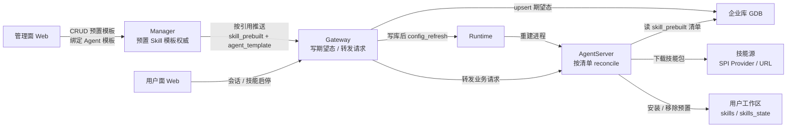
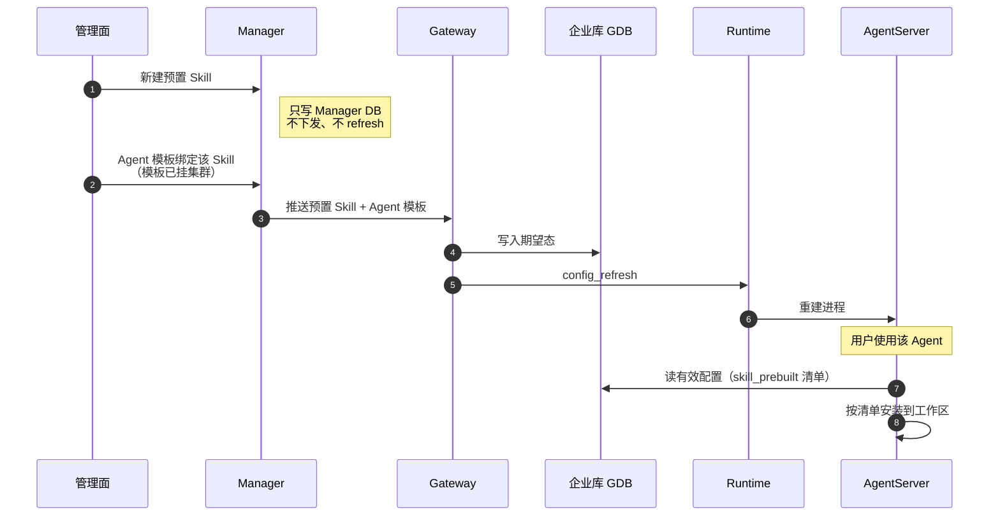

# 预置 Skill 设计


## 1. 需求与边界

企业版由管理员在管理面维护标准技能包，经 Agent 模板绑定后，用户使用对应 Agent 时自动出现在「我的技能 → 预置」。

| 要点 | 说明 |
|------|------|
| 权威 | Manager 表 `skill_prebuilt_template`；有引用才推 Gateway GDB，写库后再 `config_refresh` |
| 生效条件 | 挂到 Agent `template_ref.skill_prebuilt`，且该 Agent 已配置到集群并授权 |
| 装包时机 | Gateway 只存期望态；真正安装在 AgentServer 按清单 reconcile，不做「写接口即装包」 |
| 安装路径 | `provider`（SPI）或 `url`，按字段推断，不另传 `mode` |

与其它技能来源：

| 来源 | 谁决定 | 用户侧 | `source_type` |
|------|--------|--------|---------------|
| 预置 Skill | 管理员 + Agent 模板 | 预置分组；不可编辑/卸载/发布；企业版可启停 | `prebuilt` |
| 内置技能 | 产品打包 | 广场可安装；与管理面预置不是同一来源 | 产品内置 |
| 用户自装 | 用户 | 可安装/卸载/启停 | `user` |

非目标：不替代自装与广场；单独建模板不装包；不与个人版「内置不可切换」混用规则。


## 2. 整体方案


### 2.1 架构图

> 本图只画模块间交互。配置下发通用链路见[配置下发及生效设计](./配置下发及生效设计.md)。




### 2.2 业务流程图

主路径：新建预置 Skill → Agent 模板绑定 → 用户侧生效。




## 3. 数据模型


### 3.1 表 `skill_prebuilt_template`

Manager DB 与 Gateway GDB 同构（权威在 Manager，运行面读 GDB）。


| 字段 | 类型 | 说明 |
|------|------|------|
| `id` | INTEGER PK | 库内自增主键 |
| `template_id` | VARCHAR(100) UNIQUE | 对外稳定 ID；Agent `template_ref.skill_prebuilt` 引用本字段 |
| `template_name` | VARCHAR(128) | 管理面展示名 |
| `description` | VARCHAR(512) | 可选说明 |
| `skill_id` | VARCHAR(512) | 远端 / 本地定位 ID；两种模式均必填 |
| `package_url` | VARCHAR(2048) | **仅 url**：合法 `http(s)://` 且含主机；生产建议 `https`。运行面：import-local 白名单仅 HTTPS，TeamSkillsHub 白名单允许 http/https |
| `source_id` | VARCHAR(64) | **仅 provider**：已注册技能源实例 ID |
| `version_id` | VARCHAR(128) | **仅 provider**：精确制品版本 |
| `enabled` | BOOLEAN | `false` 时不进入租户预置清单 |
| `data` | JSON | 扩展袋；url 可用 `data.sha256`；可带 `data.author`；**禁止**在 `data` 内放 `source_id` / `skill_id` / `version_id` / `package_url` |
| `created_at` / `updated_at` | DATETIME | 时间戳 |


落库校验：合并后必须能推断 `provider` 或 `url` 之一。`data.sha256` 若提供须为 64 位小写 hex。


### 3.2 Agent 模板槽位

| 槽位 key | 引用表 | 基数 |
|----------|--------|------|
| `skill_prebuilt` | `skill_prebuilt_template.template_id` | 可多条 |


有效配置加载时：`instance_agent_resource` → 启用中的 `agent_template` → `normalize_template_ref` → 按槽位拉取 **`enabled=True`** 的预置行 → `EffectiveEnterpriseConfig.skill_prebuilt`。


## 4. 安装双模式


| 模式 | 判定（字段推断） | 运行面行为 |
|------|------------------|------------|
| `provider`（推荐） | 齐 `source_id` + `skill_id` + `version_id` | `SkillManager.install_prebuilt_from_provider`；摘要以 Provider 为准，**不读**模板 `data.sha256`。若同时带 `package_url`，URL **不作**安装入口。 |
| `url`（兼容） | 合法 `package_url` 且走不成 provider | `install_skill_sync(package_url, checksum=data.sha256?)` |


```text
if source_id and version_id:
    mode = provider
elif package_url is http(s) with host:
    mode = url
else:
    reject: invalid_template: cannot infer install path
```


## 5. 同步、冲突与白名单


### 5.1 何时推送 / 何时装包

| 时机 | 行为 |
|------|------|
| 新建预置（未引用） | 只写 Manager |
| 绑定或变更已挂集群的 Agent 模板；或改已引用预置项；bootstrap | 推 GDB + `config_refresh`（不即时装包） |
| 用户侧创建/使用 Agent 实例 | 按期望清单 reconcile 到工作区 |


### 5.2 reconcile 行为契约

对 `workspace/skills` 串行对齐：

1. 清单内：按 mode 安装或跳过；账本 `source_type=prebuilt`。
   - **provider**：比 `version_id`，不同则重装。
   - **url**：比完整 `package_url`（账本 `origin`）；提供 `data.sha256` 时再比摘要。任一不同则重装。`sha256` 可选：同 URL 且未改摘要时，远端包内容变更不会自动更新。
2. 清单外的 `prebuilt`：硬删盘 + 账本（不降级为 `user`）。
3. 不覆盖同名 `user` 技能。

URL / 版本更新后用户侧拿新包：管理员改 `package_url`（或改 `data.sha256`）并推送 GDB、`config_refresh` 后，用户下次创建/使用 Agent 实例触发 reconcile 时按上表判定重装；推送本身不在用户盘即时装包。


### 5.3 冲突与用户面

| 场景 | 行为 |
|------|------|
| 与用户自装同名 | 不覆盖；冲突报错 |
| 用户卸载预置 | 拒绝 |
| 用户启停预置 | 企业版允许 |
| 模板禁用或取消引用 | 下次 sync 移除对应预置 |
| 用户自装 | 不受预置清单移除影响 |


### 5.4 下载白名单

| 方式 | 白名单 | 失败 |
|------|--------|------|
| URL | `IMPORT_LOCAL_ALLOWED_DOWNLOAD_HOSTS`（仅 HTTPS）**或** `TEAM_SKILLS_HUB_ALLOWED_DOWNLOAD_HOSTS`（http/https），命中其一即可 | 未命中拒绝 |
| SPI | 源 `download_policy.allowed_hosts` 或 Provider 默认 | 皆空 fail-closed；不回落环境变量 |


## 6. 落点与验收


| 层 | 路径 |
|----|------|
| Manager | `manager_server/.../skill_prebuilt_template.py`、`push_template_to_gateway.py` |
| Gateway | `agent-gateway/.../skill_prebuilt_template.py`；有效配置 `effective/loader.py` |
| AgentServer | `skill_prebuilt.py`、`skill_manager.py`；触发 `_sync_enterprise_skill_prebuilt` |

- [ ] 未绑定 Agent 时用户工作区不出现该技能
- [ ] SPI / URL 均可建；无法推断路径 400
- [ ] 绑定并推送后，使用 Agent 时清单与工作区对齐（增装 / 清单外移除）
- [ ] 不可卸载预置；企业版可启停；不覆盖 user
- [ ] 白名单未命中安装失败
- [ ] 仍被引用时不可删预置模板


## 7. 参考


- 产品操作说明：`applications/manager/manager_web/docs/guides/skill_prebuilt.md`
- [配置下发及生效设计](./配置下发及生效设计.md)
- [管理面接口文档](../接口文档/管理面接口文档.md)
- 产品文档：[预置Skill](../../核心功能/统一管理平台/Agent资源/预置Skill.md)

