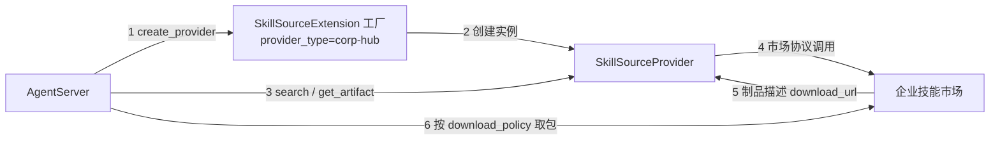

# 企业自建 SkillHub 接入（SPI 扩展）

面向需要**写代码**的开发者：当企业技能市场协议与内置 `swarmskillhub` **不兼容**时，通过 **Skill Source SPI** 扩展接入 AgentServer，供技能广场检索/安装与管理面[预置 Skill](../../../核心功能/统一管理平台/Agent资源/预置Skill.md) 的 SPI 安装使用。

| 适用场景 | 接入方式 |
|----------|----------|
| 市场协议与内置 `swarmskillhub` **不一致** | **本文**：实现 SPI 扩展并部署 |
| 市场与内置 `swarmskillhub` 同一套 HTTP 接口 | 无需写扩展；配置 `endpoint_ref` 即可（[附录 A](#附录-a兼容内置-swarmskillhub-时可不写扩展)） |
| 无市场 API，仅有技能包 ZIP 直链 | 预置 Skill 走 URL 安装，不写 SPI |


## 1. 方案概览

SPI 扩展负责将企业技能市场协议适配为平台统一模型（至少 `search` / `get_artifact`）。技能包下载、白名单校验、验签与工作区安装由 AgentServer 完成；Provider **不直接修改工作区**。



流程说明：

1. AgentServer 按配置调用扩展工厂  
2. 工厂创建 Provider 实例  
3. 检索或取制品元数据  
4. Provider 调用企业技能市场  
5. 市场侧信息映射为 `ArtifactDescriptor`（含 `download_url`）  
6. AgentServer 按白名单调用 `download_artifact` 取得 ZIP 并安装  

接入步骤：

1. 按本文示例扩展包实现（工厂 + Provider）。  
2. 将扩展目录挂入 AgentServer 搜索路径并重启/加载。  
3. 管理面下发 `skill_sources`（`provider_type` + `source_id` + `endpoint_ref` + `allowed_hosts`）。  
4. 预置 Skill 填写同一 `source_id` 与市场侧 `skill_id` / `version_id`，绑定 Agent 模板验收。


## 2. 扩展包结构

```text
corp_skill_hub/
  extension.yaml      # 清单（目录被发现所必需）
  __init__.py         # 导出 register_extensions
  extension.py        # 工厂 + 注册
  provider.py         # Provider 实现
```

### 2.1 `extension.yaml`

```yaml
id: corp_skill_hub
name: corp_skill_hub
version: 0.1.0
description: Corporate skill marketplace Skill Source provider.
author: your-team
min_jiuwenswarm_version: "0.2.0"
enabled: true
roles:
  - agentserver
capabilities:
  - skill-source-v2
config_schema:
  type: object
```

字段说明（加载器对多数项使用默认值，**并非全部必填**）：

| 字段 | 是否必须 | 说明 |
|------|----------|------|
| 文件本身 `extension.yaml` | 要有 | 用来被发现为扩展根目录 |
| `id` / `name` / `version` / `description` | 建议有 | 元数据；配置了 `extensions.enabled` 时用 `name` 匹配 |
| `author` / `min_jiuwenswarm_version` | 可选 | 缺省为空串 |
| `enabled` | 可选 | 是否加载主要看搜索路径与 `extensions.enabled` |
| `roles` / `capabilities` | 可选 | 约定填 `agentserver`、`skill-source-v2`；当前不靠它们拦 SPI |
| `config_schema` / `dependencies` | 可选 | 有 `dependencies` 才会装依赖 |

真正决定 SPI 能否使用的是代码：`register_extensions` 注册工厂，且工厂声明合法 `provider_type`。

### 2.2 `__init__.py`

```python
from .extension import register_extensions

__all__ = ["register_extensions"]
```


## 3. 实现 Provider 与工厂

SDK：`jiuwenswarm.extensions.sdk.skill_source`。可对照内置实现 `jiuwenswarm/extensions/swarm_skill_hub/`。

**说明**：下列市场路径为**假想协议**，仅用于演示如何适配 SPI；请按实际 API 修改 `search` / `get_artifact` 中的请求路径与字段解析。

假想市场：

- `GET {base}/skills?q=&page=&page_size=` → `{ "items": [...], "total": N }`  
- `GET {base}/skills/{id}/versions/{version}/download` → `{ "url", "sha256" }`  

### 3.1 `provider.py`（最小必选）

SDK 中仅 `search`、`get_artifact` 为抽象必选；安装与预置只依赖这两项。`check_updates` **不是**抽象方法：不实现也不影响检索/安装，但技能广场「检查更新」会按能力调用它——需要该能力时再实现，并在 `capabilities` 中声明 `check_updates`。实现上可对每条已安装技能再调一次 `search` 比较 `version_id`，此处省略完整代码。

```python
from __future__ import annotations

from datetime import datetime, timezone
from typing import Any

import httpx

from jiuwenswarm.extensions.sdk.skill_source import (
    ArtifactDescriptor,
    ArtifactRef,
    ProviderInvocationContext,
    SkillCandidate,
    SkillRef,
    SkillSearchRequest,
    SkillSearchResult,
    SkillSourceProvider,
)


class CorpSkillHubProvider(SkillSourceProvider):
    provider_type = "corp-hub"
    capabilities = frozenset({"search", "check_updates", "get_artifact"})
    download_allowed_hosts: tuple[str, ...] = ()

    def __init__(
        self,
        base_url: str,
        *,
        source_id: str,
        display_name: str = "企业技能市场",
        timeout: float = 60.0,
        verify_ssl: bool = True,
        allowed_hosts: tuple[str, ...] = (),
    ) -> None:
        self.source_id = source_id.strip()
        self.display_name = display_name.strip() or self.source_id
        self._base = base_url.rstrip("/")
        if not self._base:
            raise ValueError("endpoint_ref / base_url is required")
        self._timeout = timeout
        self.verify_ssl = verify_ssl
        self.download_allowed_hosts = allowed_hosts
        self._client: httpx.AsyncClient | None = None

    async def start(self) -> None:
        if self._client is None:
            self._client = httpx.AsyncClient(
                timeout=self._timeout,
                follow_redirects=False,
                verify=self.verify_ssl,
            )

    async def close(self) -> None:
        client, self._client = self._client, None
        if client is not None:
            await client.aclose()

    async def search(
        self,
        request: SkillSearchRequest,
        context: ProviderInvocationContext,
    ) -> SkillSearchResult:
        del context
        if self._client is None:
            await self.start()
        assert self._client is not None
        resp = await self._client.get(
            f"{self._base}/skills",
            params={
                "q": request.q,
                "page": request.page,
                "page_size": request.page_size,
            },
        )
        resp.raise_for_status()
        raw = resp.json()
        items_raw = raw.get("items") if isinstance(raw, dict) else None
        if not isinstance(items_raw, list):
            raise RuntimeError("corp-hub search: items must be a list")

        items: list[SkillCandidate] = []
        for row in items_raw:
            if not isinstance(row, dict):
                continue
            skill_id = str(row.get("id") or "").strip()
            version_id = str(row.get("version") or "").strip()
            name = str(row.get("name") or skill_id).strip()
            if not skill_id or not version_id or not name:
                raise RuntimeError("corp-hub search: id/version/name required")
            items.append(
                SkillCandidate(
                    source_id=self.source_id,
                    skill_id=skill_id,
                    version_id=version_id,
                    name=name,
                    display_name=str(row.get("display_name") or name).strip() or name,
                    summary=str(row.get("summary") or "").strip() or None,
                    version=version_id,
                    updated_at=datetime.now(timezone.utc),
                )
            )
        total = raw.get("total") if isinstance(raw, dict) else None
        try:
            total_i = int(total) if total is not None else None
        except (TypeError, ValueError):
            total_i = None
        next_page = (
            request.page + 1
            if total_i is not None and request.page * request.page_size < total_i
            else None
        )
        return SkillSearchResult(items=tuple(items), total=total_i, next_page=next_page)

    async def get_artifact(
        self,
        skill_ref: SkillRef,
        version_id: str,
        context: ProviderInvocationContext,
    ) -> ArtifactDescriptor:
        del context
        if skill_ref.source_id != self.source_id:
            raise RuntimeError("SkillRef.source_id mismatch")
        if self._client is None:
            await self.start()
        assert self._client is not None
        resp = await self._client.get(
            f"{self._base}/skills/{skill_ref.skill_id}/versions/{version_id}/download"
        )
        resp.raise_for_status()
        raw = resp.json()
        if not isinstance(raw, dict):
            raise RuntimeError("corp-hub artifact response must be object")
        download_url = str(raw.get("url") or "").strip()
        if not download_url:
            raise RuntimeError("corp-hub artifact missing url")
        sha = str(raw.get("sha256") or "").strip().lower() or None
        # 远端字段名不同：在此映射到 ArtifactDescriptor 标准字段即可
        return ArtifactDescriptor(
            artifact_ref=ArtifactRef(skill_ref=skill_ref, version_id=version_id),
            download_url=download_url,
            checksum_sha256=sha,
            metadata={
                k: raw[k]
                for k in ("display_name", "version", "author")
                if k in raw and raw[k] is not None
            },
        )
```

### 3.2 `extension.py`（工厂）

```python
from __future__ import annotations

import os
import re
from urllib.parse import urlparse

from jiuwenswarm.extensions.sdk.skill_source import (
    SkillSourceExtension,
    SkillSourceProvider,
    SourceConfig,
)

from .provider import CorpSkillHubProvider

_ENV_REF_RE = re.compile(r"[A-Z][A-Z0-9_]{0,127}")
PROVIDER_TYPE = "corp-hub"


def _resolve_endpoint(endpoint_ref: str | None) -> str:
    value = str(endpoint_ref or "").strip()
    if value.startswith("env://"):
        name = value[6:]
        if not _ENV_REF_RE.fullmatch(name):
            raise ValueError(f"invalid env endpoint_ref: {endpoint_ref}")
        resolved = str(os.getenv(name) or "").strip()
        if not resolved:
            raise ValueError(f"environment variable not set: {name}")
        return resolved
    return value


class CorpSkillHubSourceExtension(SkillSourceExtension):
    provider_type = PROVIDER_TYPE
    api_version = "2"

    async def initialize(self, config) -> None:
        return None

    async def shutdown(self) -> None:
        return None

    def default_source_config(self) -> SourceConfig | None:
        return None  # 不自动注册默认源；由管理面 skill_sources 下发

    def create_provider(self, config: SourceConfig) -> SkillSourceProvider:
        endpoint = _resolve_endpoint(config.endpoint_ref)
        if not endpoint:
            raise ValueError("endpoint_ref is required for corp-hub")
        display_name = str(config.options.get("display_name") or "").strip() or "企业技能市场"
        hosts: list[str] = []
        host = (urlparse(endpoint).hostname or "").strip().lower()
        if host:
            hosts.append(host)
        return CorpSkillHubProvider(
            endpoint,
            source_id=config.source_id,
            display_name=display_name,
            verify_ssl=config.verify_ssl,
            allowed_hosts=tuple(hosts),
        )


async def register_extensions(registry):
    extension = CorpSkillHubSourceExtension()
    registry.register_skill_source_extension(extension)
    return [extension]
```

约定：

- `register_extensions` **只注册工厂**，不要在此注册租户级 Provider 实例。  
- 实例由 AgentServer 应用 `skill_sources` 后调用 `create_provider(config)` 绑定。  
- `provider_type` / `source_id` 须匹配 `^[a-z0-9][a-z0-9-]{0,63}$`。


## 4. 责任边界：下载、白名单、验签

本节说明**何时可用默认实现、何时必须覆盖**。误用默认验签会导致安装直接失败。

### 4.1 方法职责

| 方法 | 必选 | 说明 |
|------|------|------|
| `search` | 是 | 返回 `SkillSearchResult`；条目含本源 `source_id`、`skill_id`、`version_id`、`name` |
| `get_artifact` | 是 | 返回 `ArtifactDescriptor`；`artifact_ref` 须与请求的 source/skill/version 一致 |
| `check_updates` | 建议 | 非抽象方法；广场「检查更新」用。不做则检索/安装仍可用，但更新检查不可用；若提供须在 `capabilities` 中声明 |
| `download_artifact` | 否 | 默认：禁跳转、限大小、校验响应为 ZIP + 可选 `checksum_sha256` |
| `verify_artifact` | 否 | 默认按官方 `skillhub-artifact-v1`（HMAC）契约；见[附录 B](#附录-bskillhub-artifact-v1-hmac-摘要) |
| `start` / `close` | 否 | 懒启动与释放客户端 |

### 4.2 最终制品

无论是否覆盖下载逻辑，`download_artifact` 返回的字节必须是**合法技能包 ZIP**（解压后能定位含 `SKILL.md` 的目录）。非 ZIP 格式不能安装。

### 4.3 下载与 `download_url`

| 场景 | 要求 |
|------|------|
| 使用**默认** `download_artifact` | `download_url` 须为 `http(s)` **ZIP 直链**（含主机名）；运行面**不跟随重定向** |
| **覆盖** `download_artifact` | `get_artifact` 的 URL 可不直接返回 ZIP 文件，但仍须是能过白名单的 `http(s)://主机/...`；自定义方法须返回合法 ZIP 字节 |
| 宿主预检 | 下载前校验 `download_url` 协议与 `allowed_hosts`；空白名单 **fail-closed**（不回落环境变量白名单） |

### 4.4 完整性与验签

| 远端情况 | 默认行为 | 开发者做法 |
|----------|----------|------------|
| 仅有 `download_url`，可选 `checksum_sha256`，**无签名** | 默认可用（信任策略多为 `if-present`，无签名不拦） | 在 Descriptor 填 `checksum_sha256`（64 位小写 hex）即可 |
| 签名字段名不同，但算法/拼法符合官方 HMAC 契约 | 默认可用 | 在 `get_artifact` **映射字段名**到 `signature` 等标准字段 |
| 带了签名，但算法/原文拼法/编码与官方契约不同 | **默认会报错** | 覆盖 `verify_artifact`，或**不要**把不兼容签名写入 Descriptor |
| 下载需鉴权头、必须跟随跳转等 | 默认下载可能失败 | 覆盖 `download_artifact` |

字段名不同 ≠ 必须自写验签；**算法和契约不同**才需要覆盖 `verify_artifact`。

### 4.5 宿主安装顺序（Provider 内不必实现）

1. `get_artifact` → 校验 ArtifactRef / SHA 格式  
2. 取源 `allowed_hosts`，皆空则失败  
3. 校验 `download_url` 主机命中白名单  
4. `download_artifact` → `verify_artifact`  
5. 解压、解析 `SKILL.md`、写入工作区（预置为 `source_type=prebuilt`）


## 5. 部署扩展到 AgentServer

扩展搜索目录由 `extensions.extension_dirs` 决定。当前默认写在 `jiuwenswarm/resources/config.yaml`：

```yaml
extensions:
  # 扩展包搜索目录（字符串），用 ';' 分割多个目录
  extension_dirs: ${EXTENSION_DIRS:-jiuwenswarm/extensions}
```

未设置 `EXTENSION_DIRS` 时默认搜索 `jiuwenswarm/extensions`；企业版常通过 AgentServer 的 env / ConfigMap 覆盖。

1. 将 `corp_skill_hub/` 放入搜索目录的**父路径**下，或把新路径追加进 `EXTENSION_DIRS`（`;` 分隔）。  
2. 保证有 `extension.yaml`，且根模块可导入 `register_extensions`。  
3. 若配置了 `extensions.enabled`，将清单 `name`（上例 `corp_skill_hub`）加入白名单。  
4. 重启 AgentServer；日志应显示扩展加载成功，且 `provider_type=corp-hub` 已注册。  

未注册时下发 `skill_sources` 会报：`provider_type is not registered: corp-hub`。

平台加载相关代码：`jiuwenswarm/extensions/manager.py`、`loader.py`；Skill Source 工厂注册：`registry.register_skill_source_extension`。


## 6. 下发源实例与预置联调

扩展只提供工厂；**源实例**由管理面扩展配置模板（`component=agent_server`）的 `custom_config.skill_sources` 下发，并挂到 Agent 模板的 `extension_config`。

```json
{
  "skill_sources": [
    {
      "source_id": "corp-hub",
      "provider_type": "corp-hub",
      "enabled": true,
      "priority": 200,
      "endpoint_ref": "https://skills.corp.example.com",
      "capabilities": ["search", "check_updates", "get_artifact"],
      "verify_ssl": true,
      "download_policy": {
        "allowed_hosts": [
          "skills.corp.example.com",
          "artifacts.corp.example.com"
        ]
      },
      "options": {
        "display_name": "企业技能市场"
      }
    }
  ]
}
```

| 字段 | 说明 |
|------|------|
| `source_id` | 预置 Skill「技能源 ID」须与此一致 |
| `provider_type` | 须等于扩展工厂的 `provider_type` |
| `endpoint_ref` | API 根地址，或 `env://VAR_NAME` |
| `download_policy.allowed_hosts` | 强烈建议显式配置；优先于 Provider 默认白名单 |
| `verify_ssl` | 仅布尔 |

配置语义：出现 `skill_sources` 键（含 `[]`）才会应用；`[]` 清空配置源，仅保留各扩展 `default_source_config()` 的默认源。

预置 Skill 填写：`source_id` + 市场 `skill_id` + `version_id`（不填 URL）。操作见[预置 Skill](../../../核心功能/统一管理平台/Agent资源/预置Skill.md)。


## 7. 验收

- [ ] AgentServer 加载扩展后，`corp-hub` 工厂已注册  
- [ ] `skill_sources` 下发成功，可对 `source_id=corp-hub` 调用 `get_artifact`  
- [ ] `search` 返回至少一条含 `skill_id` / `version_id` 的结果  
- [ ] 默认下载路径下，`download_url` 主机在白名单内且为 ZIP 直链；或自定义 `download_artifact` 能返回合法 ZIP  
- [ ] 预置 Skill 绑定 Agent 后，用户侧「预置」可见且不可卸载  
- [ ] 白名单皆空时安装失败  
- [ ] 若填入不兼容官方契约的签名字段，安装失败或已改为覆盖 `verify_artifact` / 不填签名  

单测可参考：`tests/unit_tests/agentserver/test_skill_manager_enterprise_state.py` 中的 stub Provider。


## 8. 常见错误

| 错误 / 现象 | 原因 |
|-------------|------|
| `provider_type is not registered` | 扩展未加载或 `provider_type` 不一致 |
| `skill source not found` | `source_id` 未下发或与预置不一致 |
| `未配置 download_policy.allowed_hosts` | 管理面与 Provider 默认白名单皆空 |
| `download_url host 不在白名单` | 漏配制品域名 |
| `不支持自动跳转` | 默认下载遇到 302；改直链或覆盖 `download_artifact` |
| `artifact signature` / HMAC 相关失败 | 填入了非 `skillhub-artifact-v1` 签名却走默认验签 |
| `downloaded content is missing SKILL.md` | 非技能包 ZIP 或目录结构不对 |
| `provider returned a different ArtifactRef` | `get_artifact` 改写了 source/skill/version |


## 9. 参考

- SDK：`jiuwenswarm/extensions/sdk/skill_source.py`  
- 内置参考：`jiuwenswarm/extensions/swarm_skill_hub/`  
- 验签实现：`jiuwenswarm/server/runtime/skill/artifact_security.py`  
- 配置应用：`SkillManager.apply_skill_source_configs` / `install_prebuilt_from_provider`  
- [预置 Skill](../../../核心功能/统一管理平台/Agent资源/预置Skill.md)、[预置 Skill 设计](../../../开发文档/设计文档/预置Skill设计.md)、[管理面接口文档](../../../开发文档/接口文档/管理面接口文档.md)


---

## 附录 A：兼容内置 `swarmskillhub` 时可不写扩展

内置 Provider（`provider_type=swarmskillhub`）调用市场时只用两个 HTTP 接口：

1. **列表/检索**：`GET {endpoint}/api/v1/plugins`  
2. **取制品**：`GET {endpoint}/api/v1/packages/{skill_id}?version={version_id}`，`data` 中带 ZIP 的 `download_url`（及可选摘要/签名字段）  

响应信封：`{ "code": 200, "message": "...", "data": { ... } }`。

市场已实现上述契约时，直接下发即可：

```json
{
  "skill_sources": [
    {
      "source_id": "corp-skillhub",
      "provider_type": "swarmskillhub",
      "endpoint_ref": "https://skillhub.corp.example.com",
      "download_policy": {
        "allowed_hosts": ["skillhub.corp.example.com", "artifacts.corp.example.com"]
      }
    }
  ]
}
```

包校验不另调接口：摘要/签名来自取制品响应，由 AgentServer 下载后本地校验。


## 附录 B：`skillhub-artifact-v1` HMAC 摘要

默认 `verify_artifact` 使用的官方契约（偏平台定制，**第三方市场不必强行兼容**）：

| 项 | 值 |
|----|-----|
| 算法 | `HmacSHA256` |
| 编码 | `hex-lower` |
| scope | `skillhub-artifact-v1` |

签名原文（换行拼接）：

```text
skillhub-artifact-v1
{skill_id}
{version_id}
{artifact_sha256}
```

用 `key_id` 解析出的密钥做 HMAC-SHA256，结果小写 hex 与 `signature` 比对；ZIP 内容 SHA256 须与 `artifact_sha256` 一致。

第三方若使用 RSA/JWT/其它 HMAC 拼法，应覆盖 `verify_artifact`，或仅使用 `checksum_sha256`、不填签名字段。
