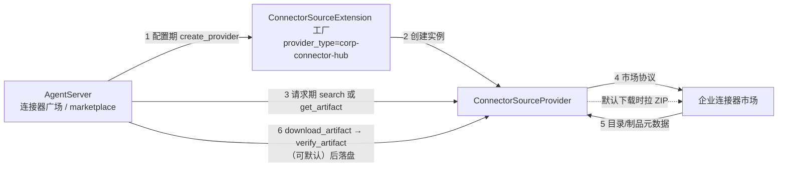

# 企业自建连接器广场接入（SPI 扩展）

当企业连接器（MCP）市场与内置 `openjiuwen-hub` **协议不兼容**时，开发者可通过 **Connector Source SPI** 扩展接入 AgentServer，供连接器广场完成检索、详情与安装。

文中常用术语：

- **SPI**（Service Provider Interface）：平台规定的扩展接口（方法与数据模型）；开发者按接口实现，平台按接口调用，无需改 AgentServer 核心代码。  
- **工厂**（`ConnectorSourceExtension`）：按 `provider_type` 注册的扩展入口，负责 `create_provider`。  
- **Provider**（`ConnectorSourceProvider`）：工厂按配置创建的适配器实例，把企业市场协议翻译成 SPI（如 `search` / `get_artifact`）；不负责落盘、connect、凭证。

| 适用场景 | 接入方式 |
|----------|----------|
| 市场协议与内置 `openjiuwen-hub` **不一致** | **本文**：实现 SPI 扩展并部署 |
| 市场与内置 `openjiuwen-hub` 同一套 HTTP 接口 | 无需写扩展；配置 `endpoint_ref` 即可（[附录 A](#附录-a兼容内置-openjiuwen-hub-时可不写扩展)） |

---

## 目录

1. [方案概览](#1-方案概览)
2. [SPI 契约（实现前必读）](#2-spi-契约实现前必读)
3. [扩展包骨架](#3-扩展包骨架)
4. [最小实现](#4-最小实现)
5. [MCP 包与下载验签](#5-mcp-包与下载验签)
6. [部署与下发配置](#6-部署与下发配置)
7. [联调与验收](#7-联调与验收)
8. [常见错误](#8-常见错误)
9. [参考](#9-参考)
- [附录 A：兼容内置 Hub](#附录-a兼容内置-openjiuwen-hub-时可不写扩展)
- [附录 B：Hub HMAC（可选）](#附录-bhub-hmac-摘要可选深入)

---

## 1. 方案概览

SPI 扩展把企业连接器市场协议适配为平台统一模型（至少 `search` / `get_artifact`）。安装时调用方传入 **`version_id`（必填）** 及可选 `package_name`；宿主先调 **`get_artifact`**，再调 **`download_artifact` → `verify_artifact`**（后两步可走默认实现），**不调用** `get_detail`。`get_detail` 仅详情页（`mcp.show`）使用。

白名单、ZIP 落盘与安装账本由 AgentServer 完成；Provider **不直接改连接状态或写工作区**，也不负责 connect / 凭证。



流程说明：

- **配置期（1～2）**：下发 `connector_sources` 后，按 `provider_type` 创建并绑定 Provider。  
- **请求期（3～5）**：宿主调 `search` 或 `get_artifact` → Provider 调企业市场 → 映射为 SPI 模型返回。  
- **仅安装（6）**：再调 `download_artifact` → `verify_artifact`（可默认），然后落盘写账本。  

---

## 2. SPI 契约（实现前必读）

SDK：`jiuwenswarm.extensions.sdk.connector_source`。可对照内置实现 `jiuwenswarm/extensions/swarm_connector_hub/`。

### 2.1 必选 / 可选方法

| 方法 | 必选 | 说明 |
|------|------|------|
| `search` | 是 | 返回 `ConnectorSearchResult`；条目含本源 `source_id`、`asset_id`、`package_name`、`display_name`、**`version_id`**（供安装入参）；可选 `versions`。`package_name` 须与对应 ZIP 内 `manifest.json` 的 `id` 一致；落盘后账本/目录称 `package_id`（同值） |
| `get_artifact` | 是 | 返回 `ConnectorArtifactDescriptor`；`artifact_ref` 须与请求的 source/asset/version 一致；摘要字段为 `content_sha256` |
| `get_detail` | 否 | 详情页（`mcp.show`）用；**安装不调用**；未实现会报 `does not support get_detail` |
| `check_updates` | 否 | 非抽象；广场「检查更新」用。不做则检索/安装仍可用；若提供须在 `capabilities` 中声明 |
| `download_artifact` | 否 | 默认：禁跳转、限大小、校验响应为 ZIP + 可选 `content_sha256`；管理面须显式配置 `download_policy.allowed_hosts`（皆空则默认不按主机过滤） |
| `verify_artifact` | 否 | 默认：无 `signature` 则跳过；**有签名则必须覆盖**（通用 SPI 无内置签章契约） |
| `start` / `close` | 否 | 懒启动与释放客户端 |

**`capabilities` 只声明已实现的能力。** 最小实现应声明 `{"search", "get_artifact"}`；加上 `get_detail` / `check_updates` 时再写入，并真正实现对应方法。

安装时宿主顺序（Provider 内不必实现）见 [§1](#1-方案概览) 与 [§7.1](#71-联调请求示例) 第 4 步：`get_artifact` → `download_artifact` → `verify_artifact` → 落盘。

---

## 3. 扩展包骨架

```text
corp_connector_hub/
  extension.yaml      # 清单（目录被发现所必需）
  __init__.py         # 导出 register_extensions
  constants.py        # PROVIDER_TYPE 单点定义
  extension.py        # 工厂 + 注册
  provider.py         # Provider 实现
```

### 3.1 `extension.yaml`

```yaml
id: corp_connector_hub
name: corp_connector_hub
version: 0.1.0
description: Corporate connector marketplace Connector Source provider.
author: your-team
dependencies: {}
```

加载器对多数字段有默认值，**并非全部必填**。实务上：

- 目录内必须有 `extension.yaml`（用来被发现为扩展根）  
- 建议填写 `name`：配置了 `extensions.enabled` 时按此值做白名单匹配（不是目录名，也不是 `provider_type`）  
- `id` / `version` / `description` / `author` / `dependencies` 可选；`dependencies` 非空时加载器会尝试安装依赖  

平台是否把该扩展当作连接器源使用，取决于：包入口是否通过 `register_extensions` 调用了 `register_connector_source_extension`；工厂的 `provider_type` 是否合法，且与管理面 `connector_sources[].provider_type` 一致。

### 3.2 `__init__.py`

```python
from .extension import register_extensions

__all__ = ["register_extensions"]
```

### 3.3 `constants.py`

`provider_type` 在工厂类、Provider 类与管理面配置中须一致；字符串只在此处定义一次，供 `extension.py` / `provider.py` 引用（与内置 `swarm_connector_hub` 做法相同）。

- **工厂**上的 `provider_type`：扩展注册与管理面 `connector_sources[].provider_type` 匹配的键  
- **Provider**上的 `provider_type`：实现自描述，须与工厂同值（当前绑定路径不以它选工厂）

```python
PROVIDER_TYPE = "corp-connector-hub"
```

---

## 4. 最小实现

下列市场路径为**假想协议**，仅演示如何适配 SPI；请按实际 API 修改请求路径与字段解析。勿与[附录 A](#附录-a兼容内置-openjiuwen-hub-时可不写扩展) 的内置 Hub 路径混淆。

假想市场：

- `GET {base}/connectors?q=&page=&page_size=` → `{ "items": [...], "total": N }`（条目须含可安装版本，映射为 SPI `version_id`）  
- `GET {base}/connectors/{asset_id}/versions/{version}/download` → `{ "url", "sha256" }`  

### 4.1 `provider.py`（`search` + `get_artifact`）

```python
from __future__ import annotations

import httpx

from jiuwenswarm.extensions.sdk.connector_source import (
    ConnectorArtifactDescriptor,
    ConnectorArtifactRef,
    ConnectorCandidate,
    ConnectorRef,
    ConnectorSearchRequest,
    ConnectorSearchResult,
    ConnectorSourceProvider,
    ProviderInvocationContext,
)

from .constants import PROVIDER_TYPE


class CorpConnectorHubProvider(ConnectorSourceProvider):
    provider_type = PROVIDER_TYPE
    # 只声明已实现的能力；需要详情/检查更新时再追加并实现对应方法
    capabilities = frozenset({"search", "get_artifact"})
    download_allowed_hosts: tuple[str, ...] = ()

    def __init__(
        self,
        base_url: str,
        *,
        source_id: str,
        display_name: str = "企业连接器市场",
        timeout: float = 60.0,
        verify_ssl: bool = True,
        allowed_hosts: tuple[str, ...] = (),
    ) -> None:
        self.source_id = source_id.strip()
        self.display_name = display_name.strip() or self.source_id
        self._base = base_url.rstrip("/")
        if not self._base:
            raise ValueError("endpoint_ref / base_url is required")
        self._timeout = timeout
        self.verify_ssl = verify_ssl
        self.download_allowed_hosts = allowed_hosts
        self._client: httpx.AsyncClient | None = None

    async def start(self) -> None:
        if self._client is None:
            self._client = httpx.AsyncClient(
                timeout=self._timeout,
                follow_redirects=False,
                verify=self.verify_ssl,
            )

    async def close(self) -> None:
        client, self._client = self._client, None
        if client is not None:
            await client.aclose()

    async def search(
        self,
        request: ConnectorSearchRequest,
        context: ProviderInvocationContext,
    ) -> ConnectorSearchResult:
        del context
        if self._client is None:
            await self.start()
        assert self._client is not None
        resp = await self._client.get(
            f"{self._base}/connectors",
            params={
                "q": request.q,
                "page": request.page,
                "page_size": request.page_size,
            },
        )
        resp.raise_for_status()
        raw = resp.json()
        items_raw = raw.get("items") if isinstance(raw, dict) else None
        if not isinstance(items_raw, list):
            raise RuntimeError("corp-connector-hub search: items must be a list")

        items: list[ConnectorCandidate] = []
        for row in items_raw:
            if not isinstance(row, dict):
                continue
            asset_id = str(row.get("id") or "").strip()
            package_name = str(row.get("package_name") or asset_id).strip()
            display_name = str(row.get("display_name") or package_name).strip()
            if not asset_id or not package_name or not display_name:
                raise RuntimeError(
                    "corp-connector-hub search: id/package_name/display_name required"
                )
            items.append(
                ConnectorCandidate(
                    source_id=self.source_id,
                    asset_id=asset_id,
                    package_name=package_name,
                    display_name=display_name,
                    version_id=str(row.get("version") or "").strip(),
                    short_description=str(row.get("summary") or "").strip(),
                    icon_uri=str(row.get("icon_uri") or "").strip(),
                    tags=tuple(row.get("tags") or ())
                    if isinstance(row.get("tags"), list)
                    else (),
                    category_name=str(row.get("category") or "").strip(),
                )
            )
        total = raw.get("total") if isinstance(raw, dict) else None
        try:
            total_i = int(total) if total is not None else None
        except (TypeError, ValueError):
            total_i = None
        next_page = (
            request.page + 1
            if total_i is not None and request.page * request.page_size < total_i
            else None
        )
        return ConnectorSearchResult(
            items=tuple(items),
            total=total_i,
            next_page=next_page,
            page=request.page,
            page_size=request.page_size,
        )

    async def get_artifact(
        self,
        connector_ref: ConnectorRef,
        version_id: str,
        context: ProviderInvocationContext,
    ) -> ConnectorArtifactDescriptor:
        del context
        if connector_ref.source_id != self.source_id:
            raise RuntimeError("ConnectorRef.source_id mismatch")
        if self._client is None:
            await self.start()
        assert self._client is not None
        version = str(version_id or "").strip()
        if not version:
            raise RuntimeError("corp-connector-hub artifact: version_id required")
        resp = await self._client.get(
            f"{self._base}/connectors/{connector_ref.asset_id}/versions/{version}/download"
        )
        resp.raise_for_status()
        raw = resp.json()
        if not isinstance(raw, dict):
            raise RuntimeError("corp-connector-hub artifact response must be object")
        download_url = str(raw.get("url") or "").strip()
        if not download_url:
            raise RuntimeError("corp-connector-hub artifact missing url")
        sha = str(raw.get("sha256") or "").strip().lower() or None
        package_name = str(raw.get("package_name") or "").strip()
        # 远端字段名不同：在此映射到 ConnectorArtifactDescriptor 标准字段即可
        return ConnectorArtifactDescriptor(
            artifact_ref=ConnectorArtifactRef(
                connector_ref=connector_ref,
                version_id=version,
            ),
            download_url=download_url,
            content_sha256=sha,
            package_name=package_name,
            metadata={
                k: raw[k]
                for k in ("display_name", "version", "author")
                if k in raw and raw[k] is not None
            },
        )
```

### 4.2 `extension.py`（工厂）

```python
from __future__ import annotations

import os
import re
from urllib.parse import urlparse

from jiuwenswarm.extensions.sdk.connector_source import (
    ConnectorSourceConfig,
    ConnectorSourceExtension,
    ConnectorSourceProvider,
)

from .constants import PROVIDER_TYPE
from .provider import CorpConnectorHubProvider

_ENV_REF_RE = re.compile(r"[A-Z][A-Z0-9_]{0,127}")


def _resolve_endpoint(endpoint_ref: str | None) -> str:
    value = str(endpoint_ref or "").strip()
    if value.startswith("env://"):
        name = value[6:]
        if not _ENV_REF_RE.fullmatch(name):
            raise ValueError(f"invalid env endpoint_ref: {endpoint_ref}")
        resolved = str(os.getenv(name) or "").strip()
        if not resolved:
            raise ValueError(f"environment variable not set: {name}")
        return resolved
    return value


class CorpConnectorHubSourceExtension(ConnectorSourceExtension):
    provider_type = PROVIDER_TYPE

    async def initialize(self, config) -> None:
        return None

    async def shutdown(self) -> None:
        return None

    def default_source_config(self) -> ConnectorSourceConfig | None:
        return None  # 不自动注册默认源；由管理面 connector_sources 下发

    def create_provider(self, config: ConnectorSourceConfig) -> ConnectorSourceProvider:
        endpoint = _resolve_endpoint(config.endpoint_ref)
        if not endpoint:
            raise ValueError(f"endpoint_ref is required for {PROVIDER_TYPE}")
        display_name = (
            str(config.options.get("display_name") or "").strip() or "企业连接器市场"
        )
        hosts: list[str] = []
        host = (urlparse(endpoint).hostname or "").strip().lower()
        if host:
            hosts.append(host)
        return CorpConnectorHubProvider(
            endpoint,
            source_id=config.source_id,
            display_name=display_name,
            verify_ssl=config.verify_ssl,
            allowed_hosts=tuple(hosts),
        )


async def register_extensions(registry):
    extension = CorpConnectorHubSourceExtension()
    registry.register_connector_source_extension(extension)
    return [extension]
```

约定：

- `register_extensions` **只注册工厂**，不要在此注册租户级 Provider 实例。  
- 实例由 AgentServer 应用 `connector_sources` 后调用 `create_provider(config)` 绑定。  
- `provider_type` / `source_id` 须匹配 `^[a-z0-9][a-z0-9-]{0,63}$`；工厂与 Provider 的 `provider_type` 均引用 `constants.PROVIDER_TYPE`，并与管理面配置一致。  

### 4.3 可选：`get_detail` / `check_updates`

详情页（`mcp.show`）需要时，实现 `get_detail` 并在 `capabilities` 中加入 `"get_detail"`。示意：

```python
from jiuwenswarm.extensions.sdk.connector_source import ConnectorDetail

async def get_detail(
    self,
    connector_ref: ConnectorRef,
    context: ProviderInvocationContext,
) -> ConnectorDetail:
    del context
    # GET {base}/connectors/{asset_id} → 映射为 ConnectorDetail
    # 须含 source_id / asset_id / package_name / display_name；建议带 version_id
    ...
```

「检查更新」需要时实现 `check_updates`，对已安装条目返回 `ConnectorUpdateStatus`，并在 `capabilities` 中声明 `"check_updates"`。不实现也不影响检索/安装。

---

## 5. MCP 包与下载验签

### 5.1 MCP 安装包格式

无论是否覆盖下载逻辑，`download_artifact` 返回的字节必须是**合法 MCP 包 ZIP**。宿主解压后须能定位含 `manifest.json` 的包根目录，且：

- `package_type` 等于 `mcp`  
- `id` 为安全目录名，并与安装目录名 / `package_name` 一致  
- 含 `version`、`name`、`description`、`display_name` / `display_description`（含 `zh`/`en`）等清单字段  
- `integration.type` 为 `stdio-mcp` / `remote-mcp` / `cli` / `skill-only` 之一  
- 无符号链接  

非 ZIP、或清单不符合契约时无法安装。

最小 `manifest.json` 示例（`remote-mcp`）：

```json
{
  "version": "1.0.0",
  "package_type": "mcp",
  "id": "corp-demo-mcp",
  "name": "Corp Demo MCP",
  "description": "Enterprise demo connector",
  "display_name": { "zh": "企业演示连接器", "en": "Corp Demo MCP" },
  "display_description": {
    "zh": "用于联调的远程 MCP 示例包",
    "en": "Remote MCP sample package for integration"
  },
  "integration": { "type": "remote-mcp", "file": "mcp.json" },
  "skills": []
}
```

同目录需有 `mcp.json`（由 `integration.file` 声明），最小示例如下：

```json
{
  "mcpServers": {
    "corp-demo-mcp": {
      "type": "sse",
      "url": "https://mcp.corp.example.com/sse",
      "timeout": 600
    }
  }
}
```

完整校验见 `jiuwenswarm/common/mcp_package_manifest.py`。

### 5.2 下载与 `download_url`

| 场景 | 要求 |
|------|------|
| 使用**默认** `download_artifact` | `download_url` 须为 `http(s)` **ZIP 直链**（含主机名）；运行面**不跟随重定向**；URL 不得带 userinfo |
| **覆盖** `download_artifact` | `get_artifact` 的 URL 可不直接返回 ZIP 文件，但仍须是能过白名单的 `http(s)://主机/...`；自定义方法须返回合法 ZIP 字节 |
| 宿主预检 | 若 `download_policy.allowed_hosts` 非空则强制命中；否则回落 Provider 的 `download_allowed_hosts`；**两边皆空时默认不做主机过滤** |

**验收要求**：管理面显式配置 `download_policy.allowed_hosts`，不要依赖「空白名单放行」。

### 5.3 完整性与验签

| 远端情况 | 默认行为 | 开发者做法 |
|----------|----------|------------|
| 仅有 `download_url`，可选 `content_sha256`，**无签名** | 默认可用（无签名则跳过验签） | 在 Descriptor 填 `content_sha256`（64 位小写 hex）即可 |
| 带了签名，但未覆盖 `verify_artifact` | **默认会报错**（`artifact_signature_unsupported`） | 覆盖 `verify_artifact`，或**不要**把签名写入 Descriptor |
| 签名算法/拼法与官方 Hub HMAC 一致 | 可参考内置 `swarm_connector_hub/hub_verify.py` | 自行实现或复用同等契约；见[附录 B](#附录-bhub-hmac-摘要可选深入) |
| 下载需鉴权头、必须跟随跳转等 | 默认下载可能失败 | 覆盖 `download_artifact` |

字段名不同 ≠ 必须自写验签；**只要 Descriptor 里出现 `signature`，通用默认实现就会要求覆盖 `verify_artifact`**。第三方多数场景：只填 `content_sha256`、不填签名即可。

### 5.4 落盘与账本（了解即可）

Provider **不必读写**下列路径；联调验收时知道即可：

- 广场安装落到工作区 `mcp/mcp_hub/`，**不会**写入内置目录 `mcp/mcp_builtins/`  
- 安装溯源写入同一份 `mcp/hub_state.json`（官方 Hub 与企业自建源共用），靠记录中的 `source_id` 区分来源  
- `package_id` 与内置包或已安装包重名时，安装会在冲突检查阶段失败  

---

## 6. 部署与下发配置

### 6.1 部署扩展到 AgentServer

扩展搜索目录由 `extensions.extension_dirs` 决定。当前默认写在 `jiuwenswarm/resources/config.yaml`：

```yaml
extensions:
  # 扩展包搜索目录（字符串），用 ';' 分割多个目录
  extension_dirs: ${EXTENSION_DIRS:-jiuwenswarm/extensions}
```

未设置 `EXTENSION_DIRS` 时默认搜索 `jiuwenswarm/extensions`；企业版常通过 AgentServer 的 env / ConfigMap 覆盖。

1. 将 `corp_connector_hub/` 放入搜索目录的**父路径**下，或把新路径追加进 `EXTENSION_DIRS`（`;` 分隔）。  
2. 保证有 `extension.yaml`，且根模块可导入 `register_extensions`。  
3. 若配置了 `extensions.enabled`，将清单 `name`（上例 `corp_connector_hub`）加入白名单。  
4. 重启 AgentServer；日志应显示扩展加载成功，且 `provider_type=corp-connector-hub` 已注册。  

未注册时下发 `connector_sources` 会报：`provider_type is not registered: corp-connector-hub`。

平台加载相关代码（同仓源码路径）：`jiuwenswarm/extensions/manager.py`、`loader.py`；Connector Source 工厂注册：`registry.register_connector_source_extension`；运行时应用：`SourceRuntime.apply_connector_source_configs`。

### 6.2 下发源实例

扩展只提供工厂；**源实例**由管理面扩展配置模板（`component=agent_server`）的 `custom_config.connector_sources` 下发，并挂到 Agent 模板的 `extension_config`。

```json
{
  "connector_sources": [
    {
      "source_id": "corp-connector-hub",
      "provider_type": "corp-connector-hub",
      "enabled": true,
      "priority": 200,
      "endpoint_ref": "https://connectors.corp.example.com",
      "capabilities": ["search", "get_artifact"],
      "verify_ssl": true,
      "download_policy": {
        "allowed_hosts": [
          "connectors.corp.example.com",
          "artifacts.corp.example.com"
        ],
        "max_bytes": 67108864,
        "timeout_seconds": 60.0
      },
      "options": {
        "display_name": "企业连接器市场"
      }
    }
  ]
}
```

| 字段 | 说明 |
|------|------|
| `source_id` | 广场切换源、安装账本写入的源 ID；须与 Provider 实例一致 |
| `provider_type` | 须等于扩展工厂的 `provider_type` |
| `endpoint_ref` | API 根地址，或 `env://VAR_NAME` |
| `download_policy.allowed_hosts` | **必配**（验收硬项）；优先于 Provider 默认白名单 |
| `verify_ssl` | 仅布尔 |
| `capabilities` | 与 Provider 已实现能力对齐 |

配置语义：出现 `connector_sources` 键（含 `[]`）才会应用；`[]` 清空配置源，仅保留各扩展 `default_source_config()` 的默认源（内置一般为 `openjiuwen-hub`）。键缺省则不改动当前注册表。

Provider **不负责** connect / 凭证变更。

**用户面前端一般无需改代码。** 企业连接器广场已支持多源：通过 `mcp.sources.providers` 拉源列表并切换；`mcp.list` / `mcp.show` / `mcp.install` 携带选中的 `source_id`。扩展部署且 `connector_sources` 下发成功后，新源会出现在广场源切换中。仅当需要自定义详情/安装交互时才改前端。

---

## 7. 联调与验收

用户面按 `source_id` 检索与安装（前端说明见 [§6.2](#62-下发源实例)）。下文方法名为 AgentServer **RPC**；Gateway 提供等价 REST 转发，入参字段相同。

| RPC 方法 | Gateway REST |
|----------|--------------|
| `mcp.sources.providers` | `POST /api/v1/mcp/actions/sources-providers` |
| `mcp.list` | `POST /api/v1/mcp/actions/list` |
| `mcp.show` | `POST /api/v1/mcp/actions/show` |
| `mcp.install` | `POST /api/v1/mcp/actions/install` |

### 7.1 联调请求示例

下列 JSON 为 RPC / REST 的**业务入参**（`params` 或请求体中的对应字段），不是完整 HTTP 信封。企业广场远端目录用 `filter=hub`，并必填 `source_id`。

| RPC 方法 | 调用的 SPI | 说明 |
|----------|------------|------|
| `mcp.sources.providers` | **无** | 读已注册源列表（`SourceRuntime`），不调 Provider |
| `mcp.list`（`filter=hub`） | `search` | 远端广场检索；`filter=local`（我的）不调 SPI |
| `mcp.show` | `get_detail` | 详情页；未实现则失败，安装联调可跳过 |
| `mcp.install` | `get_artifact` → `download_artifact` → `verify_artifact` | 后两步可走默认实现；**不调用** `get_detail` |

**1）确认源已注册** — `mcp.sources.providers`

```json
{}
```

期望 `providers` 中含 `source_id=corp-connector-hub`、`provider_type=corp-connector-hub`。

**2）检索** — `mcp.list` → SPI `search`

```json
{
  "filter": "hub",
  "source_id": "corp-connector-hub",
  "query": "demo"
}
```

| 字段 | 必填 | 说明 |
|------|------|------|
| `filter` | 是（企业） | 远端广场用 `hub`；`local` 为我的，不调 SPI |
| `source_id` | `filter=hub` 时必填 | 与下发配置一致 |
| `query` | 否 | 关键词，映射到 `ConnectorSearchRequest.q` |

期望至少一条结果含可安装身份：`asset_id` / `package_name` / `version_id`（卡片侧也可能是 `id` / `version`，安装时仍传 `version_id`）。

**3）详情（可选）** — `mcp.show` → SPI `get_detail`

```json
{
  "id": "asset-001",
  "source_id": "corp-connector-hub"
}
```

| 字段 | 必填 | 说明 |
|------|------|------|
| `id` | 是 | 市场侧 `asset_id`（也可用 `name`） |
| `source_id` | 是（企业远端） | 绑定到对应 Provider |

未实现 `get_detail` 时失败；只验安装可跳过本步。

**4）安装** — `mcp.install` → SPI `get_artifact` → `download_artifact` → `verify_artifact`

```json
{
  "id": "asset-001",
  "source_id": "corp-connector-hub",
  "version_id": "1.0.0",
  "package_name": "corp-demo-mcp"
}
```

| 字段 | 必填 | 说明 |
|------|------|------|
| `id` | 是 | 市场侧 `asset_id` |
| `source_id` | 是 | 与下发配置一致 |
| `version_id` | 是 | 须与列表/详情卡片一致；缺省报 `version_id is required` |
| `package_name` | 否 | 下载前包名冲突预检；最终包名以 ZIP 内 `manifest.id` 为准 |

成功时宿主：`get_artifact` → `download_artifact` → `verify_artifact` → 落盘；**不会**调用 `get_detail`。connect 失败不回滚已成功的安装。

按上面 1→4 步跑通即可验收。单测可参考（同仓）：`tests/unit_tests/test_connector_source_spi.py`、`tests/unit_tests/server/connector/test_source_registry.py`、`tests/unit_tests/agentserver/mcp/test_mcp_hub_marketplace.py`。

---

## 8. 常见错误

| 错误 / 现象 | 原因 |
|-------------|------|
| `provider_type is not registered` | 扩展未加载或 `provider_type` 不一致 |
| `provider source_id does not match config` | 工厂创建的 Provider.`source_id` 与配置不一致 |
| `connector source not found` | `source_id` 未下发或广场请求源不一致 |
| 广场能搜但无版本 | `search` 未映射 `version_id`，安装会卡在缺参 |
| `version_id is required` | `mcp.install` 未传 `version_id`（应由列表/详情卡片带入） |
| `does not support get_detail` | 详情页（`mcp.show`）需要 `get_detail`，Provider 未实现（安装不依赖） |
| `连接器下载 URL 主机不在来源白名单` | 漏配制品域名，或规则未匹配 |
| `连接器下载不支持自动跳转` | 默认下载遇到 302；改直链或覆盖 `download_artifact` |
| `artifact_signature_unsupported` | Descriptor 带了 `signature` 却走通用默认验签 |
| `下载内容不是 ZIP 文件` / `invalid_zip` | 非 ZIP 或损坏 |
| `manifest.json` / `package_type must equal mcp` | ZIP 不是合法 MCP 包 |
| `Hub MCP package conflicts with built-in` | `package_name` 与内置包冲突 |

---

## 9. 参考

路径相对 `jiuwenswarm` 同仓源码（需能访问对应仓库/制品）：

**源码**

- SPI：`jiuwenswarm/extensions/sdk/connector_source.py`  
- 内置实现：`jiuwenswarm/extensions/swarm_connector_hub/`  
- MCP 包清单：`jiuwenswarm/common/mcp_package_manifest.py`  
- 源配置应用：`jiuwenswarm/server/runtime/connector/`（`SourceRuntime.apply_connector_source_configs`）  

**文档**

- [管理面接口文档](../../../开发文档/接口文档/管理面接口文档.md)  
- 仅复用官方 Hub HMAC 时：[附录 B](#附录-bhub-hmac-摘要可选深入)、`swarm_connector_hub/hub_verify.py`  

---

## 附录 A：兼容内置 `openjiuwen-hub` 时可不写扩展

内置 Provider（`provider_type=openjiuwen-hub`）经 `HubClient` / `HubAssetPort` 调用市场，MCP 侧主要使用：

1. **列表/检索**：`GET {endpoint}/api/v1/plugins?plugin_type=agent-mcp&page=&page_size=&search_keyword=`  
2. **详情**：先按 `asset_id` 查插件，再 `GET {endpoint}/api/v1/plugins/{asset_id}/versions/{version}`  
3. **取制品**：`GET {endpoint}/api/v1/packages/{asset_id}?version={version}`，`data` 中带 ZIP 的 `download_url`（及可选摘要字段）  

响应信封：`{ "code": 200, "message": "...", "data": { ... } }`。

市场已实现上述契约时，直接下发即可（可覆盖默认源的 `endpoint_ref` / 白名单）：

```json
{
  "connector_sources": [
    {
      "source_id": "openjiuwen-hub",
      "provider_type": "openjiuwen-hub",
      "endpoint_ref": "https://connectors.corp.example.com",
      "download_policy": {
        "allowed_hosts": [
          "connectors.corp.example.com",
          "artifacts.corp.example.com"
        ]
      },
      "options": {
        "display_name": "企业连接器市场"
      }
    }
  ]
}
```

包校验不另调接口：摘要/签名来自取制品响应，由 AgentServer 下载后本地校验（内置 Hub 的 HMAC 策略见扩展包 `config.yaml` 的 `verification`）。

---

## 附录 B：Hub HMAC 摘要（可选深入）

**第三方市场不必强行兼容。** 通用 SPI 默认**不会**按此验签。仅当复用官方 Hub 签章契约、或阅读内置 `swarm_connector_hub` 时才需要本节。

多数企业自建：Descriptor 只填 `content_sha256`、**不填** `signature` 即可；自有 RSA/JWT/其它 HMAC 时覆盖 `verify_artifact`。

内置 `swarm_connector_hub` 覆盖 `verify_artifact` 时使用的契约：

| 项 | 值 |
|----|-----|
| 算法 | `HmacSHA256` |
| 编码 | `hex-lower` |
| scope | `skillhub-artifact-v1` |

签名原文（换行拼接；注意连接器用 `asset_id`）：

```text
skillhub-artifact-v1
{asset_id}
{version_id}
{content_sha256}
```

用 `key_id` 解析出的密钥做 HMAC-SHA256，结果小写 hex 与 `signature` 比对；ZIP 内容 SHA256 须与 `content_sha256` 一致。

`HubTrustPolicy.verification`：`off`（默认，不验 HMAC）/ `if-present` / `required`。
