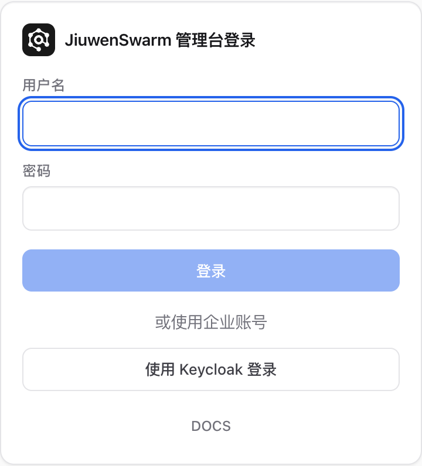
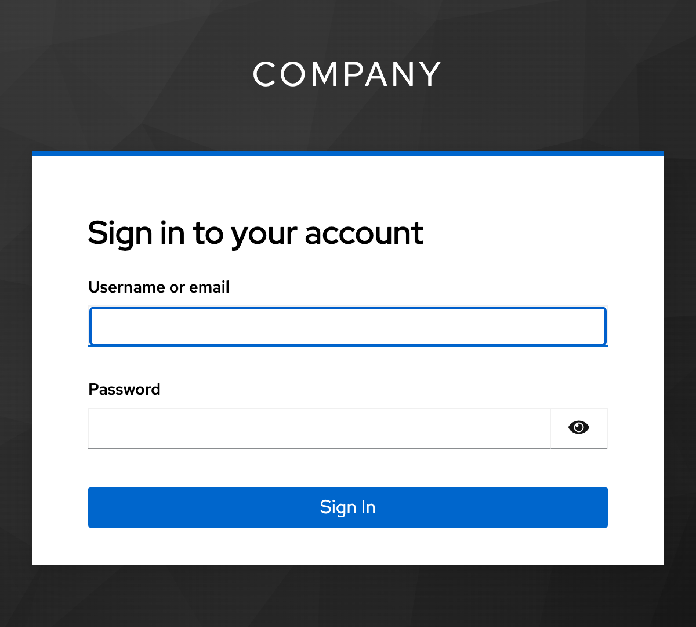

# 企业认证服务接入

JiuwenSwarm 企业版支持通过 OpenID Connect（OIDC）接入企业身份提供方。本文以 Keycloak 为例，使用授权码流程和 PKCE（S256）接入企业单点登录。员工在 Keycloak 完成身份认证后，JiuwenSwarm 身份中心校验 Keycloak 签发的访问令牌，并为员工签发平台会话所需的令牌。管理员在平台内为员工分配角色和资源权限。

## 准备工作

- 已部署 JiuwenSwarm 企业版，能够通过管理面统一入口访问平台。准备一个本地管理员账号，用于接入后检查用户和分配权限。部署步骤参见[集群部署指南](../../快速开始/集群部署指南.md)。
- 已在 Keycloak 中准备一个用于接入的 Realm 和至少一个测试用户。本文使用 `company` 作为 Realm、`https://sso.example.com/realms/company` 作为签发方地址、`https://jiuwen.example.com` 作为平台入口。配置时替换为实际值。
- 生产环境使用 HTTPS。用户浏览器和部署身份中心的环境都需能访问 Keycloak 并信任其 TLS 证书。签发方地址应与 OIDC 发现文档中的 `issuer` 一致。

## 配置 Keycloak

### 创建 OIDC 客户端

进入 Keycloak 管理控制台，选择 `company` Realm，打开 **Clients > Create client**。客户端类型选择 **OpenID Connect**，将 **Client ID** 设为 `jiuwenswarm-web`。使用以下配置。字段位置随版本而异，可在客户端的 **Settings** 或 **Advanced** 中按字段名查找。详见 [Keycloak 客户端配置](https://www.keycloak.org/docs/latest/server_admin/#_oidc_clients)。

| Keycloak 字段 | 示例值 | 用途 |
| --- | --- | --- |
| **Client authentication** | `Off` | 将浏览器端配置为公开客户端，无需客户端密钥。 |
| **Standard flow** | 开启 | 使用授权码登录。 |
| **Direct access grants**、**Implicit flow** | 关闭 | 示例只启用标准授权码流程。 |
| **PKCE method** | `S256` | 要求浏览器使用 S256 验证授权码。 |
| **Valid redirect URIs** | `https://jiuwen.example.com/auth/federation/keycloak/callback` | 允许 Keycloak 将浏览器重定向回平台以完成登录。 |
| **Valid post logout redirect URIs** | `https://jiuwen.example.com/auth/federation/keycloak/logout-callback` | 允许从 Keycloak 退出后返回平台。 |
| **Web origins** | `https://jiuwen.example.com` | 允许该来源的浏览器向 Keycloak 发起跨域请求。只填写协议、主机和实际使用的端口。 |

回调地址中的 `keycloak` 是身份中心的连接 ID。若通过配置文件自定义了 `connection_id`，请同步替换 URL 中的这一段。回调地址按浏览器实际访问的协议、域名和端口填写，逐条登记完整 URL。

### 配置访问令牌受众

1. 打开 **Clients > jiuwenswarm-web > Client scopes**，进入该客户端的专用作用域 `jiuwenswarm-web-dedicated`。
2. 在 **Mappers** 中选择 **Configure a new mapper** 或 **Add mapper > By configuration**，选择 **Audience**。
3. 将 **Name** 设为 `JiuwenSwarm Audience`，将 **Included Custom Audience** 设为 `jiuwenswarm`，开启 **Add to access token**，关闭 **Add to ID token**，然后保存。身份中心要求访问令牌的 `aud` 包含此值。详见 [Keycloak 受众映射配置](https://www.keycloak.org/docs/latest/server_admin/#_audience_hardcoded)。

可在客户端的 **Client scopes > Evaluate** 中选取测试用户查看生成的访问令牌。此示例应看到 `iss` 为 `https://sso.example.com/realms/company`，`azp` 为 `jiuwenswarm-web`，`aud` 包含 `jiuwenswarm`。请在受控环境内检查声明，避免复制完整令牌到日志或工单。

## 配置 JiuwenSwarm 身份中心

在部署工具的 `.env.custom` 中填写以下三个变量。

```dotenv
IDENTITY_SSO_SERVER_URL=https://sso.example.com/realms/company
IDENTITY_SSO_LOGIN_CLIENT_ID=jiuwenswarm-web
IDENTITY_SSO_TOKEN_AUDIENCE=jiuwenswarm
```

| 变量 | 说明 |
| --- | --- |
| `IDENTITY_SSO_SERVER_URL` | Keycloak Realm 的签发方地址。身份中心根据该地址读取 `/.well-known/openid-configuration`，因此变量值只填到 Realm 路径。 |
| `IDENTITY_SSO_LOGIN_CLIENT_ID` | Keycloak 客户端的 **Client ID**。 |
| `IDENTITY_SSO_TOKEN_AUDIENCE` | 与企业认证服务约定的令牌接收方标识。Keycloak 访问令牌的 `aud` 必须包含该值。若访问令牌还要交给企业出口网关等服务，也需满足接收方的受众校验规则。 |

使用环境变量接入时，三个值须同时填写。保存后，使用 `./deploy.sh up manager -n <命名空间>` 部署或更新管理套件，将变量注入身份中心（Identity）容器。部署命令和组件说明见[集群部署指南](../../快速开始/集群部署指南.md)。

此方式的连接 ID 为 `keycloak`，登录按钮显示 **使用 Keycloak 登录**，登录成功的企业用户归入标识为 `federated-keycloak` 的组织。平台本地账号仍可通过用户名和密码登录。

### 自定义连接配置

需要为多个 Realm 分别注册连接，或自定义登录按钮名称、目标组织及声明映射时，可以改用 `IDENTITY_FEDERATION_CONFIG_FILE`。将 JSON 文件挂载到身份中心容器，并把该变量设为容器内的文件路径。身份中心优先读取该文件。以下示例将企业员工归入 `company-employees` 组织。

```json
{
  "connections": [
    {
      "connection_id": "keycloak",
      "name": "Company SSO",
      "flow": "browser_pkce",
      "issuer": "https://sso.example.com/realms/company",
      "client_id": "jiuwenswarm-web",
      "organization_id": "company-employees",
      "access_token_audience": "jiuwenswarm"
    }
  ]
}
```

以上配置适用于新连接。正式使用后请保持连接 ID、签发方和目标组织稳定，以保留已建立的用户绑定。对使用私有 CA 的 Keycloak，可在连接配置中通过 `ca_bundle` 指定容器内的 CA 文件，同时在用户的浏览器环境中建立证书信任。若显式开启 `automatic_silent_renew`，还需在 Keycloak 的 **Valid redirect URIs** 中登记同连接的 `/auth/federation/<connection_id>/silent-callback` 完整 URL。

## 验证登录与权限

先确认统一入口能查到连接及其浏览器登录配置。以下请求无需登录，分别检查响应中是否有 `keycloak` 连接，以及 `authority`、`client_id` 是否与 Keycloak 配置一致。

```bash
BASE_URL=https://jiuwen.example.com
curl -fsS "$BASE_URL/idp/v1/auth/federation/connections"
curl -fsS "$BASE_URL/idp/v1/auth/federation/keycloak/configuration"
```

1. 使用无痕窗口打开平台统一登录页 `https://jiuwen.example.com/auth`，确认出现 **使用 Keycloak 登录**。

   

2. 点击企业登录按钮，确认浏览器跳转到 `company` Realm 的 Keycloak 登录页。使用测试员工账号登录，等待浏览器返回 JiuwenSwarm。

   

3. 使用本地管理员账号进入 **身份中心 > 用户**，确认平台已创建员工记录。在 **身份中心 > 组织** 中检查员工是否加入接入时指定的组织。若目标组织尚不存在，身份中心会在首次登录时创建。身份中心以连接 ID、签发方和用户标识 `sub` 绑定外部账号，员工再次登录会沿用此平台账号。参见[用户](../../核心功能/统一管理平台/身份中心/用户.md)和[组织](../../核心功能/统一管理平台/身份中心/组织.md)。
4. 员工的 Keycloak 身份用于登录，平台角色由 JiuwenSwarm 管理。管理员按职责分配所需的[角色](../../核心功能/统一管理平台/身份中心/角色.md)。若员工要在用户面使用 Agent，还需检查[集群准入](../../核心功能/统一管理平台/集群管理/集群准入.md)及 Agent 和运行时配置。参见[快速上手](../../快速开始/快速上手.md)。
5. 从平台退出后，确认浏览器能完成 Keycloak 退出并返回平台登录页。测试期间可再次点击企业登录按钮，检查是否按预期回到 Keycloak 登录页。

## 接入接口

通过平台入口访问以下接口。平台 Web 登录页会按顺序调用，请求中的 `{connection_id}` 使用对应连接 ID。

| 方法与路径 | 用途 |
| --- | --- |
| `GET /idp/v1/auth/federation/connections` | 获取已启用的企业认证连接。响应中的 `connections` 列出连接 ID、显示名称和登录流程。 |
| `GET /idp/v1/auth/federation/{connection_id}/configuration` | 获取浏览器登录配置，包括签发方 `authority`、客户端 `client_id`、`scope` 和是否启用静默续期。 |
| `POST /idp/v1/auth/federation/{connection_id}/token-login` | 在 `Authorization: Bearer <access_token>` 中提交 Keycloak 的访问令牌。校验通过后返回平台的 `access_token`、`refresh_token`、`token_type` 和 `expires_in`。 |

浏览器从 Keycloak 完成授权码交换后，向 `token-login` 提交 Keycloak 的访问令牌。身份中心使用 Keycloak 发布的公钥校验 JWT 的 RS256 签名，并检查签发方 `iss`、受众 `aud`、客户端标识 `azp`、用户标识 `sub` 和令牌时效，再签发平台令牌。后续调用平台接口使用身份中心签发的平台访问令牌。

## 常见问题

| 现象 | 检查项 |
| --- | --- |
| 登录页只有账号密码入口 | 检查身份中心是否加载完整的 `IDENTITY_SSO_*` 配置。如果设置了 `IDENTITY_FEDERATION_CONFIG_FILE`，检查挂载路径及文件中的连接列表。通过 `connections` 接口确认连接已注册。 |
| 配置接口报错，或点击登录后未到达 Keycloak | 从身份中心运行环境检查 Realm 发现地址和 TLS 证书链。发现文档的 `issuer` 应与配置一致，授权、令牌和公钥端点应与签发方同源。浏览器发往 Keycloak 的跨域请求还需匹配 **Web origins**。 |
| Keycloak 提示回调地址无效 | 对照浏览器授权请求的 `redirect_uri` 和 **Valid redirect URIs**，检查协议、域名、端口、连接 ID 及路径。若退出时报回调错误，检查 **Valid post logout redirect URIs**。 |
| `token-login` 返回 `401 invalid_external_access_token` | 确认提交的是 Keycloak 访问令牌，检查有效期、签名、`iss`、`azp`，以及 `aud` 是否包含平台配置的受众。修改受众映射后重新登录以取得新令牌。 |
| `token-login` 返回 `403 disabled` | 管理员可在 **身份中心 > 用户** 检查对应平台账号的启用状态。 |
| 登录成功，但无法打开管理功能或使用 Agent | 检查平台角色、集群准入以及 Agent 和运行时配置。可用资源由平台授权决定。 |
