# 快速上手

本文介绍JiuwenSwarm企业版从环境准备到完成第一句对话的最短路径，说明如何部署环境，在管理面完成必要配置，使第一位成员在对话界面发出第一句话。

## 快速部署

### 环境准备

**安装 JiuwenSwarm 前，请确保满足以下要求：**

- 操作系统：Linux（推荐 Ubuntu 20.04）
- CPU 架构：**集群内所有节点的架构必须一致，统一为 AMD64 或统一为 ARM64，禁止混合架构部署**
- 硬件资源：至少 2 个计算节点，每个节点最低配置为 16 核 CPU、32 GB 物理内存
- 运行环境：已预先搭建好 Kubernetes 集群，搭建流程可参考官方指导：https://kubernetes.io/zh-cn/docs/setup/

**执行以下命令，逐一校验节点环境信息：**

```
# 查看操作系统
uname -s

# 查看 CPU 架构
uname -m

# 查看 CPU 核心数量
nproc

# 查看总内存大小（单位：GB）
free -g | grep Mem | awk '{print $2}'

# 校验 K8s 集群节点就绪状态
kubectl get nodes
```

### 预装软件

| 工具 | 版本要求 | 校验范围 | 校验方法 | 核心用途 |
| ---- | -------- | -------- | -------- | -------- |
| yq | mikefarah/yq v4+（Go 版本） | 仅部署节点 | 运行 `yq --version`，检查版本是否符合要求 | 解析、修改 YAML 配置文件 |
| jq | 无强制版本限制 | 仅部署节点 | 执行 `which jq`，校验是否已安装 | 解析并筛选 JSON 数据，提取所需字段 |

### 下载部署工具

从官网获取部署工具包的下载地址 `<download_url>`，请根据部署节点的 CPU 架构（可通过 `uname -m` 查看）选择对应的安装包。以 0.0.50s 版本为例，下载地址如下：

| CPU 架构 | 下载地址示例 |
| -------- | ------------ |
| x86_64（amd64） | `https://openjiuwen-ci.obs.cn-north-4.myhuaweicloud.com/jiuwenclaw/JiuwenClaw/dev/JiuwenClaw_deployTool_0.0.50s_amd64_dev.zip` |
| aarch64（arm64） | `https://openjiuwen-ci.obs.cn-north-4.myhuaweicloud.com/jiuwenclaw/JiuwenClaw/dev/JiuwenClaw_deployTool_0.0.50s_arm64_dev.zip` |

在部署节点上执行以下命令，下载部署工具包：

```
wget <download_url>
```

解压命令：

```
unzip <部署工具包>.zip
```

进入解压后的目录：

```
cd <部署工具包目录>
```

> 说明：后续所有部署、运维命令，均需进入解压后的工具目录执行。

### 启动服务

>说明：管理员默认账号是`admin`，密码是`admin`。首次部署时可通过修改 `.env.custom` 文件中的环境变量 `IDENTITY_ADMIN_PASSWORD` 来设置`admin`账号的初始密码。

执行以下命令，启动部署运行面服务。-n表示指定命名空间：

```
./deploy.sh up -n test
```

启动部署管理面服务：

```
./deploy.sh up manager -n test
```

部署完成后，查看管理面对外端口`<Port>`：
```
kubectl get svc -n test
```
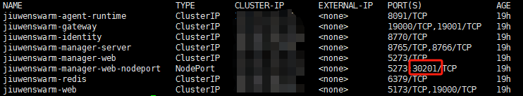


通过 `http://<服务器地址>:<Port>` 访问管理面。


## 整体逻辑

JiuwenSwarm分为两部分：**用户面**负责处理对话，**管理面**负责配置规则并下发给用户面。用户面部署完成后，并不知道谁可以使用、使用哪个模型、有哪些Agent，这些都需要在管理面配置。

配置可归结为三个问题：

- **谁能用**：成员或者组织（一组成员，便于批量授权）。
- **用什么**：一个可对话Agent。
- **跑在哪**：根据运行时模板配置好的运行环境（例如：容器资源池）。

三者最终在**集群**中汇合。集群是一套独立部署环境，在集群上设置**准入**（谁能登录）和**集群配置**（启用哪些Agent和运行时，并授权给谁），配置才会生效。 成员能够对话，须同时满足：1.已被准入；2.至少一个 Agent 授权覆盖该成员；3.至少一个运行时授权覆盖该成员。

页面左上角的「配置引导」在「新手开局」中列出了完成第一次对话所需的步骤，与下文步骤一一对应。总览页的「配置检查清单」会提示尚未创建的项目。

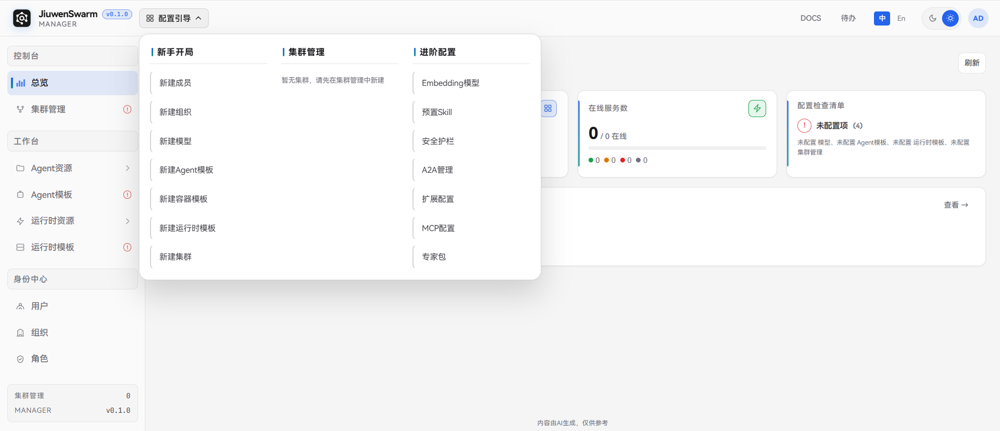


## 配置步骤

使用 `admin` 账号登录管理面，依次完成以下步骤。

### 1. 新建成员

进入「身份中心 → 用户」，点击「新建用户」，填写用户 ID（登录用）、显示名和密码。该账号用于最后登录对话界面。

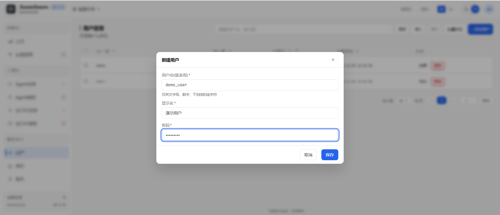

### 2. 新建组织并添加成员

进入「身份中心 → 组织」，新建组织后切换到「成员」页签，添加上一步的成员。成员数量很少时可跳过本步，在后续步骤中直接按用户准入、授权。

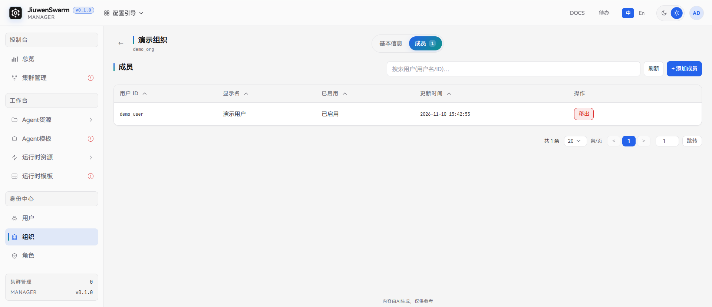

### 3. 新建模型

进入「工作台 → Agent资源 → 模型」，点击「新建模型」，填写模型信息。

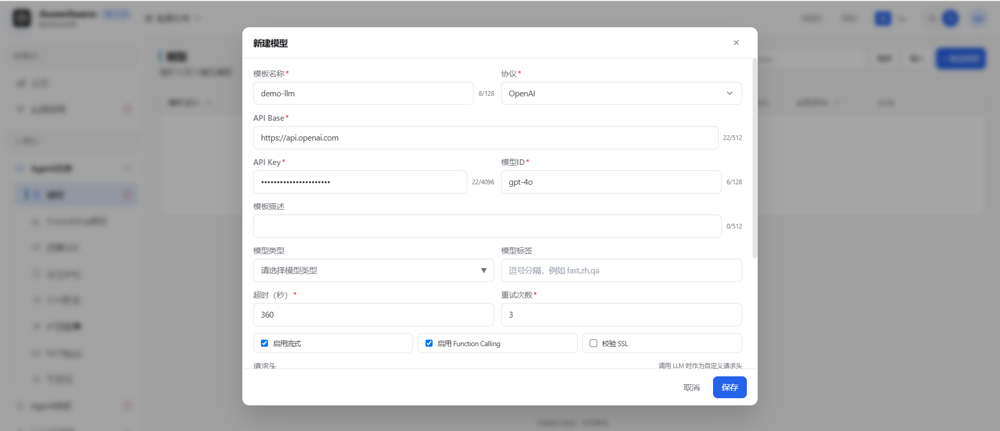

### 4. 新建 Agent 模板

进入「工作台 → Agent模板」，点击「新建 Agent模板」。仅「模板名称」和「默认模型」必填，其中默认模型选择上一步创建的模型。

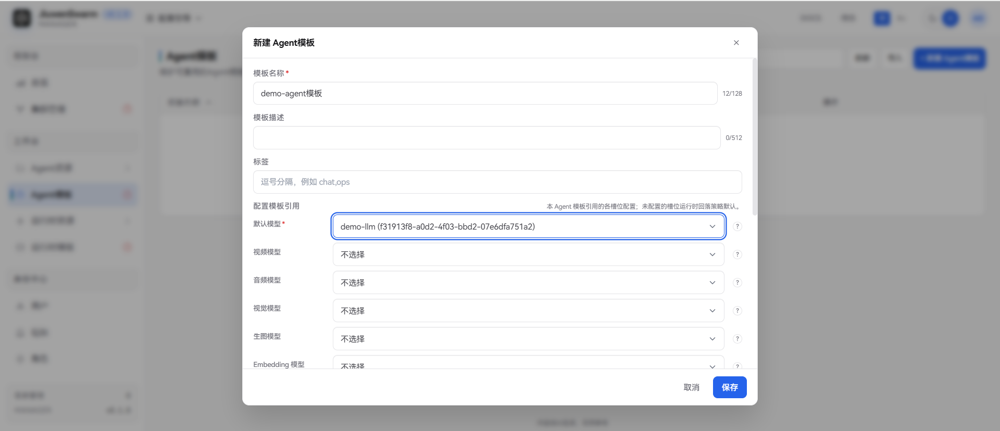

### 5. 创建运行时模板

部署工具包在部署期间会自动生成运行时模板(文件所在路径：`部署工具目录/conf/agentserver.json`)，先将该文件从部署机下载到本地，然后进入「工作台 → 运行时模板」，点击「导入」，选择部署工具包在部署期间自动生成的agentserver.json文件。

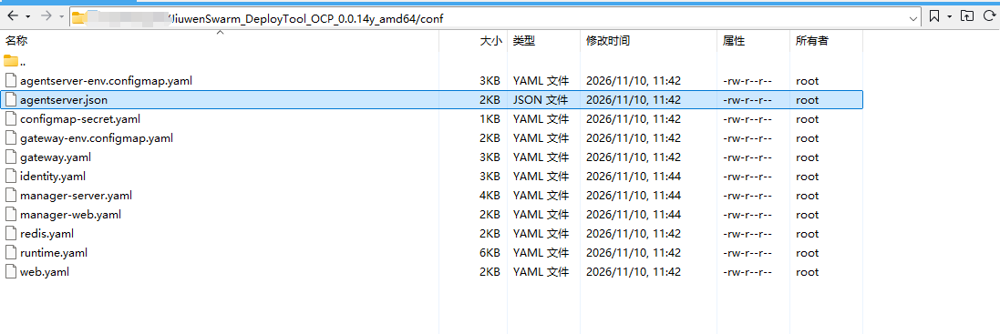

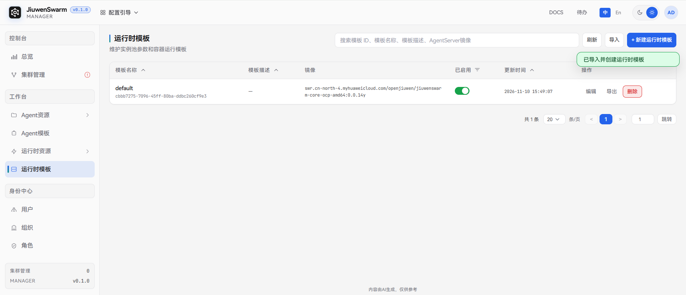

### 6. 新建集群

进入「集群管理」，点击「新建集群」，填写集群名称。服务地址有两种填写方式：

- **手动填写地址**（默认）：默认值为不带命名空间的服务名，适用于管理面与集群部署在同一命名空间的常规情况。如果有特殊部署方式，可修改为实际可达的地址。
- **自动生成地址**：填写命名空间后按命名空间拼出地址，集群部署在其他命名空间时选择此方式。

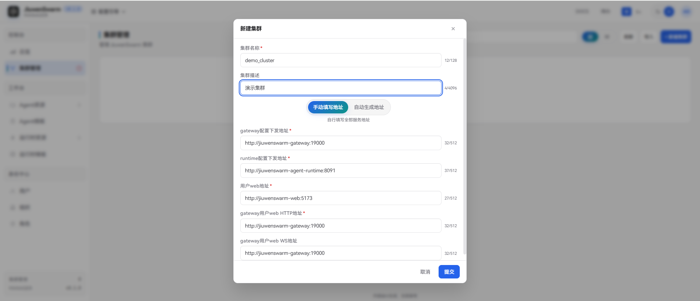

### 7. 配置集群准入

进入集群详情的「集群准入」页签，添加第 2 步的组织（或在「用户」页签添加用户）。登录权限为「拒绝」的条目优先于「允许」，过期时间留空表示永不过期。

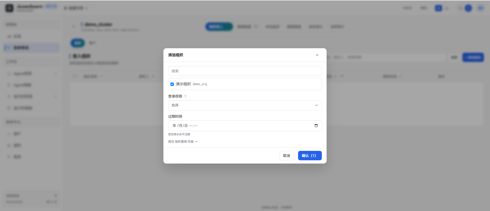

### 8. 配置集群配置

进入集群详情的「集群配置」页签：

- 在「Agent」页添加第4步的 Agent 模板。授权范围默认为全员可用，也可选择部分组织或用户。
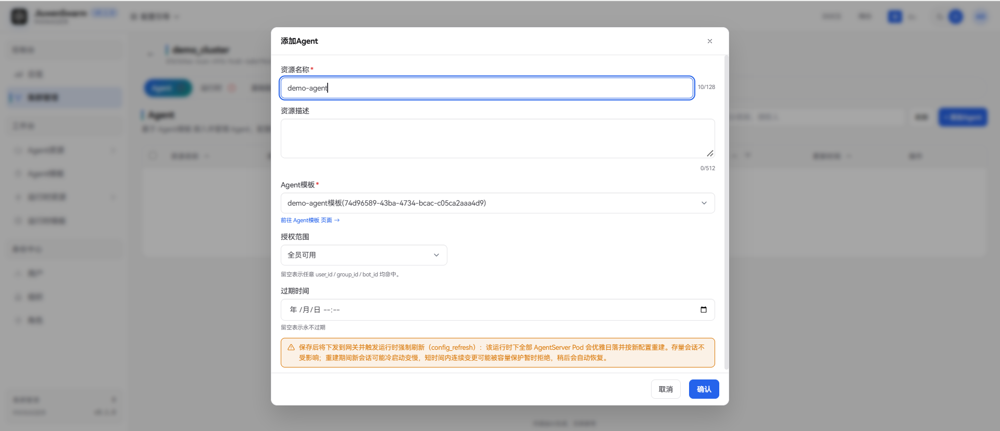
- 在「运行时」页添加第5步的运行时模板，授权范围含义相同。
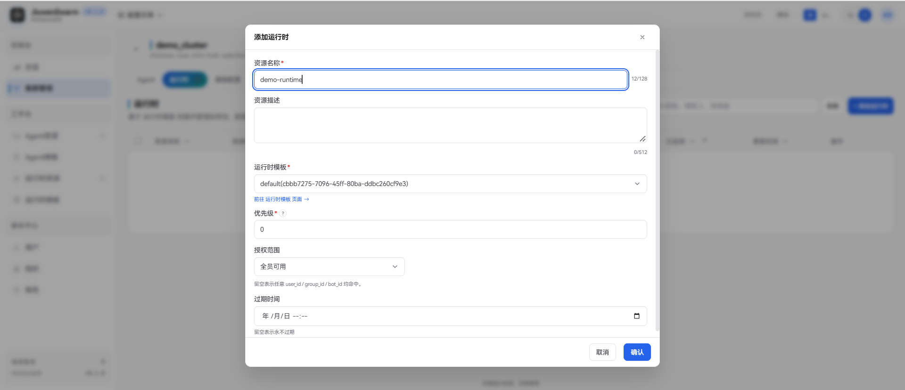

## 成员对话

使用前面创建的成员账号在登录页登录。


登录后系统会自动进入对话界面，在输入框中提问即可。
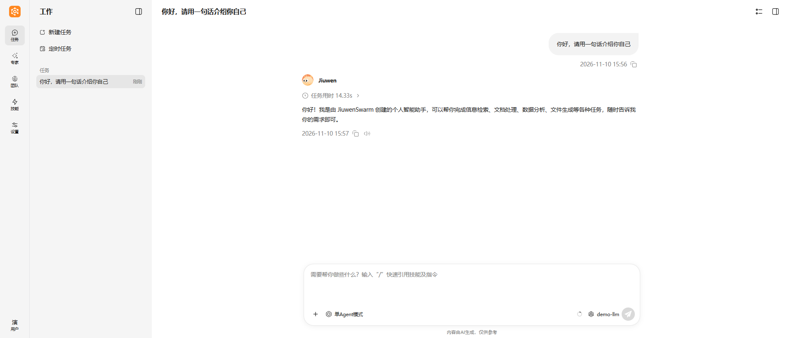

## 常见问题

**登录后提示"当前账号没有可用的 Agent 上下文组合"**

按"整体逻辑"中的三个条件逐项检查：1.成员或其所在组织是否在集群准入名单内且未过期、未被拒绝；2.Agent 授权范围是否覆盖该成员；3.运行时授权范围是否覆盖该成员。

**新建集群失败，提示 gateway health check failed**

管理面无法访问填写的Gateway地址。请确认集群已部署，以及地址与实际部署一致，并且从管理面后端能访问该地址。
