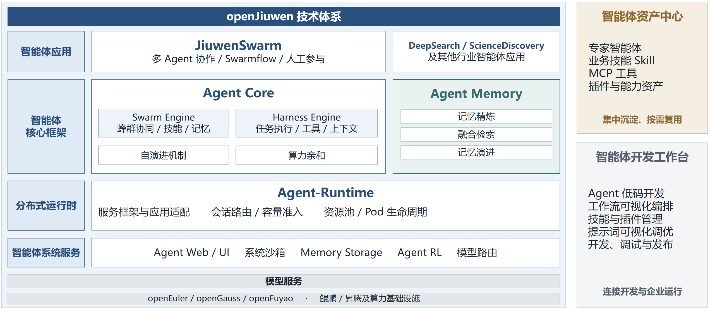
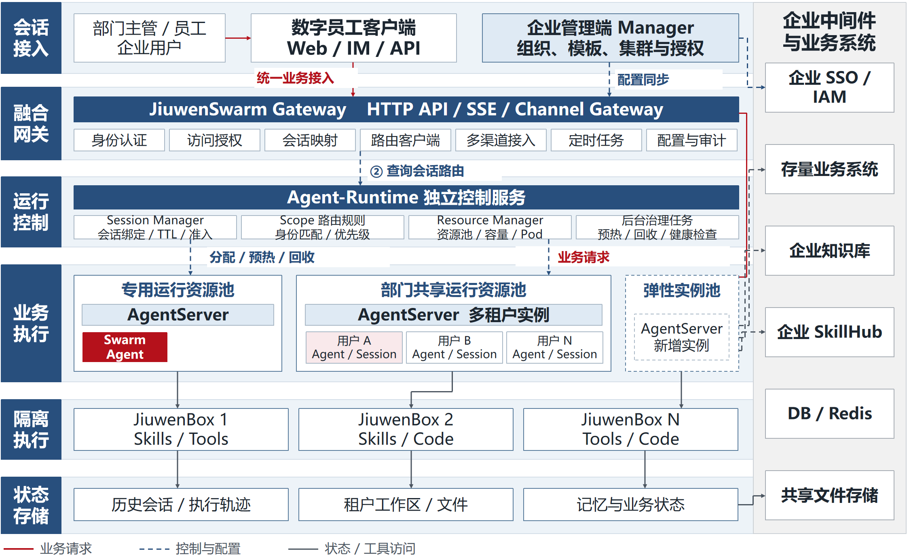
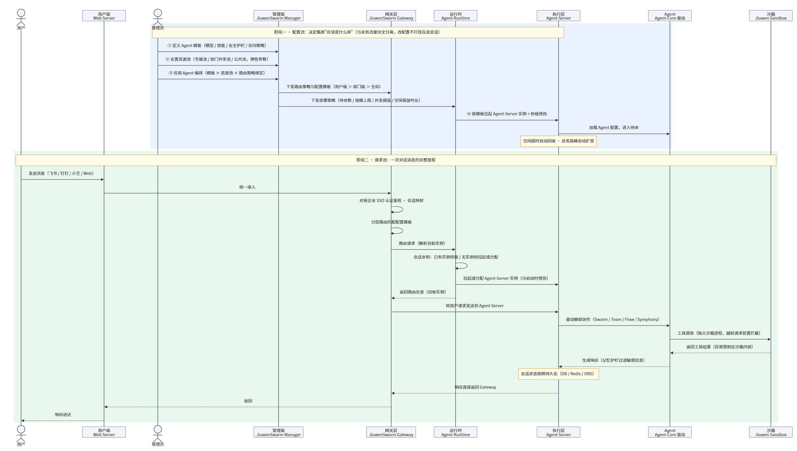
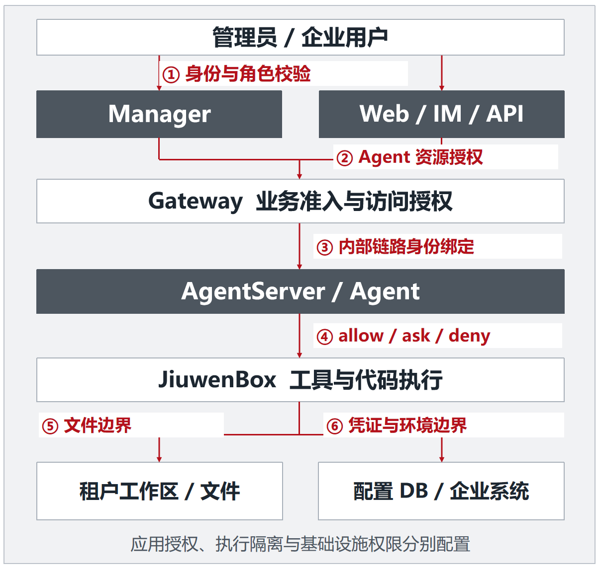

# JiuwenSwarm 企业版整体架构

> JiuwenSwarm 企业版背后的架构概念

## 架构全景

图 1. 企业级蜂群架构全景

JiuwenSwarm 位于多智能体业务协作层，Agent-Runtime 提供分布式运行时，复用 Core、Memory 与生态资产。

## 技术方案

图 2. 企业级蜂群技术方案

### 组件拆解

#### JiuwenSwarm Manager

Manager 为集群做出全局决策：资源池编排（定义资源规格与调度策略）、Agent 编排（定义集群可用 Agent 及其访问策略）、用户与组织准入管理、配额限制（覆盖工作空间占用、团队规模等维度）、状态监控与审计。所有配置变更全程留痕，可追溯、可审计、可回滚。**Manager 不在业务流量路径上——它下发策略、回收状态，不处理单次用户请求。**

#### JiuwenSwarm Gateway

网关是集群面向终端用户的前端，负责渠道管理、用户认证鉴权（对接企业已有身份体系，如 SSO 单点登录）、会话映射、消息管理、负载均衡与分发、定时任务管理。网关设计上考虑了水平扩缩——通过部署多个副本来扩容，并在副本之间平衡流量。**网关不执行任何 Agent 逻辑。**

#### openJiuwen Agent-Runtime

Agent-Runtime 负责监视待分配的会话请求，并选择 Agent-Server 实例来让会话在上面运行。调度决策考虑的因素包括：会话亲和、资源规格与调度策略、单实例并发阈值、空闲保留时长。它向下掌管集群物理资源的调度与分配——实例从创建、运行、空闲到回收全流程自动托管，空闲超时自动释放、业务高峰自动扩容；向上支撑会话亲和与上下文共享等企业级能力。**它不负责用户身份认证，也不接触用户数据。**

#### JiuwenSwarm Agent-Server

Agent-Server 是被运行时按需拉起的服务实例，职责与单机版执行层相同：Agent 管理、工具管理、技能管理、记忆管理。每个实例绑定独立的 workspace，文件、记忆、配置均按实例粒度收敛——这是多租户数据硬隔离的结构基础。**它不直接调度集群资源；工具调用不在实例内执行，而是下沉到沙箱资源池。**

#### openJiuwen Agent-Core

Agent-Core 使 Agent-Server 能够有效运行蜂群协作，负责管理 Agent 的执行与生命周期，包含 Harness、Core、Teams、Evolving 等多种协作模式。**它不碰基础设施与策略管控。**

#### JiuwenBox

沙箱是横切所有实例工具调用路径的安全组件。JiuwenBox 权限沙箱网关负责网关访问授权与越权请求前置拦截——未授权访问在入口处即被阻断；沙箱资源池以独立进程承载所有工具调用，每个实例拥有独立的受限工作目录。工具异常、资源滥用都被限制在沙箱内部，不会波及主进程与其他实例。**沙箱不存储业务数据。**

### 配置流与请求流

企业版的一切活动发生在两条完全分离的链路上：**配置流**自上而下，决定集群"应该是什么样"；**业务流**自用户而来，处理实际发生的事。管理面、用户面、网关、运行时、AgentServer、Agent、沙箱全链路时序图见《整体架构时序图.html》，浏览器打开即渲染。

图 3. JiuwenSwarm 企业版业务流程图

#### 配置流

1. **Agent 被定义。** 管理员在管理面定义一个集群可用的 Agent：用什么模型、配哪些技能、守什么安全护栏、谁可以用。

2. **资源池 被安置。** 管理员定义资源池的规格与调度策略——最小待命实例数、最大规模上限、单实例并发阈值、空闲保留时长等弹性参数，并把算力按组织与业务划分。比如分为专属实例池（核心高管 / 涉密场景）、部门级共享池、公共通用池三类。

3. **Agent 被应用。** Agent × 资源池 × 路由策略绑定到集群生效，决定"谁、在什么条件下、用哪个池里的哪个模板"。配置下发到 Gateway（路由策略与配置模板）与 Runtime（部署策略），全程留痕、可灰度、可回滚。

4. **Agent 被运行。** 运行时按模板拉起 Agent-Server 实例并驱动 Agent-Core 加载配置；新实例创建的同时即完成秒级预热，先于用户第一条消息就绪；此后空闲超时自动回收、业务高峰自动扩容，全生命周期托管。

#### 请求流

1. **进入**：企业用户可访问用户面网页或 IM 渠道，可访问由管理面分配，自己权限范围内可用的 Agent；
2. **认证**：用户面请求完成企业身份鉴权，统一接入送入网关；
3. **路由**：按分层路由策略匹配配置模板——用户级 > 部门级 > 全局兜底，决定进哪个资源池、用哪个 Agent；
4. **调度**：Agent-Runtime 执行会话亲和——已有实例继续服务；无实例则分配或冷启动；
5. **执行**：Agent-Server 加载 Agent 配置，驱动 Agent-Core 执行任务或展开协作；
6. **工具**：所有工具调用下沉到沙箱资源池的独立进程执行，越权请求被前置拦截，按需访问 SkillHub、MCP 及企业存量系统；
7. **落盘**：会话状态快照持久化；记忆写入前经安全护栏过滤，密码、Token、身份证号等敏感信息不进入记忆体系；
8. **返回**：响应沿原路送回用户面或 IM 渠道。

## 全链路安全

图 4. 纵深安全体系

企业版的安全遵循纵深防护原则——从身份到数据，从工具到执行，每一个边界都有防线：

- **应用授权**：用户身份认证、网关访问授权、Agent 服务访问授权依次校验，任一层不通过即被拦截；
- **数据隔离**：校验全部通过后，请求才触达实例绑定的专属 workspace——文件目录、记忆库、进程权限、会话数据均按实例独立，跨租户访问从架构上被排除；
- **执行隔离**：所有工具调用下沉到沙箱以独立进程执行，工具异常与资源滥用不波及主进程和其他实例；敏感信息在写入记忆前经安全护栏过滤，不进入记忆体系。

## 服务连续性

### 服务高可用

全链路具备异常自动检测、故障转移与服务降级能力，网关、运行时、管理面、用户面这些常驻服务均支持多副本部署，集群无单点故障——任一节点异常时，流量自动切换至健康副本，服务不中断。

### 零中断升级

非运行态配置支持热更新，变更即时生效；运行态配置通过 Pod 级滚动升级完成，逐副本替换，集群始终保有完整服务能力；被替换或回收的实例执行优雅退出，待在途会话处理完毕后方终止。升级全程服务不中断，用户零感知。

## 相关资源

- openJiuwen 社区：[GitHub](https://github.com/openJiuwen-ai) · [AtomGit](https://atomgit.com/openJiuwen)
- JiuwenSwarm 企业版仓库：[GitHub](https://github.com/JiuwenSwarm-ai/jiuwenswarm) · [AtomGit](https://atomgit.com/JiuwenSwarm/jiuwenswarm)（含 [agent-core](https://atomgit.com/JiuwenSwarm/agent-core)、[agent-runtime](https://atomgit.com/JiuwenSwarm/agent-runtime)）
