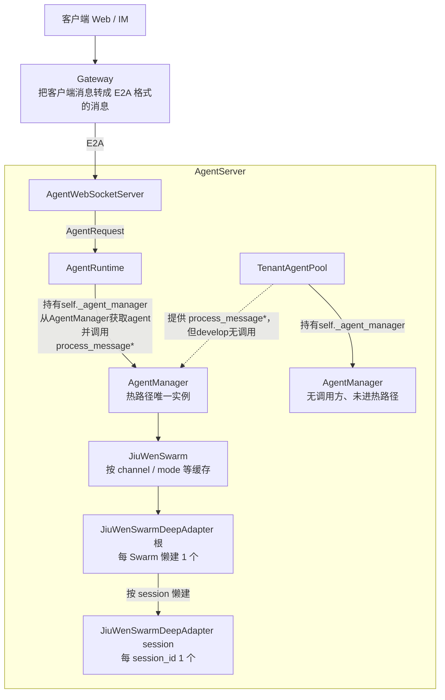
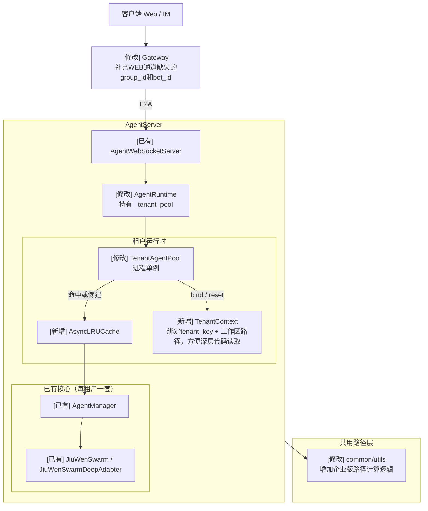
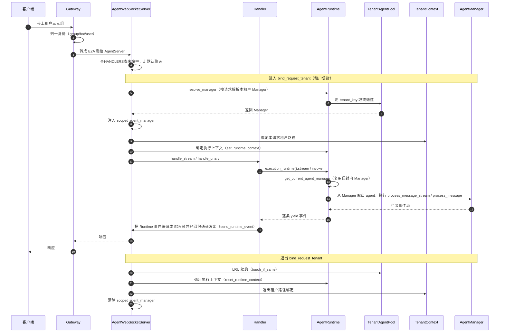
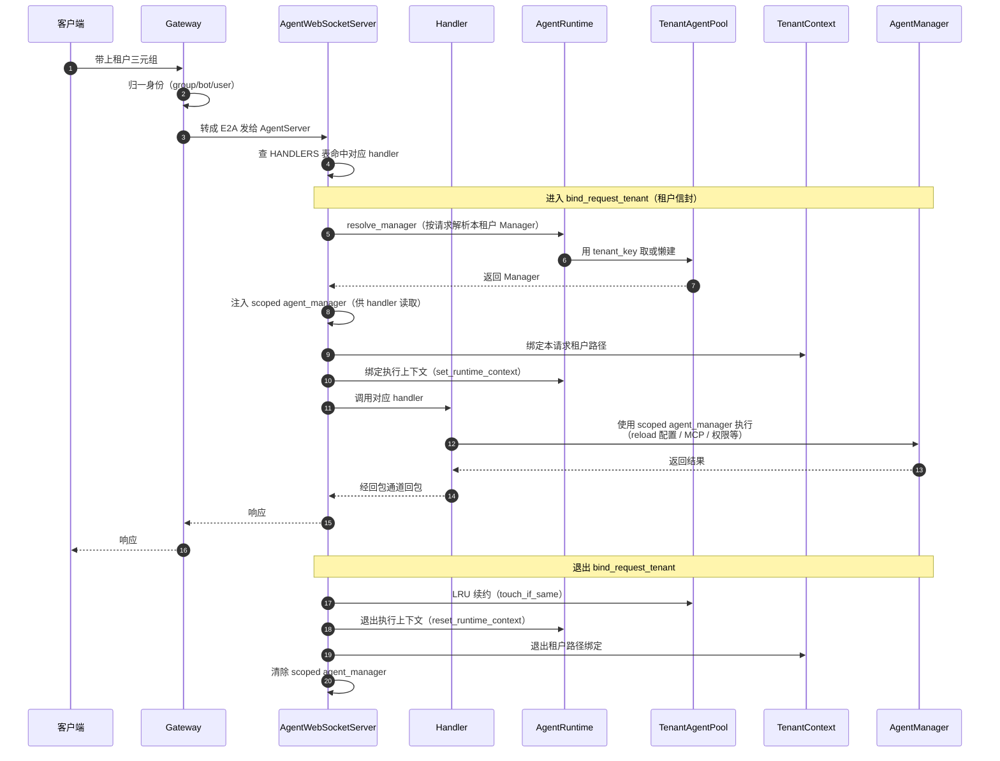
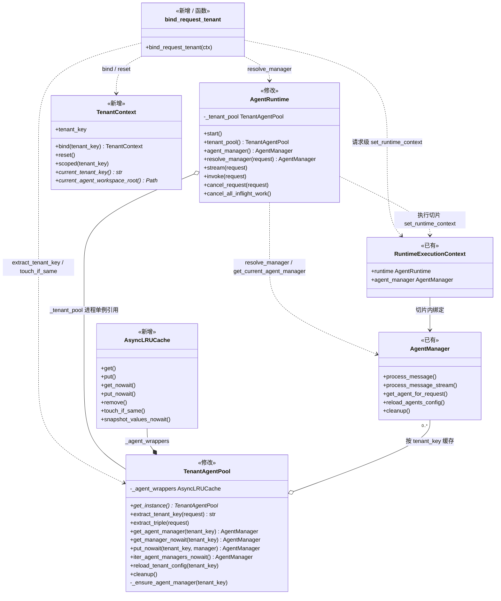

# AgentServer 多租户设计

## 需求背景

企业部署需要在同一套 AgentServer 进程内服务多个逻辑租户，并保证：

1. 运行时隔离：不同租户的AgentManager、工作区目录互不串扰。
2. 个人版兼容：合入多租户后，个人版须保持原有逻辑与数据不变：
   - 运行时实例：走同一套TenantAgentPool，但个人版进程内永远只有一个 AgentManager，对外与合入前单例行为一致；
   - 落盘路径：落盘路径仍用develop现有目录布局，不迁到企业版的workspace_{tenant_key}。

## 能力现状

**对象关系（实质单例）**

## 整体方案

### 租户 Key 约定

企业版用group_id（IM 侧常为 chat_id）、bot_id、user_id组成三元组，用MD5("{group_id}::{bot_id}::{user_id}")算出tenant_key，使用tenant_key用作池LRU key、企业版工作区目录名的多租户隔离Key。

三元组来源：
- 企业版：Web取WS握手query里的group_id、bot_id、user_id或HTTP头里的X-Group-Id、X-Bot-Id、X-User-Id，IM取入站Message上的chat_id、bot_id、user_id。
- 个人版：可附带身份字段(Web少量场景传user_id，IM传chat_id、bot_id、user_id），但池键固定默认tenant_key=MD5(default:default:default)，进程内单Manager，不按三元组分槽。个人版工作路径也保持和原来一致，不按照tenant_key划分工作路径，不影响个人版已有历史数据。

### 架构图

> 节点前缀：`[新增]` = develop 无、本次合入新增；`[修改]` = develop 已有、本模块需修改；`[已有]` = develop 已有、本模块不改。  

### 业务流程图

#### 1. 聊天默认路径

#### 2. 其他路径

> `session` / `skills` / `mcp` / `commands` 等查表命中 → 同一 `bind_request_tenant` 信封 → handler 用 scoped Manager。一般不进 Runtime。

### 类图

  
> 节点前缀：`[新增]` = develop 无、本次合入新增；`[修改]` = develop 已有、本模块需修改；`[已有]` = develop 已有、本模块不改。

