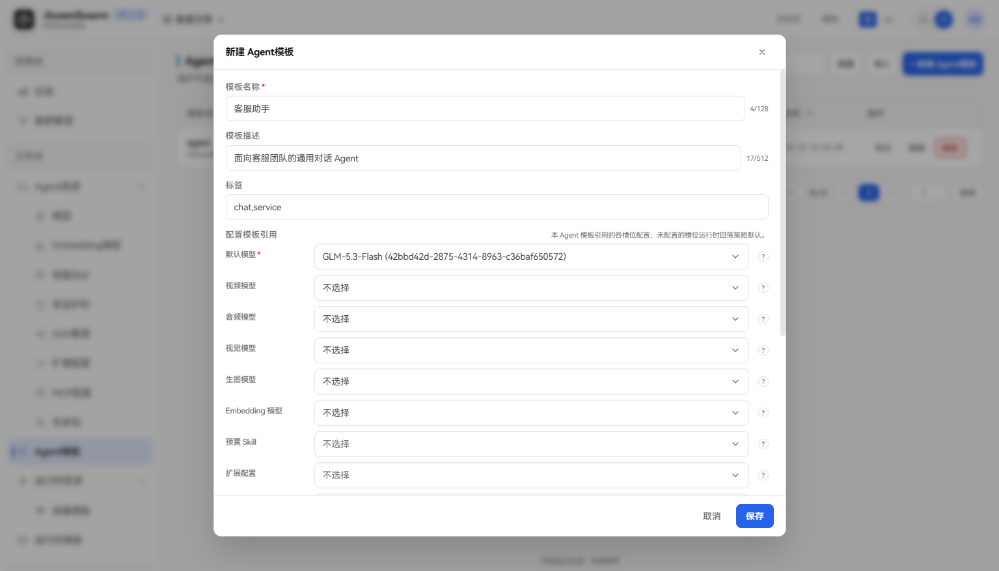
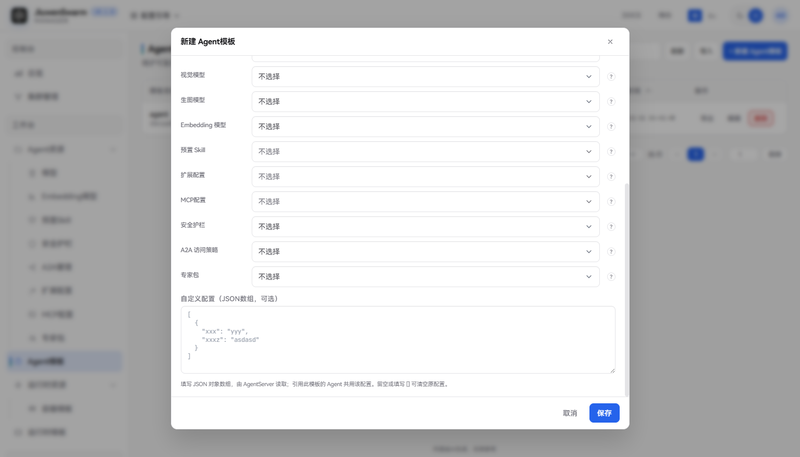

# Agent模板


## 功能说明

**Agent模板**是由管理员在管理面维护的一套可复用的 Agent 配置，用于把「Agent资源」中的各类资源组合在一起，例如使用哪个模型、启用哪些预置 Skill 和 MCP 服务、应用哪套安全护栏等。Agent 模板配置到集群并授权给组织或用户后，用户在用户面可选择已授权的Agent按该模板中的配置运行。

典型用途：

- 为不同业务场景准备不同的 Agent，例如客服助手、研发助手分别使用不同的模型和 Skill。
- 同一个 Agent 模板配置到多个集群，统一维护、一处修改。
- 按组织或用户授权不同的 Agent 模板，控制不同人群可使用的能力范围。

## 使用流程概览

完整生效链路如下：

1. 在「工作台 → Agent资源」中创建需要的资源，至少创建一个模型。
2. 在「工作台 → Agent模板」新建 Agent 模板，在「配置模板引用」中选择资源。
3. 将该 Agent 模板配置到集群，并授权给组织或用户。
4. 用户登录用户面后，即可使用该 Agent 进行对话。

## 管理面配置

### 新建 Agent 模板

进入「工作台 → Agent模板」，点击「新建 Agent模板」，填写以下信息后点击「保存」：





| 字段 | 说明 |
| ---- | ---- |
| **模板名称** | 必填，管理面展示用名称，在集群配置中选择 Agent 模板时显示，最多 128 个字符 |
| **模板描述** | 可选，说明用途，最多 512 个字符 |
| **标签** | 可选，自定义标签，多个标签用英文逗号分隔，如 `chat,ops`，用于分类和搜索 |
| **配置模板引用** | 为各槽位选择要引用的资源，下拉列表中只列出对应资源页中已启用的资源。若暂无选项，可点击槽位右侧的「?」图标，跳转到对应资源页创建或启用资源。 |
| **自定义配置** | 可选，填写 JSON 对象数组，由 AgentServer 读取，引用此模板的 Agent 共用该配置，详见[自定义配置](#自定义配置) |


#### 自定义配置

「自定义配置」用于向 AgentServer 传递槽位之外的附加配置，格式为 JSON 对象数组，数组中每个元素必须是对象。留空或填写 `[]` 可清空原有配置。

例如，当 MCP 服务需要动态获取访问令牌时，可在此填写该 Agent 实例的客户端凭据，AgentServer 会使用数组中第一组完整的 `client_id` 和 `client_secret`：

```json
[
  {
    "client_id": "customer-agent",
    "client_secret": "******"
  }
]
```

若管理面开启了 Agent 客户端注册功能，新建或编辑弹框中会额外显示「Keycloak Agent 客户端」区域。填写 Client ID 并点击注册后，系统会在 Keycloak 中创建对应客户端并托管密钥，效果等同于在自定义配置中手工填写凭据。已注册的模板 Client ID 不可修改；删除模板时会一并删除绑定的 Keycloak 客户端。

### 编辑、禁用与删除

- **编辑**：点击行内「编辑」，可修改模板信息和槽位引用。模板已配置到集群时，保存后变更会下发到网关并生效。
- **禁用**：通过列表中「已启用」列的开关启用或禁用。禁用后，已配置到集群中引用该模板的 Agent 将读取不到该模板的配置。
- **删除**：点击行内「删除」。仍被集群中的 Agent 引用时删除会失败，需先在「控制台 → 集群管理」的集群配置中移除引用该模板的 Agent。

### 配置到集群

Agent 模板需要配置到集群并授权后，才会下发到运行面供用户使用。具体操作参考[快速上手](../../快速开始/快速上手.md)中的「配置集群配置」章节。

## 注意事项

- 修改已配置到集群的 Agent 模板，保存后会触发该运行时下的全部 AgentServer Pod 优雅下线并按新配置重建，已有会话不受影响。重建期间新会话启动可能变慢，短时间内连续修改可能被容量保护暂时拒绝，稍后会自动恢复。建议在业务低峰期修改。
