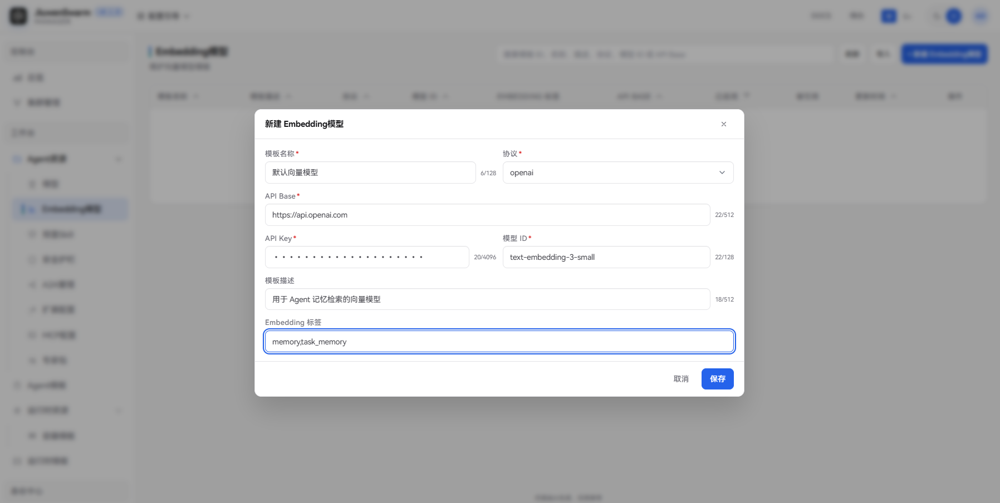
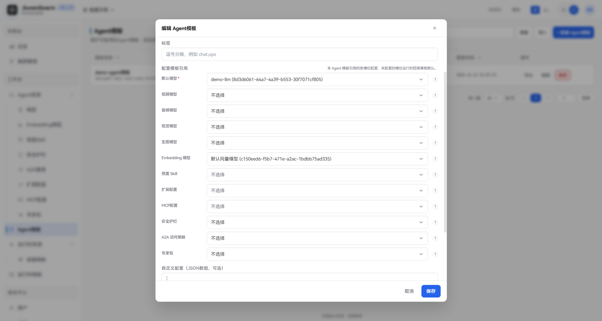

# Embedding模型

## 功能说明

**Embedding模型**是由管理员在管理面统一维护的向量模型连接配置，包括服务地址、API Key、模型 ID 等。它本身不会直接生效，需要被 **Agent 模板** 的「Embedding 模型」槽引用，再随 Agent 模板配置到集群后，才会下发到运行面，供 Agent 把文本转为向量，以支持语义检索与记忆相关能力。

下发后，运行面主要在以下能力中使用该配置：

| 能力 | 作用 |
| ---- | ---- |
| **Agent 记忆** | 对工作区记忆内容做向量化索引与语义检索（如 `memory_search`）。 |
| **编程记忆** | Code 模式下对编码相关记忆做向量检索。 |
| **经验记忆** | 经验检索等工具（`experience_retrieve`、`experience_learn`、`experience_clear`）在做做相似度匹配时使用向量模型。 |

>说明： 以上能力依赖真实 Embedding 服务完成语义匹配，未在 Agent 模板中配置 Embedding 模型时，相关语义检索可能降级或不可用，但不影响普通文本对话。

典型用途：

- 由管理员统一接入企业采购或私有化部署的 Embedding 服务，终端用户无需也无法自行配置 API Key。
- 同一个 Embedding 模型被多个 Agent 模板复用，修改一次即可同步到所有引用它的集群。
- 需要记忆检索、编程记忆或经验记忆时，在对应 Agent 模板中配置 Embedding 模型。

## 使用流程概览

完整生效链路如下：

1. 在管理面「工作台 → Agent资源 → Embedding模型」新建 Embedding 模型。
2. 在「工作台 → Agent模板」的「配置模板引用」中，为「Embedding 模型」槽选择该模型。
3. 将该 Agent 模板配置到集群，并授权给组织或用户。
4. 用户登录用户面后，使用该 Agent 时，运行面按模板中的 Embedding 配置进行向量化，无需用户额外操作。

## 管理面配置

### 新建 Embedding模型

进入「工作台 → Agent资源 → Embedding模型」，点击「新建 Embedding模型」，填写以下信息后点击 **保存**：

| 字段 | 说明 |
| ---- | ---- |
| **模板名称** | 必填，管理面展示用名称，在 Agent 模板中选择 Embedding 模型时显示，最多 128 个字符。 |
| **协议** | 必填，Embedding 服务的接口协议。当前管理面可选值为 `openai`，兼容 OpenAI Embeddings 接口的服务选择该项即可。 |
| **API Base** | 必填，Embedding 服务的接口地址，须为合法的 `http(s)` URL，最多 512 个字符。生产环境应使用 `https` 地址，使用 `http` 时，API Key 和请求内容将以明文传输 。|
| **API Key** | 必填，访问 Embedding 服务的密钥，输入后以密文显示，最多 4096 个字符。 |
| **模型 ID** | 必填，上游 Embedding 模型名称（调用时传给服务的 `model` 参数），如 `text-embedding-3-small`，最多 128 个字符。 |
| **模板描述** | 可选，说明用途，最多 512 个字符。 |

### 编辑、禁用与删除

- **编辑**：点击行内「编辑」，可修改模板信息。被集群中的 Agent 模板引用时，保存后变更会下发到网关并生效。
- **禁用**：通过列表中「已启用」列的开关启用或禁用。禁用后，该模型不再出现在 Agent 模板的 Embedding 模型选择列表中，已引用该模型的 Agent 也将读取不到该模型，相当于对应槽位未配置。
- **删除**：点击行内「删除」。仅「被引用」为 0 的 Embedding 模型可以删除，仍被 Agent 模板引用时删除会失败。

### 绑定到 Agent 模板并配置到集群

Embedding 模型需要先绑定到 **Agent 模板** 的「Embedding 模型」槽，再将该 Agent 模板配置到集群，才会下发到运行面生效。一个 Agent 模板至多引用一条 Embedding 模型。

1. **绑定 Embedding 模型**：进入「工作台 → Agent模板」，新建或编辑目标模板，在「配置模板引用」的 **Embedding 模型** 槽中选择已启用的 Embedding 模型并保存。

   

2. **配置到集群**：参考[快速上手](../../../快速开始/快速上手.md)中的「配置集群配置」章节，将该 Agent 模板添加到集群并授权。

## 用户面使用

用户登录用户面后，系统会按其被授权的 Agent 模板自动加载 Embedding 配置，无需用户做任何配置，用户面也没有单独的 Embedding 选择入口。

说明：

- 企业版用户不能自行添加或切换 Embedding 模型。
- 管理员修改 Agent 模板中的 Embedding 模型或 Embedding 模型本身的配置后，运行面刷新完成即生效，新会话会使用新配置。

## 注意事项

- 修改已被集群中 Agent 引用的 Embedding 模型，保存后会触发该运行时下的全部 AgentServer Pod 优雅下线并按新配置重建，已有会话不受影响。重建期间新会话启动可能变慢，短时间内连续修改可能被容量保护暂时拒绝，稍后会自动恢复。建议在业务低峰期修改。
- API Key 仅保存在管理面并下发到运行面，导出文件中会被脱敏，跨环境导入新 Embedding 模型时需重新填写。
