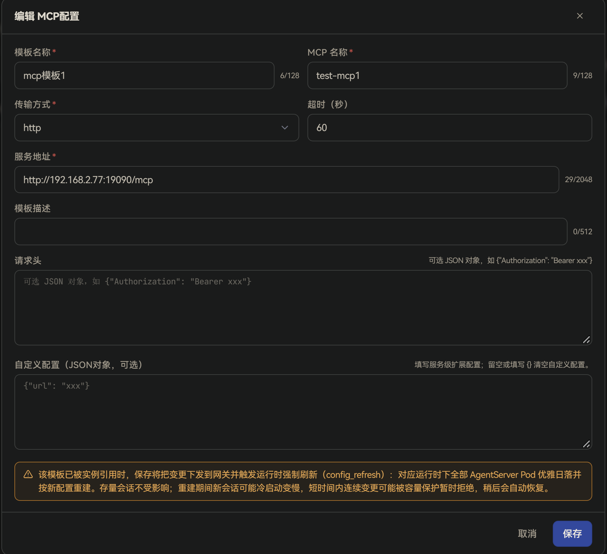
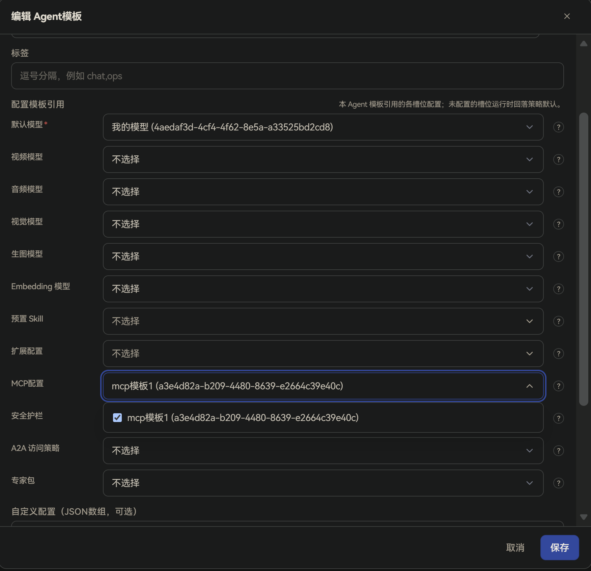
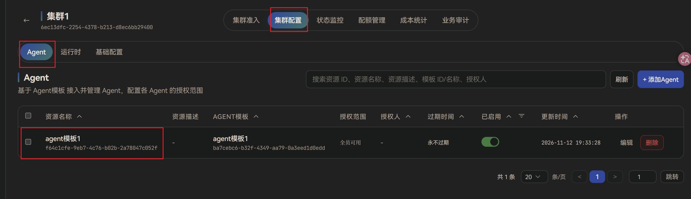
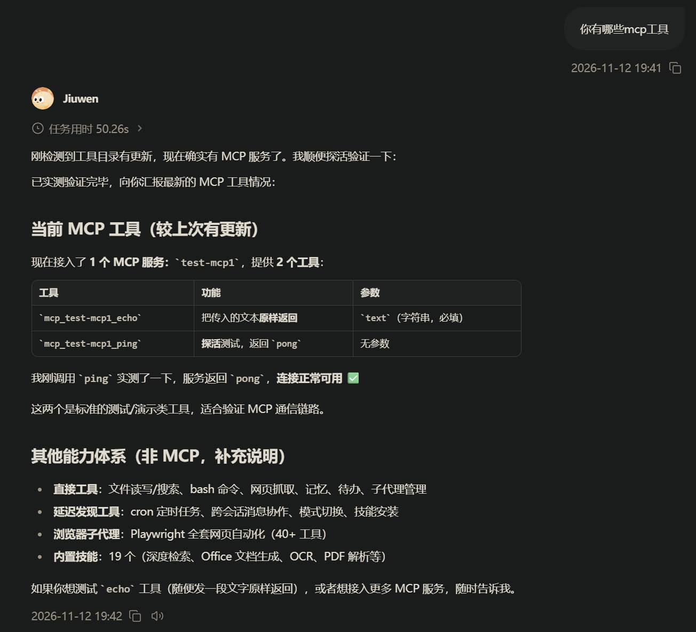

# MCP配置
## 功能说明
**MCP配置**是由管理员在管理面统一维护的远程 MCP 服务连接信息。

**MCP**（Model Context Protocol，模型上下文协议）可以通俗理解成：给 Agent 外挂一套「工具服务器」的标准协议。Agent 本身不会内置所有能力，而是通过 MCP 去连接外部服务；这些服务对外提供若干**工具**（例如查数据库、调内部 API、读写特定系统），Agent 在对话过程中可按需调用它们。

MCP 配置本身不会直接生效，需要被 **Agent 模板** 引用，再随 Agent 模板配置到集群后，才会下发到运行面。运行面收到后，会用这些 MCP 配置**整表替换**本地 `config.yaml` 里的 `mcp.servers`（也就是：企业侧下发的 MCP 会覆盖、取代原先只写在本地 yaml 里的 MCP 列表）。

与「模型」不同：一个 Agent 模板的「默认模型」等槽位通常只能选一条，而 **MCP配置** 槽位可以同时引用**多条** MCP，Agent 可同时挂接多个工具服务器。

典型用途：

+ 由管理员统一接入企业内部或第三方提供的 MCP 工具服务，终端用户无需也无法自行填写服务地址和鉴权信息。
+ 同一个 MCP 配置被多个 Agent 模板复用，修改一次即可同步到所有引用它的集群。
+ 为不同 Agent 模板挂不同工具集，例如客服 Agent 接工单 MCP，研发 Agent 接代码/流水线 MCP。

当前管理面面向企业场景，新建时仅支持**远程 MCP**（通过网络访问的服务），传输方式可选 `http`、`streamable-http`、`sse`。不在界面上配置本地进程型（`stdio`）MCP。

## 使用流程概览
完整生效链路如下：

1. 在管理面「工作台 → Agent资源 → MCP配置」新建 MCP。
2. 在「工作台 → Agent模板」的「配置模板引用」中，为「MCP配置」槽位选择一条或多条已启用的 MCP。
3. 将该 Agent 模板配置到集群，并授权给组织或用户。
4. 用户登录用户面后，对话中的 Agent 会按模板加载这些 MCP 工具，用户无需单独配置。

## 管理面配置
### 新建 MCP配置
进入「工作台 → Agent资源 → MCP配置」，点击「新建 MCP配置」，填写以下信息后点击 **保存**：

| 字段 | 说明 |
| --- | --- |
| **模板名称** | 必填，管理面展示用名称，在 Agent 模板中选择 MCP 时显示，最多 128 个字符 |
| **MCP 名称** | 必填，写入运行面 `mcp.servers[]` 的服务名，须在同一 Agent 所引用的 MCP 列表中保持唯一，如 `demo-tools`，最多 128 个字符 |
| **传输方式** | 必填，与 MCP 服务通信的方式，可选 `http`、`streamable-http`、`sse`，默认 `http`。`http` 在落库/下发时通常会归一为 `streamable-http`（Streamable HTTP，一种可持续推送数据的 HTTP 传输方式）；`sse` 为基于 Server-Sent Events（服务器推送事件）的传输 |
| **服务地址** | 必填，远程 MCP 服务的访问地址，须为合法的 `http(s)` URL，最多 2048 个字符。生产环境应使用 `https` 地址，使用 `http` 时，请求头中的令牌等敏感信息将以明文传输 |
| **超时（秒）** | 可选，调用该 MCP 服务的超时时间，须为正数 |
| **模板描述** | 可选，说明用途，最多 512 个字符 |
| **请求头** | 可选，访问 MCP 服务时附加的 HTTP 头，填写 JSON 对象，常用于鉴权，如 `{"Authorization": "Bearer xxx"}` |
| **自定义配置** | 可选，服务级扩展配置，填写 JSON 对象；留空或填写 `{}` 表示无自定义项。不能写入已被基础字段占用的键：`name`、`transport`、`url`、`headers`、`auth_headers`、`timeout_s`、`enabled` |

### 编辑、禁用与删除
+ **编辑**：点击行内「编辑」，可修改模板信息。被集群中的 Agent 模板引用时，保存后变更会下发到网关并生效。
+ **禁用**：通过列表中「已启用」列的开关启用或禁用。禁用后，该 MCP 不再出现在 Agent 模板的 MCP 选择列表中；已引用它的 Agent 也将读不到该配置，相当于未挂接该工具服务器。启用开关只认模板行上的「已启用」，不会使用 MCP 条目内部的 `enabled` 字段。
+ **删除**：点击行内「删除」。仅「被引用」为 0 的 MCP 可以删除，仍被 Agent 模板引用时删除会失败。

### 绑定到 Agent 模板并配置到集群
MCP 需要先绑定到 **Agent 模板** 的「MCP配置」槽位，再将该 Agent 模板配置到集群，才会下发到运行面生效。

1. **绑定 MCP**：进入「工作台 → Agent模板」，新建或编辑目标模板，在「配置模板引用」中添加 **MCP配置** 槽位，选择一条或多条已启用的 MCP 并保存。

   

2. **配置到集群**：参考[快速上手](../../../快速开始/快速上手.md)中的「配置集群配置」章节，将该 Agent 模板添加到集群并授权。

   

## 用户面使用
用户登录用户面后，系统会按其被授权的 Agent 模板自动加载 MCP 工具，无需用户做任何配置。对话过程中，当任务需要外部工具时，Agent 会按已挂接的 MCP 发起调用。

说明：

+ 企业版用户面不提供 MCP 的自行添加或修改入口，工具列表由管理员通过 Agent 模板统一下发。
+ 管理员修改 Agent 模板中引用的 MCP，或修改 MCP 配置本身后，运行面刷新完成即生效，新会话会使用新配置。

## 注意事项
+ 同一 Agent 模板引用多条 MCP 时，各条的 **MCP 名称** 不要重复，否则运行面无法正确区分服务。
+ 请求头中常含 Bearer Token 等密钥：生产环境请使用 `https`；导出文件中敏感信息可能被脱敏，跨环境导入时需重新填写。

