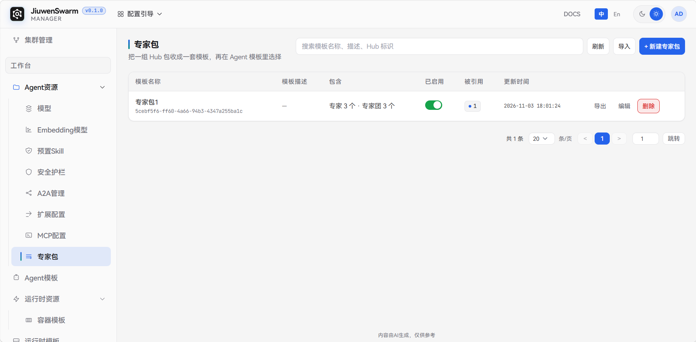
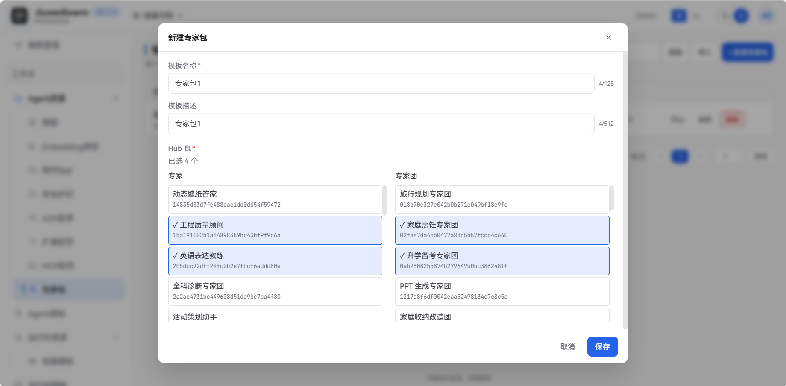
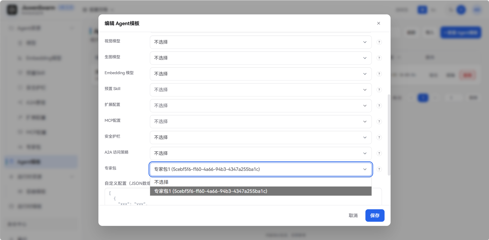
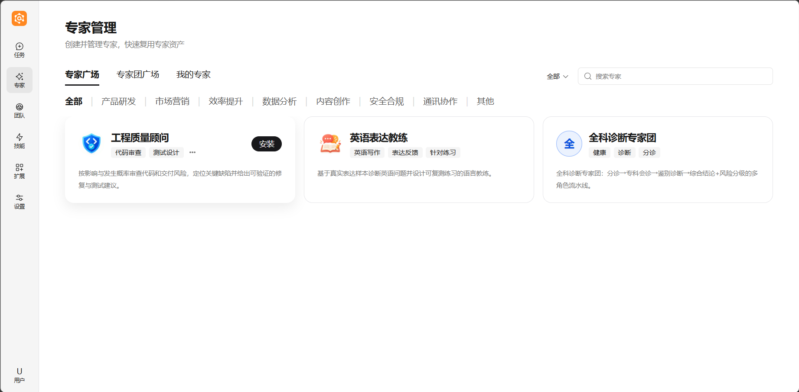
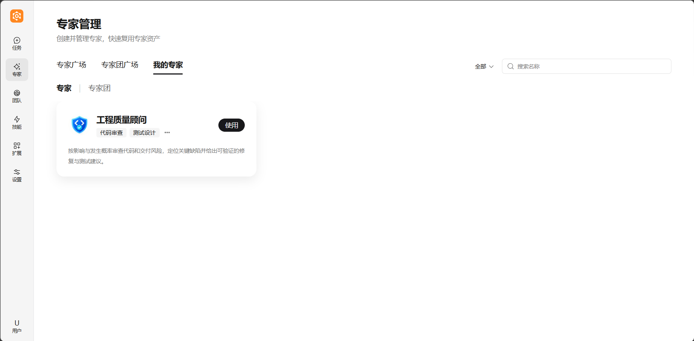
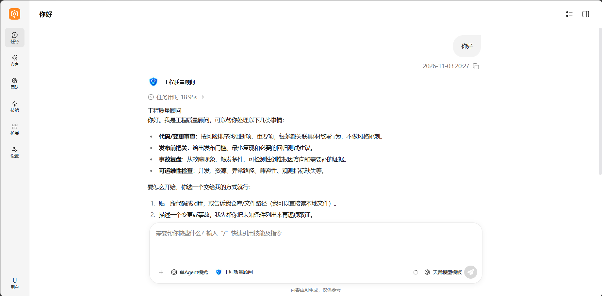
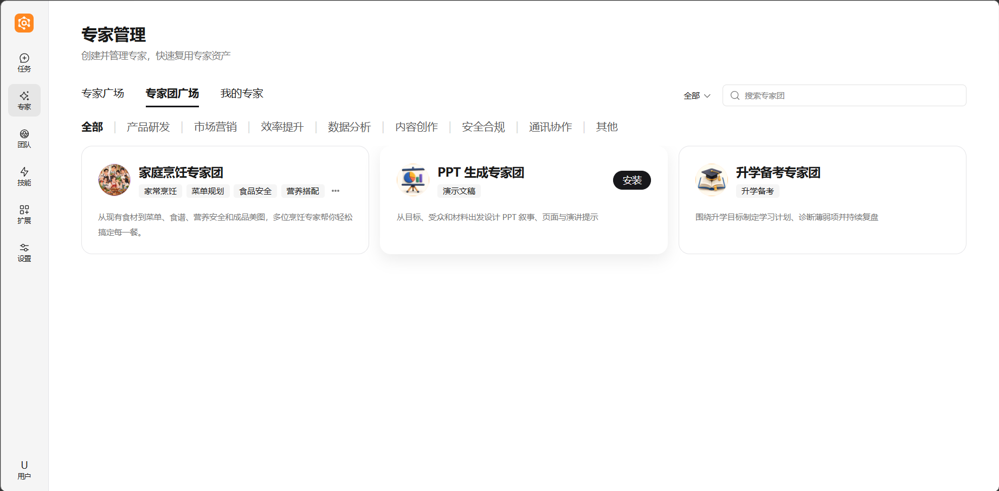
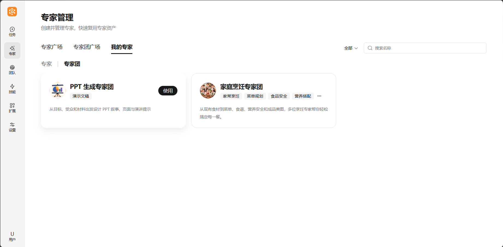
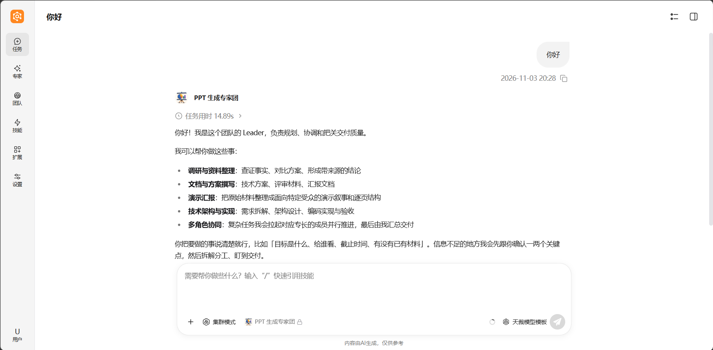

# 专家包

## 功能说明

**专家包**用来规定某个 Agent 允许用户安装和使用哪些专家、专家团。

管理员先在「专家包」里勾选允许的内容并保存；再在 Agent 模板里选中这份专家包，把该模板配到集群并授权后，用户才能在对话「专家管理」里看到、安装和选用这些专家或专家团。一个 Agent 模板只能绑定一份专家包。未绑定前，用户侧没有可安装的专家或专家团。

典型用途：

- 由管理员统一圈定企业允许使用的专家和专家团，终端用户只安装这一套里的内容。
- 同一套专家包被多个 Agent 模板复用，增减内容后保存即可同步到所有已配置该模板的集群。
- 为不同 Agent 模板准备不同的组合，例如研发类 Agent 使用代码审查专家，办公类 Agent 使用文档和演示专家团。

### 相关配置项

以下项在企业部署目录的 `.env.custom` 中配置（含义与取值见部署包 `.env.example`）；使配置生效的部署步骤见[《集群部署指南》](../../../快速开始/集群部署指南.md)。

| 配置项 | 默认值 | 说明 |
| ---- | ---- | ---- |
| `TEAM_SKILLS_HUB_BASE_URL` | 空（进程内默认 `https://swarmskills.openjiuwen.com`） | 部署时配置；决定管理面拉取可选专家/专家团列表、以及运行侧相关请求的服务地址。 |

## 使用流程概览

完整生效链路如下：

1. 在管理面「工作台 → Agent资源 → 专家包」新建专家包。
2. 在「工作台 → Agent模板」的「配置模板引用」中，为「专家包」槽选择该专家包。
3. 将该 Agent 模板配置到集群，并授权给组织或用户。
4. 已授权用户打开用户面聊天页，在「专家管理」中安装并选用这套包里的专家或专家团。

## 管理面配置

### 入口与列表

进入「工作台 → Agent资源 → 专家包」。列表展示模板名称、模板描述、**包含**、已启用、被引用和更新时间。**包含**按这一套里的内容计数，例如「专家 3 个 · 专家团 3 个」。搜索按模板名称、模板描述和资产标识。页头可以刷新、导入，每一行可以导出。

### 新建专家包

点击「新建专家包」。页面分「专家」「专家团」两栏列出可选项，勾选至少一项，填写以下信息后点击 **保存**：

| 字段 | 说明 |
| ---- | ---- |
| **模板名称** | 必填，管理面展示用名称，在 Agent 模板中选择专家包时显示，最多 128 个字符 |
| **模板描述** | 可选，说明用途，最多 512 个字符 |

### 编辑、禁用与删除

- **编辑**：点击行内「编辑」，可修改名称、描述，也可以增减已勾选的专家或专家团。被集群中的 Agent 模板引用时，保存后变更会下发到网关并生效。
- **禁用**：通过列表中「已启用」列的开关启用或禁用。禁用后，该专家包不再出现在 Agent 模板的专家包选择列表中。已经配置到集群、且引用了这一套的 Agent，其用户也不能再安装和使用这套包。
- **删除**：点击行内「删除」。仅「被引用」为 0 的专家包可以删除，仍被 Agent 模板引用时删除会失败。先在那些 Agent 模板上取消选择，再回到专家包页删除。
- **被引用**：数字是引用这一套的 Agent 模板数。点击后进入 Agent 模板页。

### 导入与导出

- **导出**：在某一行点击「导出」，下载这一套专家包模板。
- **导入**：页头点击「导入」，选择此前导出的文件。新的模板 ID 会写入管理面，仍要在 Agent 模板里选中后才下发。相同模板 ID 且内容一致时沿用已有行。相同模板 ID 但包组合不同时导入失败，不会覆盖。

### 绑定到 Agent 模板并配置到集群

专家包需要先绑定到 **Agent 模板** 的「专家包」槽上，再将该 Agent 模板配置到集群，才会下发到运行面生效。

1. **绑定专家包**：进入「工作台 → Agent模板」，新建或编辑目标模板，在「配置模板引用」的 **专家包** 槽中选择已启用的专家包并保存。该槽至多一条。槽旁边的引导可回到专家包页。

   

2. **配置到集群**：参考[快速上手](../../../快速开始/快速上手.md)中的「配置集群配置」章节，将该 Agent 模板添加到集群并授权。

## 用户面使用

已授权用户打开用户面聊天页后，左侧点击 **专家**，进入「专家管理」。专家广场和专家团广场列出当前 Agent 绑定的那一套，包含尚未安装的内容。

### 安装专家

1. 打开 **专家广场**。
2. 在卡片上点击 **安装**，或打开详情后再点击 **安装**。
3. 安装完成后，切到 **我的专家 → 专家**，可以看到这一份。

对话处在 **单Agent模式** 时，选中已安装的专家再发送。集群模式不能选专家。

### 安装专家团

1. 打开 **专家团广场**。
2. 在卡片上点击 **安装**，或打开详情后再点击 **安装**。
3. 安装完成后，切到 **我的专家 → 专家团**，可以看到这一份。

选用专家团时，先把对话切到 **集群模式**。这条团队会话还没发出第一条消息时才能选择；发出之后不能补选，也不能更换。集群模式里如果已经选了团队技能，专家团不能再选。

## 注意事项

- 管理员在已配置到集群的专家包里取消某个专家或专家团并保存后，变更会发到引用了该专家包的集群。用户刷新后，广场、我的专家和输入框都不再出现该项，已经安装的也不能再选用。
- 不再被任何 Agent 模板引用的专家包，可以在专家包页删除。
