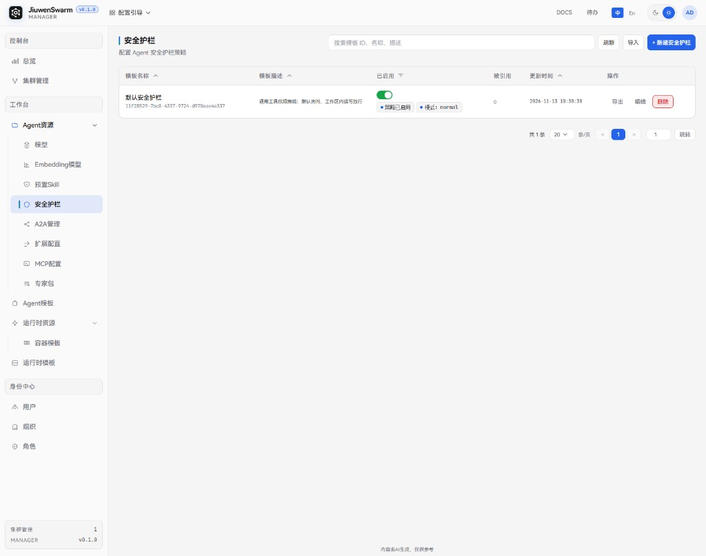
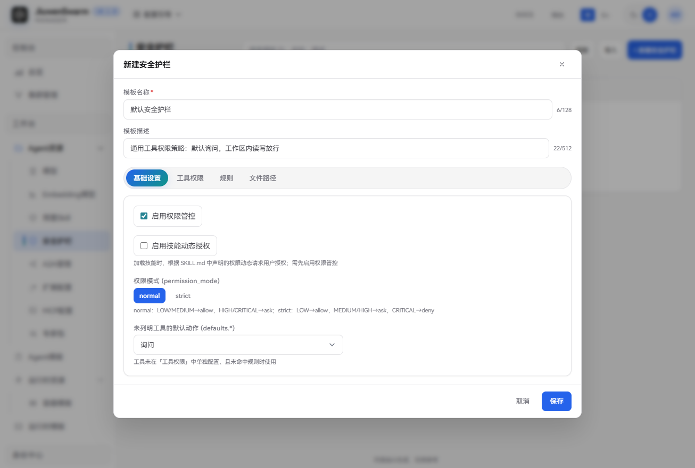
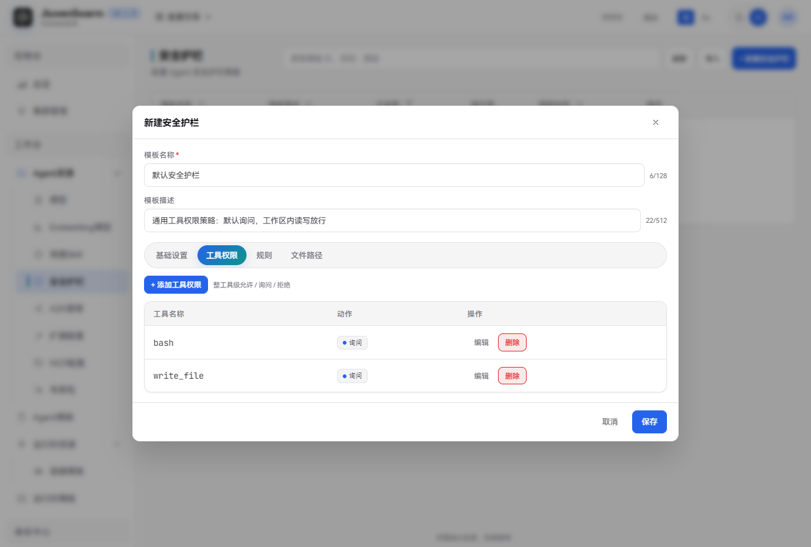
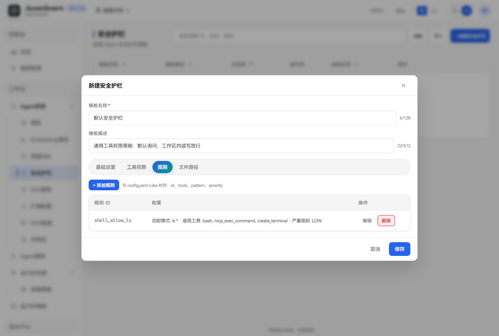
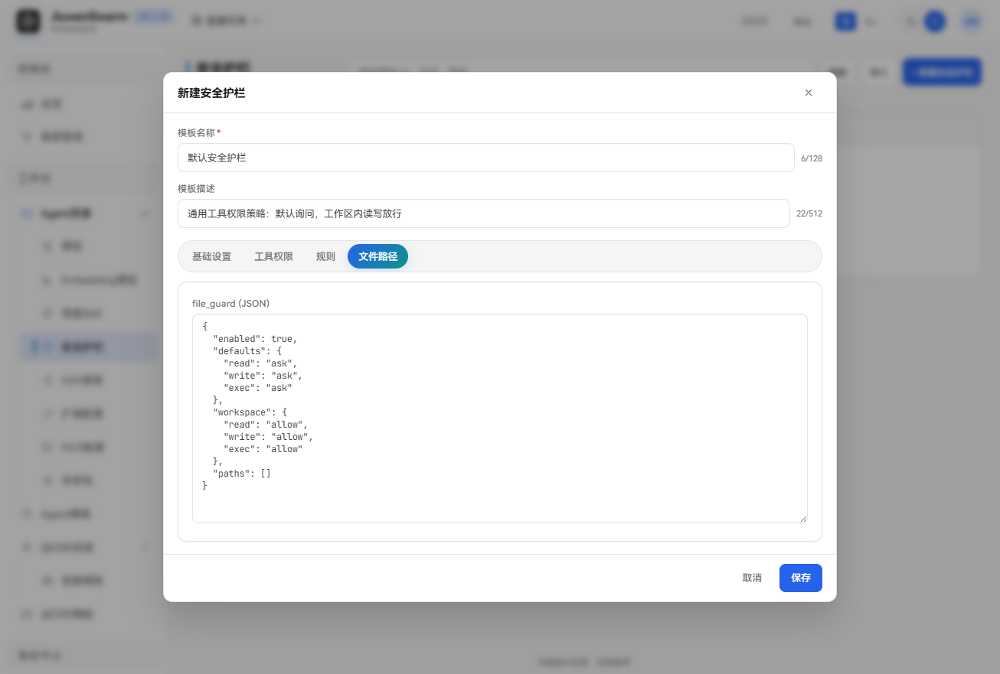
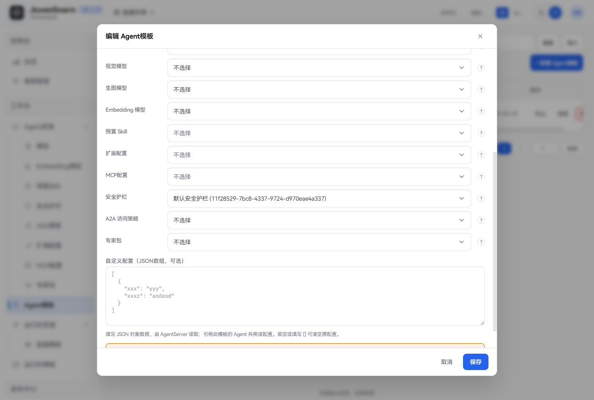

# 安全护栏


## 功能说明

**安全护栏**是由管理员在管理面统一维护的工具调用权限策略模板，用于规定 Agent 在调用工具时是直接执行（allow）、先询问用户（ask），还是直接拒绝（deny）。策略内容与运行面 `config.yaml` 中的 `permissions` 段结构一致，包括权限总开关、权限模式、默认动作、按工具配置、参数级规则，以及文件路径防护（`file_guard`）。

安全护栏本身不会直接生效，需要被 **Agent 模板** 的「安全护栏」槽引用，再随 Agent 模板配置到集群后，才会下发到运行面，由 **AgentServer** 在工具调用前执行判定。Gateway / Manager 只保存期望态：管理面保存成功只表示模板已落库（及推送），不代表节点已按新策略拦截。

一个 Agent 模板的「安全护栏」槽至多引用一条护栏。绑了多条时，运行时只取第一个**已启用**模板的策略正文。未绑定、模板行被禁用，或策略正文无效时，运行时回落到 Gateway 本地 `config.yaml::permissions`。

注意区分两个开关：

| 开关 | 位置 | 作用 |
| ---- | ---- | ---- |
| **模板行启用** | 列表「已启用」列 | 控制该护栏是否可被 Agent 模板选择、是否下发；关闭后等价于未引用 |
| **策略启用** | 新建/编辑弹窗「基础设置 → 启用权限管控」 | 权限引擎总开关；关闭后工具调用基本放行，但内置高危规则仍可能拒绝 |

典型用途：

- 由管理员统一规定企业允许自动执行、需人工确认或禁止的工具与命令，终端用户无需自行配置权限策略。
- 同一条护栏被多个 Agent 模板复用，修改一次即可同步到所有已引用它的集群。
- 为不同 Agent 模板配置不同松紧度，例如对内办公 Agent 默认询问，对外演示 Agent 使用更严格模式。

## 使用流程概览

完整生效链路如下：

1. 在管理面「工作台 → Agent资源 → 安全护栏」新建安全护栏。
2. 在「工作台 → Agent模板」的「配置模板引用」中，为「安全护栏」槽选择该护栏。
3. 将该 Agent 模板配置到集群，并授权给组织或用户。
4. 用户登录用户面后，Agent 调用工具时按护栏策略执行 allow / ask / deny。

## 管理面配置


### 入口与列表

进入「工作台 → Agent资源 → 安全护栏」。列表展示模板名称（含模板 ID）、模板描述、已启用、被引用和更新时间。已启用列除模板行开关外，还会显示「策略已启用/已禁用」以及「模式：normal/strict」。搜索按模板 ID、名称、描述。页头可以刷新、导入，每一行可以导出。




### 新建安全护栏

点击「新建安全护栏」，填写模板信息并配置策略后点击 **保存**。策略编辑分为四个页签：**基础设置**、**工具权限**、**规则**、**文件路径**。

#### 基础设置




| 字段 | 说明 |
| ---- | ---- |
| **模板名称** | 必填，管理面展示用名称，在 Agent 模板中选择护栏时显示，最多 128 个字符 |
| **模板描述** | 可选，说明用途，最多 512 个字符，不参与判定 |
| **启用权限管控** | 策略正文中的权限引擎总开关，默认开启。关闭后工具调用基本放行，但内置高危规则仍可能拒绝 |
| **启用技能动态授权** | 可选，默认关闭；仅在启用权限管控时可勾选。开启后，加载技能时按 SKILL.md 中声明的权限向用户请求授权 |
| **权限模式** | 可选，`normal`（默认）或 `strict`，决定参数级规则的严重级别如何映射为 allow / ask / deny |
| **未列明工具的默认动作** | 工具未在「工具权限」中单独配置、且未命中规则时使用，可选允许 / 询问 / 拒绝。**生产环境请勿设为「允许」**（等同默认放行全部未列明工具）；建议设为「询问」或更严 |

权限模式与严重级别的映射关系：

| 严重级别 | normal | strict |
| ---- | ---- | ---- |
| LOW | allow | allow |
| MEDIUM | allow | ask |
| HIGH | ask | ask |
| CRITICAL | ask | deny |

未知严重级别按 HIGH 处理。

#### 工具权限

为指定工具设置整工具级动作。工具级设为 **拒绝** 时立即拒绝，不再看参数规则。新建工具时默认动作为「询问」。




| 字段 | 说明 |
| ---- | ---- |
| **工具名称** | 必填，如 `bash`、`write_file` |
| **动作** | 允许 / 询问 / 拒绝 |

#### 规则

配置参数级规则，与 `config.yaml` 的 `rules` 对齐。保存时缺少规则 ID、匹配模式或适用工具的行会被丢弃。界面通过严重级别结合权限模式映射动作；若通过 API / 导入写入显式 `action`，运行时优先使用该动作。




| 字段 | 说明 |
| ---- | ---- |
| **规则 ID** | 必填，规则标识 |
| **匹配模式** | 必填，通配如 `ls *`；以 `re:` 开头表示正则 |
| **适用工具** | 必填，逗号分隔，须属同一类（如 shell 类或路径类）；空或跨类时运行时跳过该条 |
| **严重级别** | LOW / MEDIUM / HIGH / CRITICAL，默认 LOW |

#### 文件路径

以 JSON 编辑 `file_guard`，用于路径读写执行防护，与工具级 / 规则级结果取更严者合并。`enabled` 为 `false` 时关闭整层路径防护，不影响工具权限与规则。



新建时的默认示例如下（工作区内读写执行放行，工作区外默认询问）：

```json
{
  "enabled": true,
  "defaults": { "read": "ask", "write": "ask", "exec": "ask" },
  "workspace": { "read": "allow", "write": "allow", "exec": "allow" },
  "paths": []
}
```


| 字段 | 说明 |
| ---- | ---- |
| **enabled** | 是否启用路径防护层 |
| **defaults** | 未命中 workspace / paths 时的 read / write / exec 动作 |
| **workspace** | Agent 工作区内的三轴动作（配置中不写死具体路径） |
| **paths** | 额外路径规则：`path`、`match`（`prefix` 或缺省 / `glob`），以及该路径的三轴动作 |

建议生产基线：`defaults["*"]` 设为询问，关键工具单独分级，`file_guard` 按沙箱收紧；勿把未列明工具的默认动作设为允许。


### 编辑、禁用与删除

- **编辑**：点击行内「编辑」，可修改模板信息与策略正文。被集群中的 Agent 模板引用时，保存后会先推送到引用该护栏的在线 Gateway，再落库，并触发运行时配置刷新。
- **禁用**：通过列表中「已启用」列的开关启用或禁用。禁用后，该护栏不再出现在 Agent 模板的选择列表中；已引用它的 Agent 也会按「未绑定护栏」处理，回落本地 `config.yaml::permissions`。
- **删除**：点击行内「删除」。仅「被引用」为 0 的护栏可以删除，仍被 Agent 模板引用时删除会失败。先在那些 Agent 模板上取消选择，再回到安全护栏页删除。
- **被引用**：数字是引用该护栏的 Agent 模板数。点击后进入 Agent 模板页。


### 导入与导出

- **导出**：在某一行点击「导出」，下载该安全护栏模板。
- **导入**：页头点击「导入」，选择此前导出的文件。导入后仍要在 Agent 模板里选中后才会随集群下发。缺少策略正文的文件会在预检时被拒绝。


### 绑定到 Agent 模板并配置到集群

安全护栏需要先绑定到 **Agent 模板** 的「安全护栏」槽上，再将该 Agent 模板配置到集群，才会下发到运行面生效。

1. **绑定安全护栏**：进入「工作台 → Agent模板」，新建或编辑目标模板，在「配置模板引用」的 **安全护栏** 槽中选择已启用的护栏并保存。该槽至多一条。槽旁边的引导可回到安全护栏页。

   

2. **配置到集群**：参考[快速上手](../../../快速开始/快速上手.md)中的「配置集群配置」章节，将该 Agent 模板添加到集群并授权。

## 用户面使用

用户登录用户面后，系统按其被授权的 Agent 模板自动加载安全护栏，无需用户配置策略。当 Agent 发起工具调用时，按策略结果表现如下：

| 定级 | 用户体验 |
| ---- | ---- |
| **允许（allow）** | 工具直接执行，无需确认 |
| **询问（ask）** | 弹出审批确认；用户可本次允许、拒绝，或按产品能力记住规则 |
| **拒绝（deny）** | 工具不执行；若策略配置了拒绝提示文案，可向用户展示 |

说明：

- 工具权限检查主要作用于 Web / CLI 等约定通道；判定只在 AgentServer 完成。
- 开启「启用技能动态授权」后，加载技能时还会按 SKILL.md 声明另行请求授权。
- 管理员修改护栏或 Agent 模板中的护栏绑定后，运行面刷新完成即对新会话生效；存量会话不受影响。

## 注意事项

- 修改已被集群中 Agent 引用的安全护栏，保存后会触发该运行时下的全部 AgentServer Pod 优雅下线并按新配置重建，已有会话不受影响。重建期间新会话启动可能变慢，短时间内连续修改可能被容量保护暂时拒绝，稍后会自动恢复。建议在业务低峰期修改。
- 模板行「已启用」与策略内「启用权限管控」含义不同，不要混用：前者决定是否下发，后者决定权限引擎是否拦截工具调用。
- 界面新建时，「未列明工具的默认动作」可能默认为「允许」；上线前请改为「询问」或更严策略。
- 未绑定护栏、模板行禁用或策略正文无效时，运行时使用 Gateway 本地 `config.yaml::permissions`；若本地默认关闭权限管控，则相当于未启用企业护栏。
- 包内置高危规则默认生效，用户规则不能覆盖内置的拒绝结果；即使关闭「启用权限管控」，内置高危仍可能拒绝。
