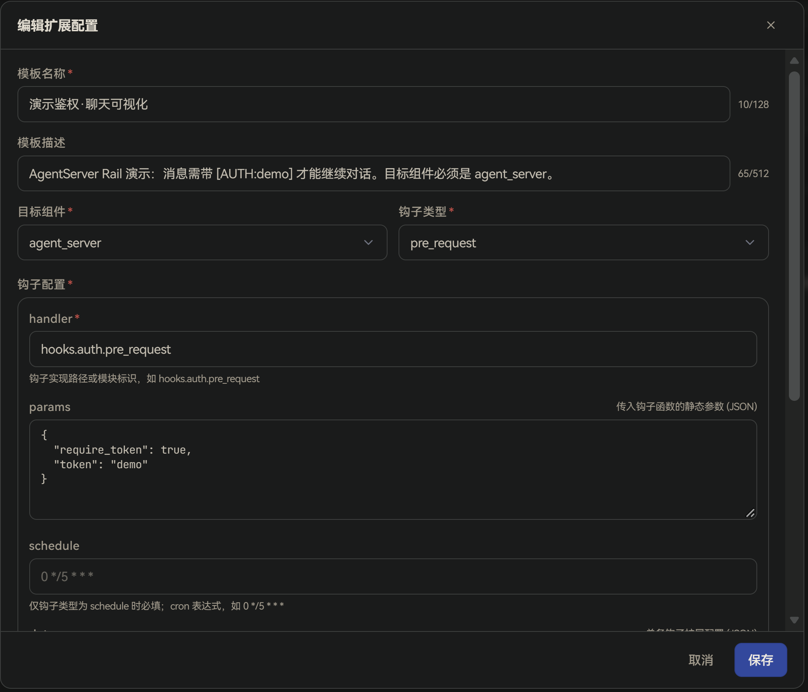
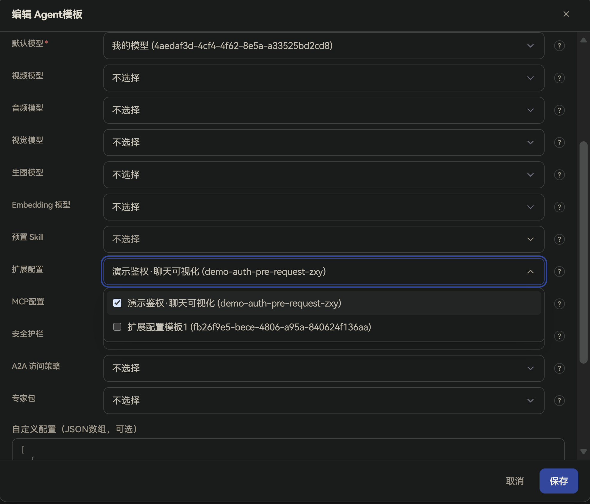
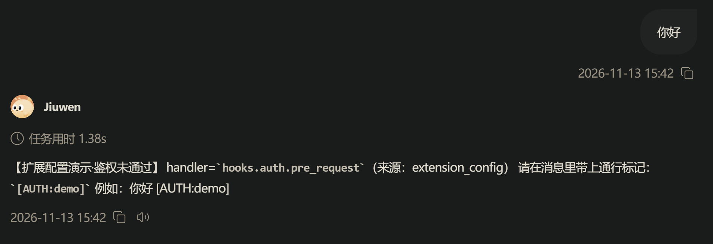
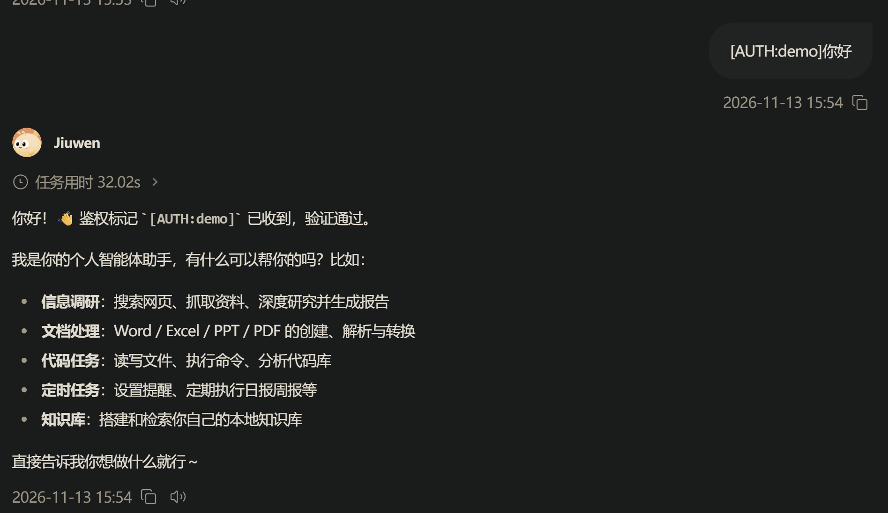

# 扩展配置
## 功能说明
**扩展配置**是由管理员在管理面统一维护的「钩子」与自定义参数模板。

**钩子**可以通俗理解成：在系统处理请求的某个固定时间点（例如请求刚进来、请求处理完、出错时、或按定时表），自动插入一段你指定的逻辑。这段逻辑由 `handler`（钩子实现路径，指向代码里已实现的函数/模块）执行；需要的参数写在 `params` / `自定义配置` 里。扩展配置本身不会直接生效，需要被 **Agent 模板** 引用，再随 Agent 模板配置到集群后，才会下发到运行面。

每条扩展配置必须指定**目标组件**（配置最终交给谁执行）和**钩子类型**（在什么时机执行）：

| 目标组件 | 说明 |
| --- | --- |
| **gateway** | 下发到网关（Gateway）。网关是用户请求进入系统的入口，适合做统一鉴权、参数校验、请求级日志等 |
| **agent_server** | 下发到 Agent 运行服务（AgentServer）。适合在对话/工具调用链路中注入业务扩展逻辑 |

| 钩子类型 | 时机 | 典型用途 |
| --- | --- | --- |
| **pre_request** | 请求处理前 | 参数校验、权限检查 |
| **post_request** | 请求处理后 | 日志记录、结果转换 |
| **error** | 请求失败时 | 错误恢复、告警通知 |
| **schedule** | 按 cron 定时触发 | 数据清理、状态同步 |

与「模型」不同：一个 Agent 模板的「默认模型」等槽位通常只能选一条，而 **扩展配置** 槽位可以同时引用**多条**。运行面会按目标组件过滤：AgentServer 侧只接收 `component=agent_server`（或未填组件）且已启用的配置；`gateway` 侧配置由网关使用。

典型用途：

+ 由管理员统一挂接企业侧定制的鉴权、审计、清理等钩子，终端用户无需也无法自行填写钩子路径和参数。
+ 同一个扩展配置被多个 Agent 模板复用，修改一次即可同步到所有引用它的集群。
+ 为不同 Agent 模板挂不同扩展：例如网关侧统一鉴权用 `gateway + pre_request`，某个业务 Agent 的清理任务用 `agent_server + schedule`。

## 使用流程概览
完整生效链路如下：

1. 在管理面「工作台 → Agent资源 → 扩展配置」新建扩展配置。
2. 在「工作台 → Agent模板」的「配置模板引用」中，为「扩展配置」槽位选择一条或多条已启用的扩展配置。
3. 将该 Agent 模板配置到集群，并授权给组织或用户。
4. 用户登录用户面后，对话请求会按模板加载这些扩展配置；用户无需单独配置。

## 管理面配置
### 新建扩展配置
进入「工作台 → Agent资源 → 扩展配置」，点击「新建扩展配置」，填写以下信息后点击 **保存**：

| 字段 | 说明 |
| --- | --- |
| **模板名称** | 必填，管理面展示用名称，在 Agent 模板中选择扩展配置时显示，最多 128 个字符 |
| **模板描述** | 可选，说明用途，最多 512 个字符 |
| **目标组件** | 必填，下发目标，可选 `gateway`、`agent_server`，默认 `gateway` |
| **钩子类型** | 必填，执行时机，可选 `pre_request`、`post_request`、`error`、`schedule`，默认 `pre_request` |
| **钩子配置 → handler** | 必填，钩子实现路径或模块标识，如 `hooks.auth.pre_request`。须指向运行面已部署、可加载的实现 |
| **钩子配置 → params** | 可选，传入钩子的静态参数，填写 JSON 对象，如 `{"require_token": true, "allowed_roles": ["user", "admin"]}` |
| **钩子配置 → schedule** | 仅当钩子类型为 `schedule` 时必填；合法 cron 表达式（5/6/7 段），如 `0 */5 * * *`（每 5 分钟）。其他钩子类型可留空 |
| **钩子配置 → data** | 可选，单条钩子的扩展字段，填写 JSON 对象；留空或 `{}` 表示无额外项 |
| **自定义配置** | 可选，用户自定义配置项，填写 JSON 对象，如 `{"auth_header": "Authorization"}`；留空表示无自定义项 |

### 编辑、禁用与删除
+ **编辑**：点击行内「编辑」，可修改模板信息。被集群中的 Agent 模板引用时，保存后变更会下发到网关并生效。
+ **禁用**：通过列表中「已启用」列的开关启用或禁用。禁用后，该扩展配置不再出现在 Agent 模板的选择列表中；已引用它的 Agent 也将读不到该配置（运行面会过滤掉 `enabled=false` 的条目）。
+ **删除**：点击行内「删除」。仅「被引用」为 0 的扩展配置可以删除，仍被 Agent 模板引用时删除会失败。

### 绑定到 Agent 模板并配置到集群
扩展配置需要先绑定到 **Agent 模板** 的「扩展配置」槽位，再将该 Agent 模板配置到集群，才会下发到运行面生效。

1. **绑定扩展配置**：进入「工作台 → Agent模板」，新建或编辑目标模板，在「配置模板引用」中添加 **扩展配置** 槽位，选择一条或多条已启用的扩展配置并保存。

   

2. **配置到集群**：参考[快速上手](../../../快速开始/快速上手.md)中的「配置集群配置」章节，将该 Agent 模板添加到集群并授权。

## 用户面使用
用户登录用户面后，系统会按其被授权的 Agent 模板自动加载扩展配置，无需用户做任何配置。对话或工具调用过程中，运行面会按目标组件与钩子类型在对应时机执行已挂接的钩子。

说明：

+ 企业版用户面不提供扩展配置的自行添加或修改入口，钩子列表由管理员通过 Agent 模板统一下发。
+ 管理员修改 Agent 模板中引用的扩展配置，或修改已被集群引用的扩展配置本身后，系统会触发该运行时下相关组件按新配置刷新（文档里说的「运行面刷新」）。重建/刷新完成后，会话即可使用新配置。

## 注意事项
+ `handler` 必须对应运行面真实存在、且目标组件可加载的实现；填错路径时配置能保存，但运行时不会按预期执行钩子。
+ 钩子类型为 `schedule` 时务必填写合法 cron；字段段数或取值不合法时，管理面保存会失败。
+ 同一 Agent 模板可引用多条扩展配置：请按目标组件区分用途（网关侧 vs AgentServer 侧），避免把仅应在网关执行的钩子标成 `agent_server`（或反过来）。
+ `params`、`data`、`自定义配置` 须为合法 JSON 对象；

