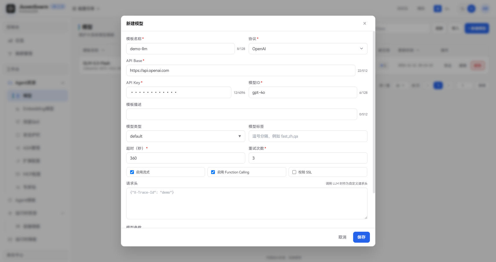
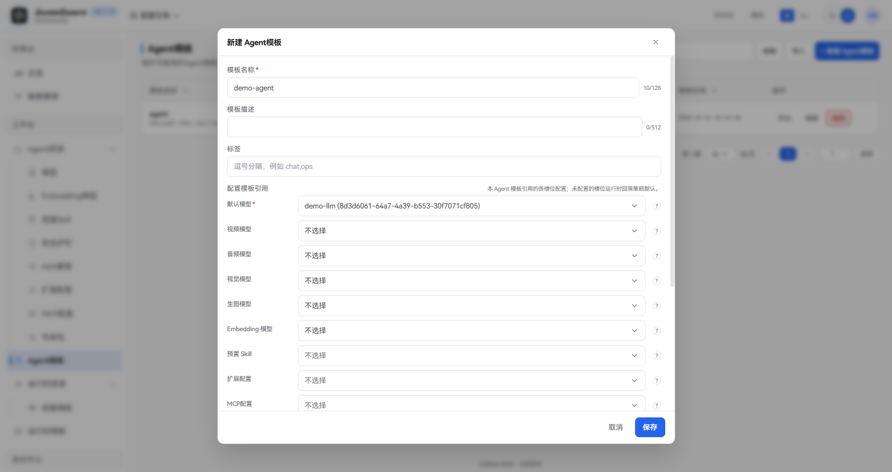
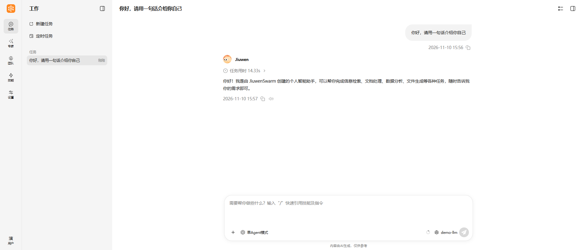

# 模型

## 功能说明

**模型**是由管理员在管理面统一维护的大语言模型连接配置，包括服务地址、API Key、模型 ID，以及超时、重试、请求头、模型参数等调用设置。模型本身不会直接生效，需要被 **Agent 模板** 引用，再随 Agent 模板配置到集群后，才会下发到运行面供用户对话使用。

一个 Agent 模板可以按用途引用多个模型，每种用途称为一个**槽位**。槽位分为两类：

- **对话模型**：即「默认模型」，是 Agent 的主对话核心模型，负责理解用户意图、文本对话、任务规划和工具调用。每次对话都由它驱动，必须配置。
- **多模态模型**：即视频、音频、视觉、生图模型，是供 Agent **工具**使用的模型，不直接参与对话。当用户发送视频、音频、图片，或要求生成图片时，对话模型会调用相应的多模态工具，再由工具调用对应的多模态模型完成处理，并把结果交还给对话模型继续回答。

| 槽位 | 类别 | 是否必填 | 用途 | 能力要求 |
| ---- | ---- | ---- | ---- | ---- |
| **默认模型** | 对话模型 | 是 | 主对话核心模型，处理文本对话、任务规划、工具调用等 | 需具备**工具调用（Function Calling）**能力，支持多轮对话 |
| **视频模型** | 多模态模型 | 否 | 视频理解工具使用，支持视频内容问答、场景识别等 | 需具备**视频理解**能力，能处理视频输入 |
| **音频模型** | 多模态模型 | 否 | 音频处理工具使用，支持语音转文字、音频内容分析等 | 需具备**语音识别/音频理解**能力 |
| **视觉模型** | 多模态模型 | 否 | 图片处理工具使用，支持图像问答、OCR、场景描述等 | 需具备**图像理解**能力，能处理图片输入 |
| **生图模型** | 多模态模型 | 否 | 图像生成工具使用，根据文本描述生成图片 | 需具备**图像生成**能力 |

多模态模型为可选配置，需要相应能力时再配置即可。未配置的多模态槽位，对应工具不会启用，Agent 无法处理该类内容，但不影响正常文本对话。多模态模型不会替代默认模型进行对话，对话模型也不会代替未配置的多模态模型处理媒体内容。

典型用途：

- 由管理员统一接入企业采购或私有化部署的大模型服务，终端用户无需也无法自行配置 API Key。
- 同一个模型被多个 Agent 模板复用，修改一次即可同步到所有引用它的集群。
- 为不同 Agent 模板选择不同的模型，例如对话使用低成本的通用模型，图片理解交给专门的视觉模型。

## 使用流程概览

完整生效链路如下：

1. 在管理面「工作台 → Agent资源 → 模型」新建模型。
2. 在「工作台 → Agent模板」的「配置模板引用」中，为「默认模型」等槽位选择该模型。
3. 将该 Agent 模板配置到集群，并授权给组织或用户。
4. 用户登录用户面后，对话自动使用 Agent 模板中配置的模型。

## 管理面配置

### 新建模型

进入「工作台 → Agent资源 → 模型」，点击「新建模型」，填写以下信息后点击 **保存**：

| 字段 | 说明 |
| ---- | ---- |
| **模板名称** | 必填，管理面展示用名称，在 Agent 模板中选择模型时显示，最多 128 个字符 |
| **协议** | 必填，模型服务的接口协议，可选 OpenAI、Anthropic、OpenRouter、DashScope、SiliconFlow、InferenceAffinity，默认 OpenAI。兼容 OpenAI 接口的模型服务选择 OpenAI 即可 |
| **API Base** | 必填，模型服务的接口地址，须为合法的 `http(s)` URL，最多 512 个字符。生产环境应使用 `https` 地址，使用 `http` 时，API Key 和对话内容将以明文传输 |
| **API Key** | 必填，访问模型服务的密钥，输入后以密文显示，最多 4096 个字符 |
| **模型ID** | 必填，模型服务侧的模型名称（调用时传给模型服务的 `model` 参数），如 `gpt-4o`，最多 128 个字符 |
| **模板描述** | 可选，说明用途，最多 512 个字符 |
| **模型类型** | 可选，可多选 default（通用对话）、video（视频）、audio（音频）、vision（视觉）、image_gen（生图），用于标识模型能力、在列表中分类筛选。不影响 Agent 模板中的可选范围 |
| **模型标签** | 可选，自定义标签，多个标签用英文逗号分隔，如 `fast,zh,qa` |
| **超时（秒）** | 必填，单次调用模型的超时时间，须大于 0，默认 360 |
| **重试次数** | 必填，调用失败后的重试次数，不能小于 0，默认 3 |
| **启用流式** | 可选，默认开启 |
| **启用 Function Calling** | 可选，默认开启 |
| **校验 SSL** | 可选，访问 HTTPS 地址时是否校验证书，默认关闭。**生产环境必须开启**，关闭仅适用于使用自签名证书的测试环境，关闭时，API Key 和对话内容存在被中间人窃取的风险 |
| **请求头** | 可选，调用模型时附加的自定义请求头，填写 JSON 对象，如 `{"X-Trace-Id": "demo"}` |
| **模型参数** | 可选，调用模型时传入的参数，填写 JSON 对象，如 `{"temperature": 0.7}` |

### 编辑、禁用与删除

- **编辑**：点击行内「编辑」，可修改模板信息。被集群中的 Agent 模板引用时，保存后变更会下发到网关并生效。
- **禁用**：通过列表中「已启用」列的开关启用或禁用。禁用后，该模型不再出现在 Agent 模板的模型选择列表中，已引用该模型的 Agent 也将读取不到该模型，相当于对应槽位未配置。
- **删除**：点击行内「删除」。仅「被引用」为 0 的模型可以删除，仍被 Agent 模板引用时删除会失败。

### 绑定到 Agent 模板并配置到集群

模型需要先绑定到 **Agent 模板** 的槽位上，再将该 Agent 模板配置到集群，才会下发到运行面生效。

1. **绑定模型**：进入「工作台 → Agent模板」，新建或编辑目标模板，在「配置模板引用」的 **默认模型** 等槽位中选择已启用的模型并保存。

   

2. **配置到集群**：参考[快速上手](../../../快速开始/快速上手.md)中的「配置集群配置」章节，将该 Agent 模板添加到集群并授权。

## 用户面使用

用户登录用户面后，系统会按其被授权的 Agent 模板自动加载模型，无需用户做任何配置。对话输入框右下角显示当前 Agent 使用的模型：

说明：

- 企业版用户面的模型选择为只读，用户不能切换模型，也不能在设置中自行添加模型。
- 管理员修改 Agent 模板中的模型或模型本身的配置后，运行面刷新完成即生效，新会话会使用新配置。

## 注意事项

- 修改已被集群中Agent引用的模型，保存后会触发该运行时下的全部AgentServer Pod优雅下线并按新配置重建，已有会话不受影响。重建期间新会话启动可能变慢，短时间内连续修改可能被容量保护暂时拒绝，稍后会自动恢复。建议在业务低峰期修改。
- API Key 仅保存在管理面并下发到运行面，导出文件中会被脱敏，跨环境导入新模型时需重新填写。
