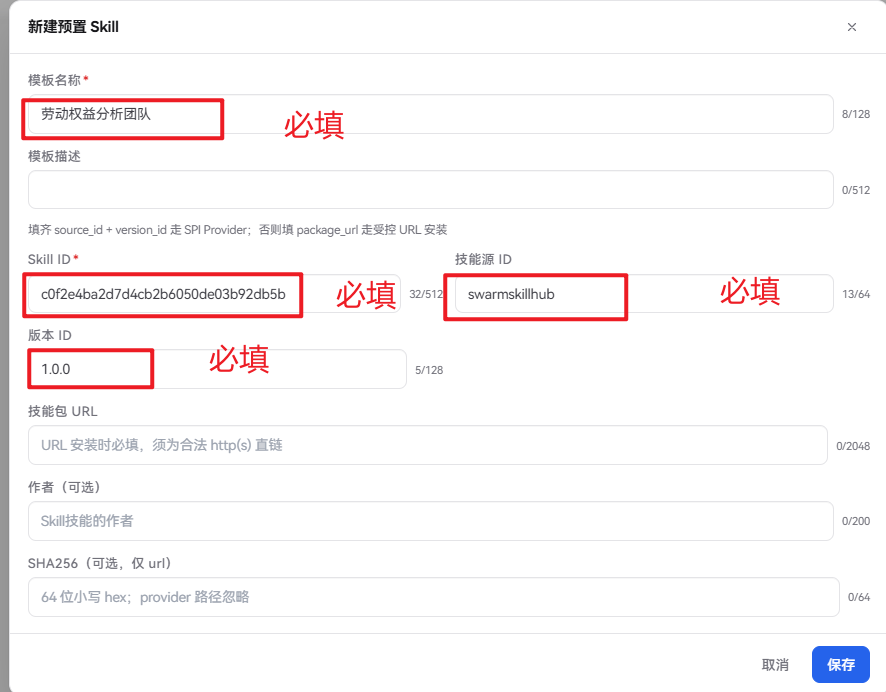
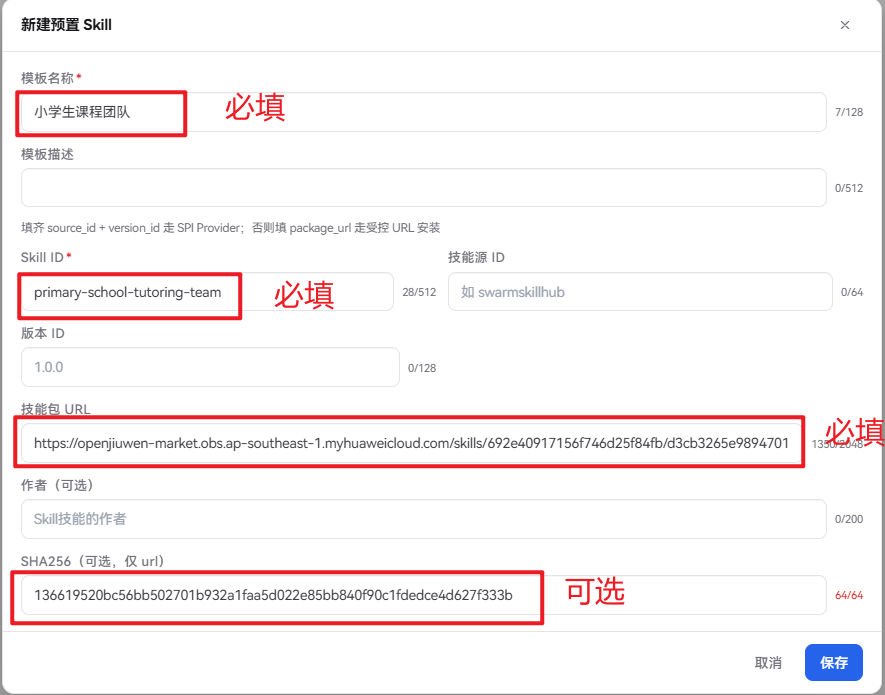
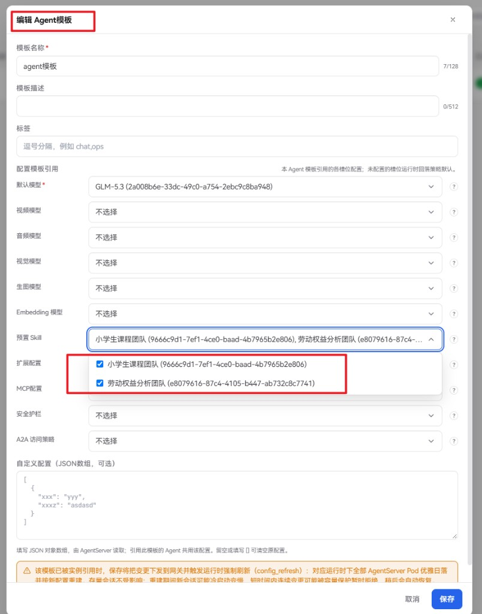
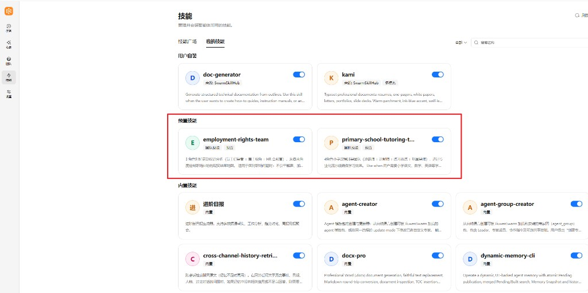
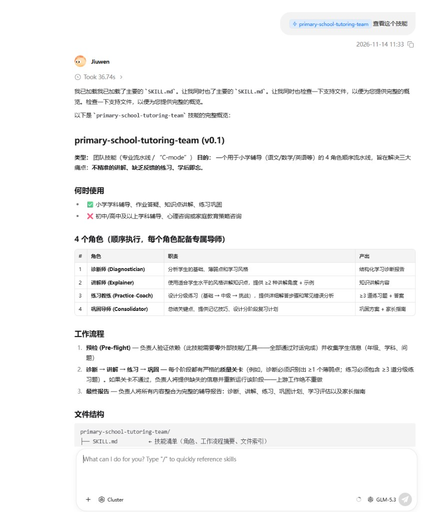

# 预置Skill

## 功能说明

**预置 Skill**是由管理员在管理面统一维护、再下发给指定 Agent 的技能模板。运行时会按 Agent 模板中的引用清单，自动将对应技能同步到用户工作区，并标记为预置来源。

预置 Skill 本身不会对所有用户生效，必须挂到 **Agent 模板** 的「预置 Skill」引用中，再将该 Agent 模板配置到集群并授权后，用户使用对应 Agent 时才会同步。

与其他技能来源的对比：

| 来源           | 谁决定可用                  | 用户侧表现                                      |
| ------------ | ---------------------- | ------------------------------------------ |
| **预置 Skill** | 管理员在管理面配置并绑定到 Agent 模板 | 自动出现在「我的技能 → 预置」；不可编辑、卸载、发布；可启停            |
| **内置技能**     | 产品打包随版本提供              | 在技能广场以「预置/内置」展示并可安装；与管理面下发的预置 Skill 不是同一来源 |
| **用户自装**     | 用户从技能广场或本地导入           | 可安装、卸载、启停、按需管理                             |

典型用途：

- 为企业内所有（或指定）Agent 统一下发合规、办公、检索等标准能力包。
- 用技能源（SPI）或受控 URL 管理安装来源，避免终端用户自行拉取不可信技能包。
- 变更引用清单后由运行面对齐：新增项安装，清单外预置项移除。

## 使用流程概览

完整生效链路如下：

1. 在管理面「工作台 → Agent资源 → 预置Skill」新建并启用模板。
2. 在「工作台 → Agent模板」的「配置模板引用」中勾选需要的预置 Skill（可多选）。
3. 将该 Agent 模板配置到集群，并授权给组织或用户。
4. 用户登录用户面使用对应 Agent 时，运行时自动同步预置技能。
5. 用户可在技能页查看、启停预置技能，并在对话中调用。

## 管理面配置

### 新建预置 Skill

进入「工作台 → Agent资源 → 预置Skill」，点击「新建预置 Skill」，填写以下信息后点击 **保存**：

| 字段                 | 说明                                               |
| ------------------ | ------------------------------------------------ |
| **模板名称**           | 必填，管理面展示用名称，最多 128 个字符                           |
| **模板描述**           | 可选，说明用途，最多 512 个字符                               |
| **Skill ID**       | 必填；SPI 须与技能源侧一致；URL 方式可自定义（如 `search/weather`）   |
| **技能源 ID + 版本 ID** | 二者同时填写时走 **SPI** 安装（如 `swarmskillhub` + `1.0.0`） |
| **技能包 URL**        | 未走 SPI 时必填，须为可直接下载 ZIP 的合法 `http(s)` 直链；**生产建议使用 `https`**（走 import-local 白名单时运行面只接受 HTTPS） |
| **作者**             | 可选，会随模板下发并写入安装账本                                 |
| **SHA256**         | 可选，仅 URL 安装时用于完整性校验（64 位小写十六进制）；SPI 路径忽略         |

安装来源二选一：填齐技能源 ID 与版本 ID 走 SPI；否则必须提供合法的技能包 URL。保存后模板默认启用。

### SPI 方式示例

适用于已接入技能源（如内置 `swarmskillhub`）的场景。填写技能源 ID、Skill ID、版本 ID，不填技能包 URL。

| 字段           | 示例值                                |
| ------------ | ---------------------------------- |
| **模板名称**     | 劳动者权益分析团队                          |
| **Skill ID** | `c0f2e4ba2d7d4cb2b6050de03b92db5b` |
| **技能源 ID**   | `swarmskillhub`                    |
| **版本 ID**    | `1.0.0`                            |

对接尚未接入的第三方技能市场时，需开发者编写 SPI 扩展包并随 AgentServer 部署加载；仅靠管理面填写字段无法完成对接。

### URL 方式示例

适用于直接提供技能包直链的场景。Skill ID 可自定义；建议填写 SHA256。

| 字段           | 示例值                                                                           |
| ------------ | ----------------------------------------------------------------------------- |
| **模板名称**     | 小学生课程团队                                                                       |
| **Skill ID** | `primary-school-tutoring-team`                                                |
| **技能包 URL**  | `https://artifacts.example.com/skills/primary-school-tutoring-team-1.0.0.zip` |
| **SHA256**   | `136619520bc56bb502701b932a1faa5d022e85bb840f90c1fdedce4d627f333b`（可选）        |

技能包 URL 须为打开即下载 ZIP 的直链（不是网页预览页），例如对象存储或 CDN 下载地址。主机须在 AgentServer 下载白名单内，否则运行面拒绝拉取；生产环境请使用 `https`。

### 编辑、禁用与删除

- **编辑**：点击行内「编辑」，可修改名称、描述、Skill ID、安装来源等。被 Agent 模板引用时，保存后会按引用关系推送到相关网关。
- **禁用**：通过列表中「已启用」列的开关启用或禁用。禁用后，该模板不再出现在 Agent 模板的可选列表中；若仍被 Agent 模板引用，下一次用户侧同步会把对应预置技能从工作区移除（不是仅从列表消失），请确认影响面后再操作。
- **删除**：点击行内「删除」。仍被 Agent 模板引用时删除会失败，需先解除引用再删。
- **被引用**：列表「被引用」列显示引用该模板的 Agent 模板数量，可跳转至 Agent 模板页查看。

### 导入与导出

- **导出**：在某一行点击「导出」，将该条预置 Skill 模板下载为 Manager 标准的 `.xlsx` 文件。
- **导入**：点击页头「导入」，选择此前导出的 `.xlsx`；系统会先预检，已存在且一致的配置会复用，不会覆盖现有项。

导入的是管理面模板配置，不会直接替用户安装技能包；仍需在 Agent 模板中引用后才会下发。

### 绑定到 Agent 模板并配置到集群

预置 Skill 需要先绑定到 **Agent 模板**，再将该 Agent 模板配置到集群，才会下发到运行面生效。

1. **绑定预置 Skill**：进入「工作台 → Agent模板」，新建或编辑目标模板，在「配置模板引用」的 **预置 Skill** 槽位中勾选一个或多个已启用的模板并保存。若暂无选项，可通过引导链接跳转到预置 Skill 页先创建。详见[Agent模板](../Agent模板.md)。
2. **配置到集群并授权**：将该 Agent 模板配置到集群，并授权给目标组织或用户。具体操作参考[快速上手](../../../快速开始/快速上手.md)中的「配置集群配置」章节。

说明：仅创建预置模板而不绑定到已挂集群的 Agent 模板，不会下发到用户工作区。

## 用户面使用

用户登录用户面、进入已授权的 Agent 后：

1. 打开左侧 **技能** → **我的技能**。
2. 在企业版下可看到独立的 **预置** 分组 / 筛选。
3. 预置技能由管理员下发，界面不提供编辑、卸载、发布。
4. 用户可按需 **启用 / 禁用** 单个预置技能；禁用后对话中不再主动使用该技能。

5. 在对话中用自然语言提出需求，Agent 会按已启用技能与说明自动选用。

## 注意事项

- 优先使用可信的 SPI 技能源或内网受控 URL；URL 安装建议填写 SHA256。
- URL 方式须把下载主机加入 AgentServer 白名单：`IMPORT_LOCAL_ALLOWED_DOWNLOAD_HOSTS`（仅 HTTPS）或 `TEAM_SKILLS_HUB_ALLOWED_DOWNLOAD_HOSTS`（允许 http/https），命中其一即可；SPI 方式使用技能源 `download_policy.allowed_hosts`（或 Provider 默认白名单），二者皆空时安装失败。
- SPI 方式下 Skill ID、源 ID、版本 ID 须与技能源侧元数据一致；URL 方式下 Skill ID 可自定义。
- 修改已挂到集群的 Agent 模板或其引用的预置 Skill，保存后会触发配置刷新与 AgentServer 重建相关成本，建议在业务低峰期操作。

机制说明见[预置Skill设计](../../../开发文档/设计文档/预置Skill设计.md)。