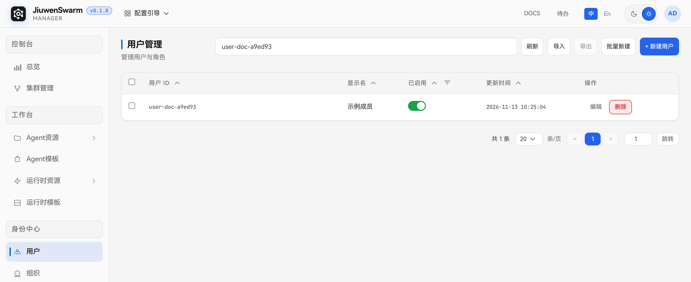
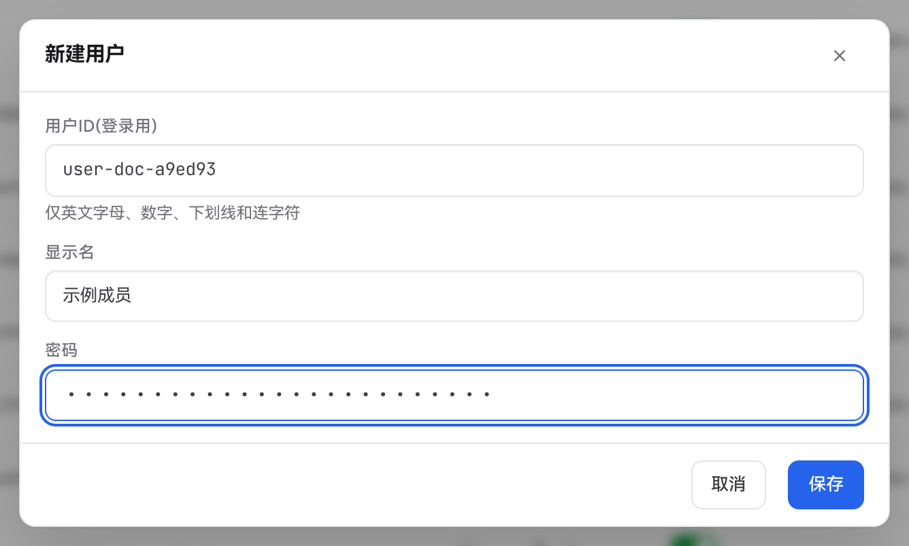
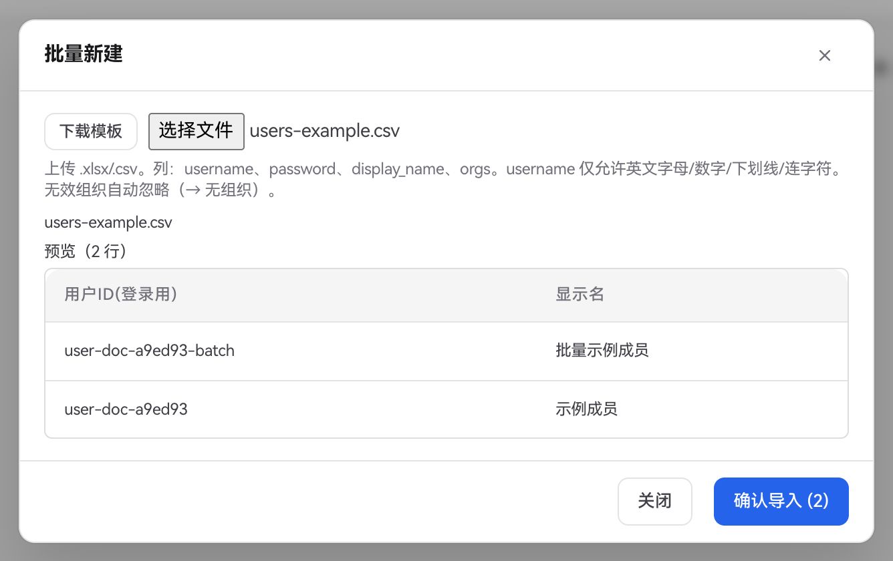
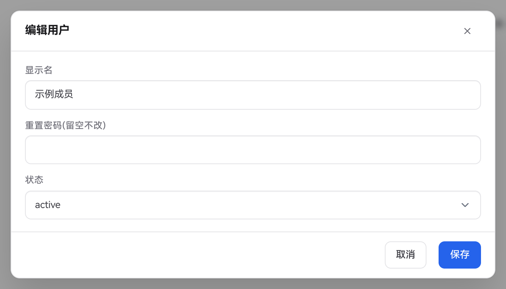
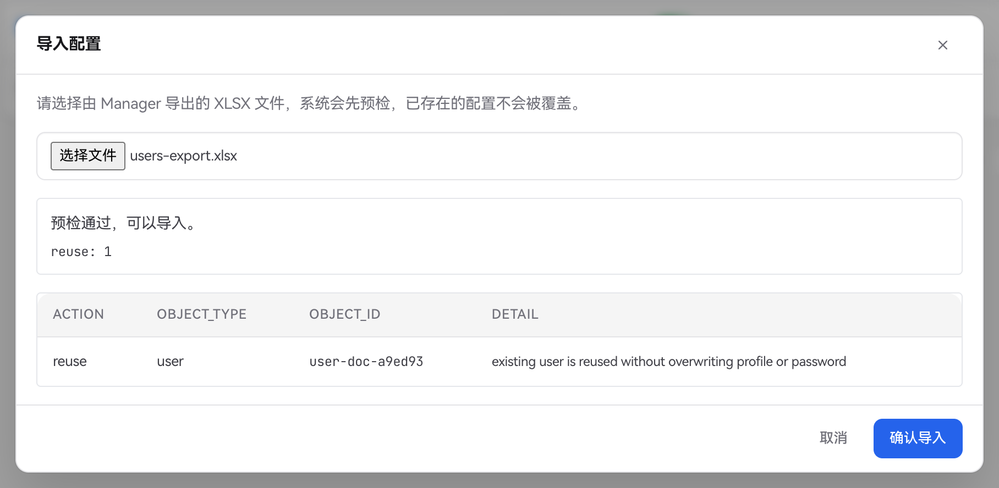

# 用户

## 功能说明

管理员在管理面的「身份中心 → 用户」维护 JiuwenSwarm 用户目录，可以新建本地账号、修改显示名、重置本地密码、启用或禁用账号，以及批量新建、导入和导出用户。

用户加入组织后，可按组织统一配置集群准入和资源授权。用户需要进入管理面时，在「身份中心 → 角色」中为其分配相应的管理面角色。

## 使用流程概览

1. 使用平台管理员账号登录管理面，进入「身份中心 → 用户」。
2. 点击「新建用户」，或通过「批量新建」一次创建多个账号。
3. 如需按组织授权，进入「身份中心 → 组织」，在目标组织的「成员」页签添加用户。
4. 在目标集群配置用户或其所在组织的准入。需要使用 Agent 对话时，继续配置覆盖该用户的 Agent 和运行时授权。操作步骤见[快速上手](../../../快速开始/快速上手.md)。

## 管理面配置

### 查看与搜索用户

「用户管理」列表显示用户 ID、显示名、启用状态和更新时间。在顶部搜索框输入用户 ID 或显示名可查找账号，也可使用「已启用」列的筛选按钮查看已启用或已禁用的用户。点击「刷新」重新加载列表。

### 新建用户

点击「新建用户」，填写以下字段后点击「保存」。保存后可在列表中按用户 ID 搜索，新建账号默认为启用状态。

| 字段 | 说明 |
| ---- | ---- |
| **用户ID(登录用)** | 必填，作为本地登录用户名及用户目录中的唯一标识。最多 64 个字符，仅支持英文字母、数字、下划线和连字符。创建后固定 |
| **显示名** | 必填，用于在列表和成员选择界面识别用户，最多 128 个字符 |
| **密码** | 必填，本地账号的初始密码，最多 256 个字符。请通过安全渠道交付给用户 |

### 批量新建用户

1. 点击「批量新建 → 下载模板」，获取 `users_template.xlsx`。
2. 使用模板中的字段填写用户信息。支持 `.xlsx` 或 UTF-8 编码的 `.csv`，每次最多提交 500 行用户数据。

   | 列名 | 说明 |
   | ---- | ---- |
   | `username` | 必填，用户 ID，填写规则与单个新建一致 |
   | `password` | 必填，初始密码 |
   | `display_name` | 可选，留空时使用用户 ID 作为显示名 |

3. 上传文件并核对预览。若提示缺少用户名、密码或用户名格式错误，修正文件后重新上传。

   

4. 点击「确认导入」，查看成功、失败数量和逐行结果。若部分用户因 ID 重复等原因创建失败，修正失败行后再提交这些行。

若弹窗提示中显示 `orgs`，请以下载模板为准。用户创建后，通过目标组织的「成员」页签配置组织归属。

### 编辑、禁用与删除

- **编辑**。点击目标用户行内的「编辑」，可修改显示名、重置本地密码，或将状态设为 `active`（启用）或 `disabled`（禁用）。仅修改其他字段时，将「重置密码(留空不改)」留空，点击「保存」。
- **启用或禁用**。操作列表中「已启用」列的开关。关闭后，该用户无法重新登录或刷新登录凭据。再次打开可恢复登录资格，用户面的访问仍受集群准入规则约束。
- **删除**。点击目标用户行内的「删除」，核对确认框中的显示名和用户 ID 后点击「确认」。删除会移除身份中心内的账号、本地凭据和组织成员关系。临时停用账号时，可使用「已启用」开关。

### 导出与导入用户资料

跨环境迁移用户资料时，可使用用户列表顶部的「导出」和「导入」。

1. 在源环境勾选需要迁移的用户，点击「导出」，下载 `.xlsx` 文件。导出文件中的 `initial_password` 列为空。
2. 对于目标环境尚未创建的本地用户，在工作表 `02_Users` 的 `initial_password` 列填写新的初始密码。企业认证用户需先在目标环境建立对应身份。
3. 在目标环境的「用户管理」页点击「导入」，选择该 `.xlsx` 文件。系统自动预检，按用户 ID 识别可复用的账号，并保留其现有资料和密码。若出现冲突、缺失密码或缺少企业认证用户等提示，按预检结果处理后重新选择文件。
4. 预检通过后，点击「确认导入」，核对新建和复用数量。迁移后在目标环境核对组织、角色和集群准入配置。

   

## 用户面使用

用户在用户面登录页输入用户 ID 和密码，按目标集群的准入与授权使用 Agent。部署已接入企业认证服务时，企业账号通过登录页的企业认证入口登录，其密码在企业认证服务中维护。

若账号已启用但用户面提示没有可访问的集群，检查目标集群是否允许该用户或其所在组织准入，以及对应规则是否已过期或存在拒绝规则。若能进入集群但无法发起对话，再检查 Agent 和运行时的授权范围是否覆盖该用户。

## 注意事项

- 批量新建文件和填写了 `initial_password` 的导入文件包含明文初始密码。请限制文件访问权限，完成导入后按企业凭据管理要求处理文件。
