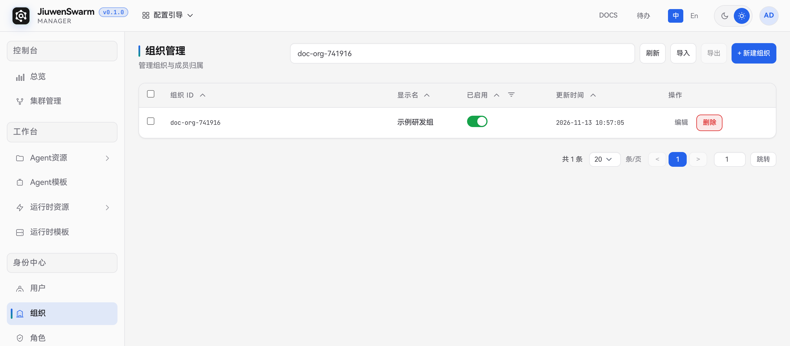
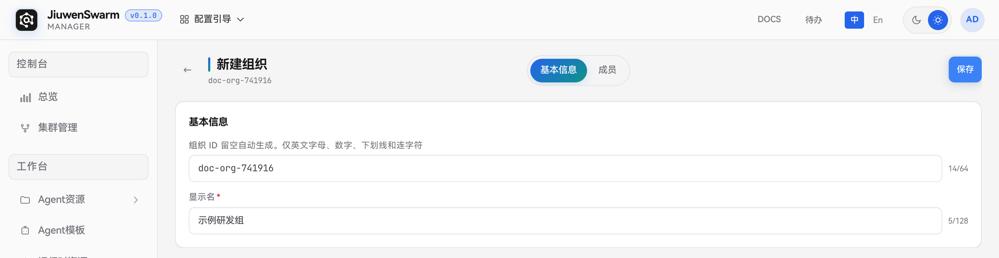
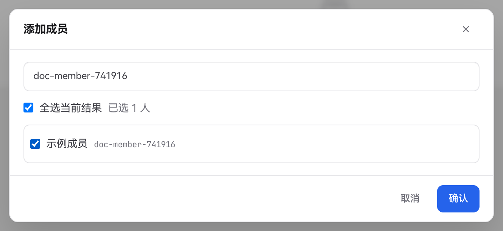
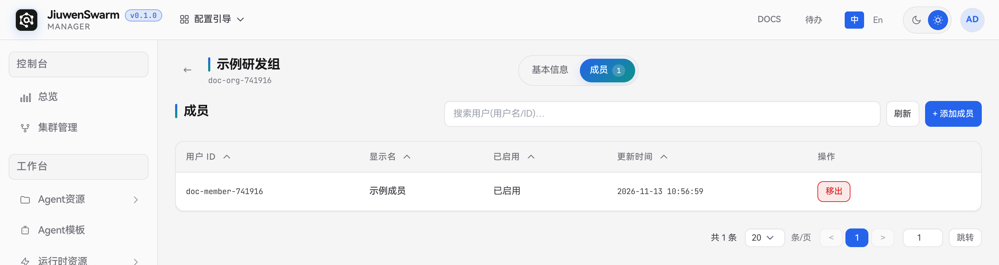

# 组织

## 功能说明

管理员在管理面的「身份中心 → 组织」维护组织和成员关系。可按部门、项目组等业务范围建立组织，再在集群中按组织配置准入，以及 Agent 和运行时的授权范围。一个用户可以加入多个组织。

## 使用流程概览

1. 使用平台管理员账号登录管理面，进入「身份中心 → 组织」。
2. 点击「新建组织」，填写基本信息并保存。
3. 在组织的「成员」页签添加已在身份中心登记的用户。创建账号的步骤见[用户](用户.md)。
4. 进入目标集群，按组织配置准入、Agent 和运行时授权。操作步骤见[快速上手](../../../快速开始/快速上手.md)。

## 管理面配置

### 查看与搜索组织

「组织管理」列表显示组织 ID、显示名、启用状态和更新时间。可按组织 ID 或显示名搜索，也可用「已启用」列筛选状态。

### 新建组织

点击「新建组织」，在「基本信息」页签填写以下字段，点击「保存」。新建组织默认启用，保存后可切换到「成员」页签。

| 字段 | 说明 |
| ---- | ---- |
| **组织 ID** | 可选。留空时由系统生成。自定义 ID 最多 64 个字符，仅支持英文字母、数字、下划线和连字符，须在身份中心内唯一。创建后固定 |
| **显示名** | 必填，用于在列表、集群准入和授权配置中识别组织，最多 128 个字符 |

### 添加和移出成员

1. 在目标组织行点击「编辑」，切换到「成员」页签。
2. 点击「添加成员」，按用户 ID 或显示名搜索，勾选一名或多名用户，再点击「确认」。

   

3. 在成员列表中核对用户 ID 和状态。要解除某个用户在本组织的成员关系，点击该行的「移出」并确认。用户账号和该用户在其他组织的成员关系继续有效。

   

系统将没有组织归属的用户归为「无组织」。给这些用户分组时，进入目标组织添加成员即可。

### 编辑、禁用与删除

- 点击目标组织行的「编辑」，在「基本信息」中修改显示名并保存。
- 在列表的「已启用」列关闭开关可禁用组织。禁用后，用户面可选组织中会隐藏该组织，已建立的成员关系会保留。重新启用后，用户可按集群配置继续使用该组织。
- 点击「删除」，核对组织名称后确认。删除会解除该组织的成员关系。删除前，检查集群准入、Agent 和运行时配置中的组织引用。若组织已绑定企业认证连接，需先解除相关绑定。

### 导出与导入组织

1. 在源环境的「组织管理」列表勾选目标组织并点击「导出」。下载的 `.xlsx` 包含组织资料、成员关系及关联的用户资料。
2. 如果新组织引用的本地成员尚未在目标环境创建，在 `02_Users` 工作表的 `initial_password` 列填写新的初始密码。企业认证用户需先在目标环境建立对应身份。凭据处理方式见[用户](用户.md#注意事项)。
3. 在目标环境的「组织管理」页点击「导入」，选择工作簿并查看预检结果。预检通过后点击「确认导入」，核对新增组织的成员列表。

预检按组织 ID 匹配。目标环境已有同 ID 组织时，系统复用该组织及其现有成员配置。需要合并成员时，可在目标组织的「成员」页签添加。导入完成后，按目标集群的配置核对准入和资源授权。

## 用户面使用

用户登录后，可在平台提供的组织选项中选择已启用的所属组织。要使用该组织下的 Agent，目标集群还需允许该用户或其所在组织准入，并配置覆盖该用户的 Agent 和运行时。

成员归属调整后，若用户面仍显示旧组织，用户可退出并重新登录，再核对所属组织和集群授权。
