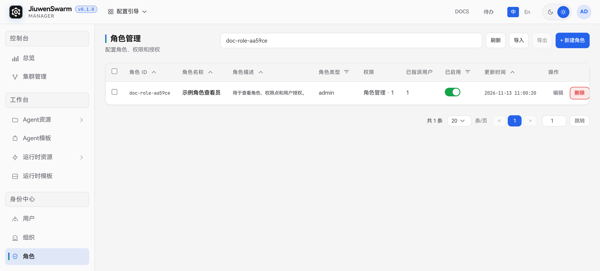
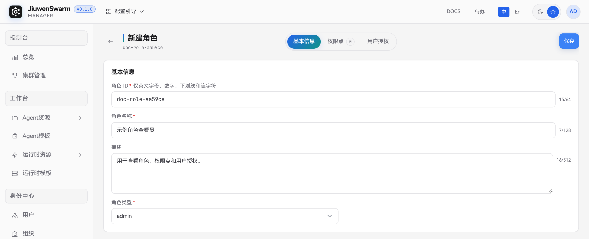
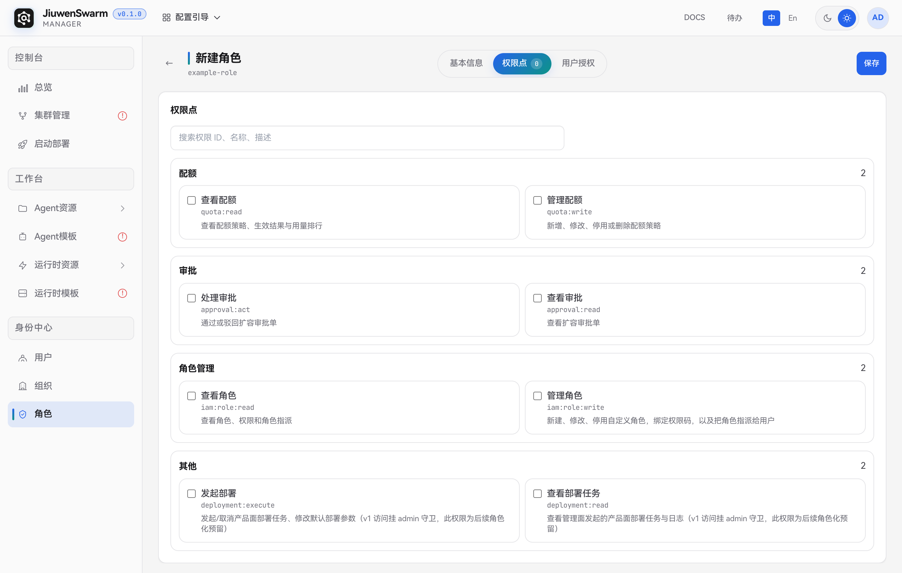
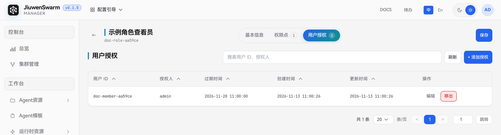

# 角色

## 功能说明

角色是一组权限点。管理员在管理面的「身份中心 → 角色」配置角色，再把角色指派给用户。用户获得其所有有效指派对应的权限。角色需处于启用状态，指派需处于有效期内。用户面使用 Agent 所需的集群准入和资源授权在目标集群配置，操作步骤见[快速上手](../../../快速开始/快速上手.md)。

系统内置「平台管理员」角色，角色 ID 为 `platform_admin`。角色页面中，内置角色的类型、权限点和启用状态为只读，且无法删除。

## 使用流程概览

1. 使用具备角色查看和管理权限的账号登录管理面，进入「身份中心 → 角色」。
2. 点击「新建角色」，填写基本信息并选择角色类型。
3. 在「权限点」页签勾选所需权限并保存。
4. 在「用户授权」页签添加授权，按需设置过期时间，再用目标用户账号核对实际可执行的操作。

## 管理面配置

### 查看与搜索角色

「角色管理」列表显示角色 ID、角色名称、描述、类型、权限数量、已指派用户数、启用状态和更新时间。可按 ID、名称或描述搜索，也可按类型和启用状态筛选。具有 `iam:role:read` 权限的账号可以查看角色。新建、编辑和指派用户需有 `iam:role:write` 权限。

### 新建角色

点击「新建角色」，在「基本信息」中填写以下字段。

| 字段 | 说明 |
| ---- | ---- |
| **角色 ID** | 必填，须唯一，最多 64 个字符。仅支持英文字母、数字、下划线和连字符。创建后固定 |
| **角色名称** | 必填，用于在列表和授权配置中识别角色，最多 128 个字符 |
| **描述** | 可选，可记录角色用途或适用人员，最多 512 个字符 |
| **角色类型** | 必填。当前版本提供 `admin` 和 `user`，默认 `admin`。权限点列表随类型切换 |

**有效的 `admin` 类型角色会授予平台管理员资格，即使只勾选了「查看角色」。** 指派前应确认用户需要访问平台管理员功能，例如用户和组织管理。

### 配置权限点

切换到「权限点」，勾选所需权限后点击「保存」。可按权限 ID、名称或描述搜索，清空搜索框可查看当前角色类型下的全部可见权限点。页签旁的数字表示已选权限点数量。修改角色类型后，重新核对已选权限。

下图为当前版本在启用用户空间配额后，`admin` 类型可选的 8 个权限点。`user` 类型可选的权限以切换后的列表为准。

| 分组 | 权限点 | 用途 |
| ---- | ---- | ---- |
| 配额 | **查看配额** `quota:read` | 查看配额策略、生效结果和用量 |
| 配额 | **管理配额** `quota:write` | 新建、修改、停用或删除配额策略 |
| 审批 | **查看审批** `approval:read` | 查看审批列表和详情 |
| 审批 | **处理审批** `approval:act` | 通过或驳回审批申请 |
| 角色管理 | **查看角色** `iam:role:read` | 查看角色、权限点和用户授权记录 |
| 角色管理 | **管理角色** `iam:role:write` | 新建、编辑、停用或删除自定义角色，配置权限点及用户授权 |
| 其他 | **查看部署任务** `deployment:read` | 为按权限点控制部署任务及日志查看预留 |
| 其他 | **发起部署** `deployment:execute` | 为按权限点控制部署任务发起、取消和默认参数修改预留 |

当前版本的「启动部署」按平台管理员资格校验访问。表中的两个部署权限点为后续按权限点授权预留。

#### 功能开关对权限点的影响

- **用户空间配额**。`WORKSPACE_QUOTA_ENABLED` 默认关闭。关闭时，角色页隐藏「查看配额」和「管理配额」，`admin` 类型在清空搜索后显示其余 6 个权限点。工作区配额相关接口也会停用。启用配额时，在企业部署目录的 `.env.custom` 中设置 `WORKSPACE_QUOTA_ENABLED=true`，并按部署流程使配置生效。配置项见[《管理面接口文档》中的「18. 工作区配额」](../../../开发文档/接口文档/管理面接口文档.md)，部署步骤见[《集群部署指南》](../../../快速开始/集群部署指南.md)。
- **审批**。「查看审批」和「处理审批」在配额关闭时仍可配置，审批列表、详情和处理操作继续按各自的权限点控制。工作区配额扩容申请需要开启配额功能。接口权限与开关要求见[《管理面接口文档》中的「工作区配额」和「审批」](../../../开发文档/接口文档/管理面接口文档.md)。

### 为用户授权

1. 保存角色后，切换到「用户授权」页签，点击「添加授权」。
2. 搜索并勾选已在身份中心登记的用户。需要临时授权时，设置晚于当前时间的「过期时间」。同一批勾选的用户共用该时间，留空表示长期有效。创建账号的步骤见[用户](用户.md)。

   

3. 点击「确认」，在列表中核对用户 ID、授权人和过期时间。

   

需要续期或改为长期授权时，点击对应用户行的「编辑」，更新或清空过期时间后点击「保存」，再核对列表中的时间。

授权到期后停止提供权限。需要提前撤销时，点击该用户行的「移出」并确认。用户通过其他有效角色获得的权限继续生效。

### 编辑、禁用与删除

- 点击自定义角色行的「编辑」，可修改基本信息或权限点。保存后的权限配置适用于该角色的所有有效指派。
- 在列表中关闭「已启用」开关可停用自定义角色。停用期间，角色停止提供权限，指派记录会保留。重新启用时，仍在有效期内的指派恢复生效。
- 点击自定义角色行的「删除」，核对角色 ID 后确认。删除会清除该角色的用户指派。

### 导出与导入角色

1. 使用平台管理员账号，在源环境的角色列表勾选目标角色并点击「导出」。下载的 `.xlsx` 包含角色、权限点、用户指派和关联用户资料。
2. 在目标环境核对工作簿中的权限点和用户。目标环境缺少本地用户时，在 `02_Users` 的 `initial_password` 列填写新的初始密码。企业认证用户需先在目标环境建立对应身份。
3. 在目标环境的「角色管理」页点击「导入」，选择工作簿，检查预检结果。相同配置的角色可复用，缺少的授权可新增。若同一角色 ID 的配置或权限点不同，或同一用户的授权过期时间不同，预检会提示冲突，处理后才能导入。内置角色须在目标环境已有相同配置才能复用。
4. 预检通过后点击「确认导入」，核对角色权限、授权对象和过期时间。新增 `admin` 类型授权前，确认目标用户具备相应的管理职责。
