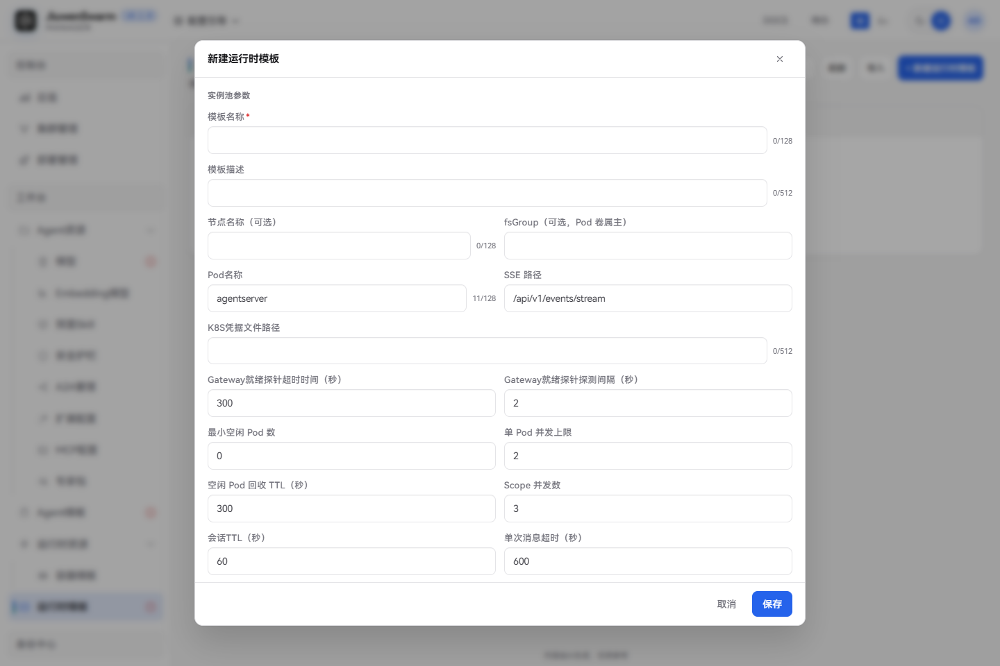
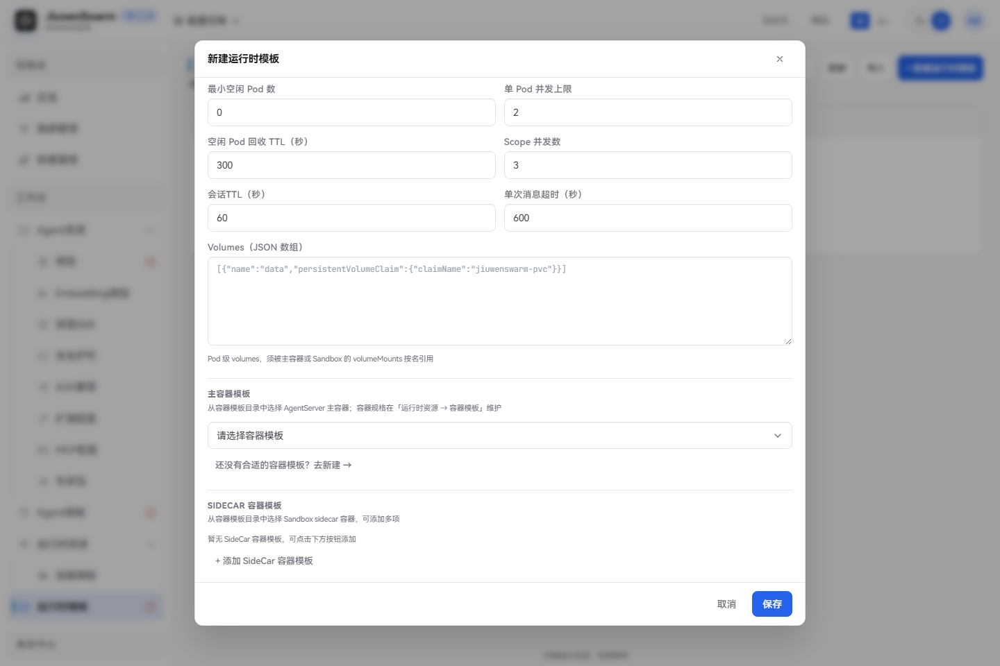

# 运行时模板

## 功能说明

**运行时模板**定义 AgentServer 实例池的完整运行方案：用哪些容器（绑定[容器模板](./运行时资源/容器模板.md)）、挂载哪些卷、网关如何探测就绪，以及实例池的弹性参数（热备、并发、空闲回收等）。

运行时模板本身不直接生效。它需要被配置到集群（集群配置 → [运行时](./集群管理/集群配置/运行时.md)）并授权后，集群才会按该模板拉起并管理 AgentServer Pod：会话到来按需扩容，空闲自动回收。

一个运行时模板绑定两类容器：

- **主容器模板**：必选其一，即 AgentServer 主容器，承载 Agent 业务。
- **SideCar 容器模板**：可选多项，即 Sandbox 沙箱容器，与主容器同 Pod 部署。

## 使用流程概览

1. 在「工作台 → 运行时资源 → 容器模板」准备好主容器（及需要的 Sandbox）模板。
2. 在「工作台 → 运行时资源 → 运行时模板」新建模板，绑定容器并填写实例池参数。
3. 在目标集群的「集群配置 → 运行时」中添加该模板并设置授权范围。
4. 授权用户发起会话后，集群按模板自动拉起和管理 AgentServer Pod。

## 管理面配置

### 新建运行时模板

进入「工作台 → 运行时资源 → 运行时模板」，点击「新建运行时模板」，填写以下信息后点击 **保存**：

**基本信息与实例池参数：**

| 字段 | 说明 |
| ---- | ---- |
| **模板名称** | 必填，最多 128 个字符 |
| **模板描述** | 可选，最多 512 个字符 |
| **节点名称** | 可选，将 Pod 固定调度到指定节点，一般留空 |
| **fsGroup** | 可选，Pod 卷的属主组 ID，用于挂载卷的权限 |
| **Pod名称** | Pod 名称，默认 `agentserver` |
| **SSE 路径** | AgentServer 事件流接口路径，网关按此路径与 Pod 建立事件流连接，默认 `/api/v1/events/stream`，须为绝对路径 |
| **K8S凭据文件路径** | 可选，运行面管理 Pod 所用的 kubeconfig 路径，按部署约定填写，通常留空 |
| **Gateway就绪探针超时时间（秒）** | 等待新 Pod 就绪的最长时间，默认 300 |
| **Gateway就绪探针探测间隔（秒）** | 就绪探测的轮询间隔，默认 2 |
| **最小空闲 Pod 数** | 保持的热备 Pod 数量，默认 0，见[资源弹性](../资源弹性.md) |
| **单 Pod 并发上限** | 单个 Pod 同时处理的会话数，默认 2 |
| **空闲 Pod 回收 TTL（秒）** | 空闲超过该时长的 Pod 被回收，默认 300 |
| **Scope 并发数** | 该模板同时服务的会话总数上限，默认 3；最多 Pod 数 = ⌈Scope 并发数 ÷ 单 Pod 并发上限⌉ |
| **会话TTL（秒）** | 会话空闲保持时长，超时释放占用，默认 60 |
| **单次消息超时（秒）** | 单次消息处理的最长等待，默认 600 |
| **Volumes** | 可选，Pod 级卷定义，JSON 数组，如 `[{"name":"data","persistentVolumeClaim":{"claimName":"jiuwenswarm-pvc"}}]`；须被主容器或 Sandbox 的 volumeMounts 按名引用 |

**容器绑定：**

| 字段 | 说明 |
| ---- | ---- |
| **主容器模板** | 从容器模板目录中选择 AgentServer 主容器，选中后显示其容器 ID 与镜像。未绑定主容器的模板无法拉起 AgentServer |
| **SideCar 容器模板** | 可添加多个 Sandbox 容器模板，按行增删；SideCar 与主容器的容器 ID 不能相同 |

**实例池参数的含义与调优建议见[资源弹性](../资源弹性.md)。**

### 编辑、禁用与删除

- **编辑**：点击行内「编辑」修改。已被集群引用时，保存后变更下发并按新参数管理实例池。
- **禁用**：通过「已启用」列的开关控制。禁用后不能再被集群新添加。
- **删除**：点击行内「删除」。删除前请确认没有集群仍在引用该模板。
- **导出 / 导入**：行内「导出」下载该模板的实例池定义 JSON；列表页「导入」可导入该文件重建模板，含容器模板时一并创建，含多个模板时仅导入第一个。
- **导入默认配置**：列表页「导入默认配置」一键导入部署阶段上传到对象存储的默认 `agentserver.json`（含容器模板）。object key 由环境变量 `AGENT_RUNTIME_DEFAULT_CONF_PATH` 控制，默认 `defaults/{ns}/agentserver.json`（`{ns}` 为部署命名空间）。若提示暂无默认配置，请确认产品面 runtime 已部署、对象存储可访问，且上传路径与该变量一致。

## 注意事项

- 修改已下发的运行时模板，保存后会触发相关运行时下的 AgentServer Pod 优雅下线并按新配置重建。已有会话不受影响，重建期间新会话启动可能变慢，建议在业务低峰期修改。
- 调大「Scope 并发数」或「单 Pod 并发上限」即提高容量上限，但受集群实际资源约束，同时应保证容器模板的 CPU / 内存上限设置合理。
- Volumes 与 volumeMounts 按名称对应，名称对不上时挂载不会生效。
