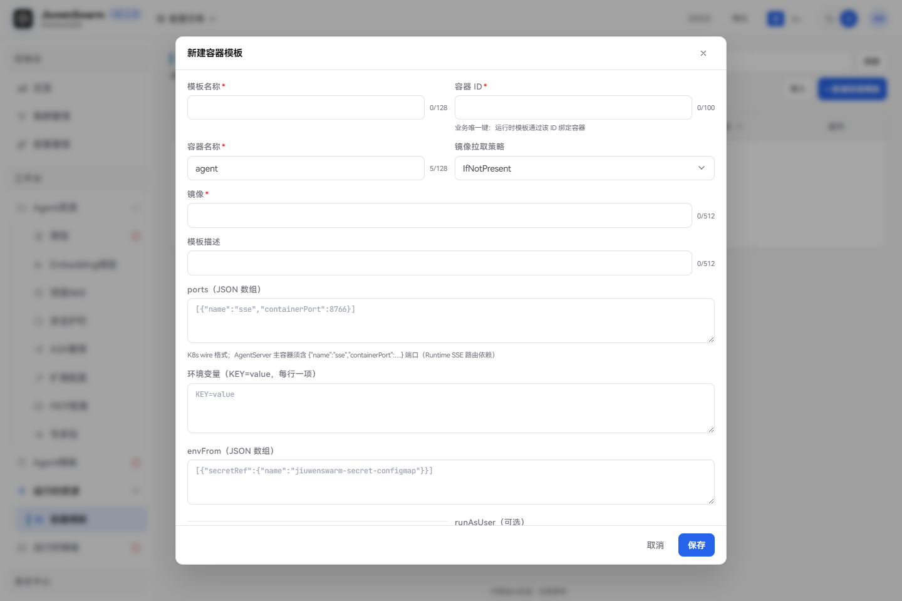
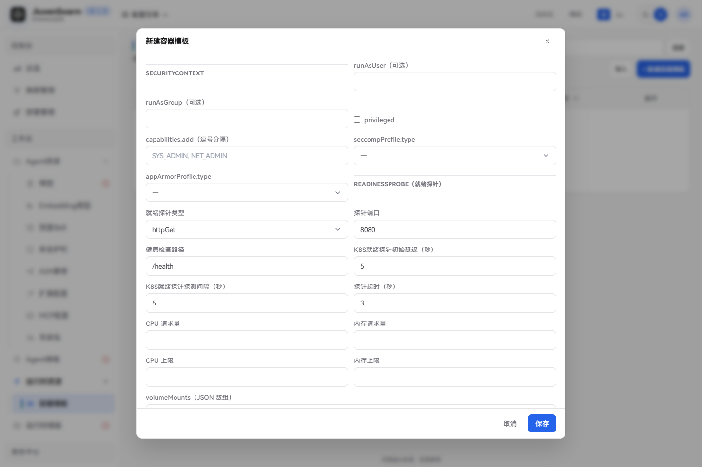
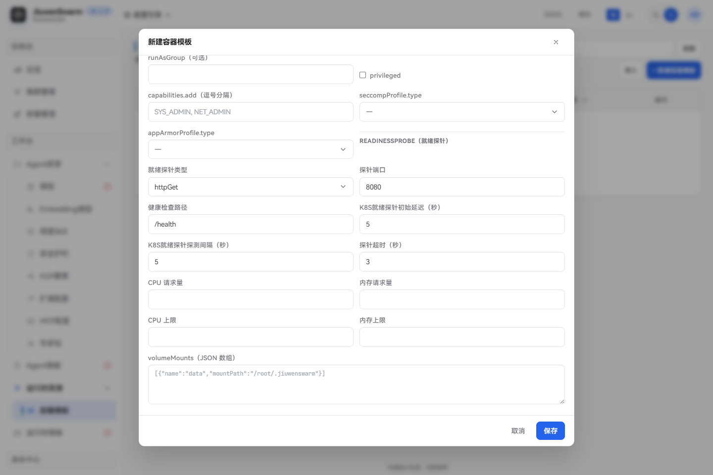
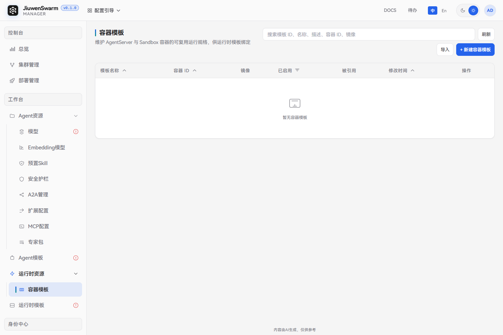

# 容器模板

## 功能说明

**容器模板**是管理员统一维护的容器运行规格，描述一个容器用什么镜像、开什么端口、用多少资源、以什么安全身份运行。它本身不会运行，需要被[运行时模板](../运行时模板.md)绑定，再随运行时模板配置到集群后，才会用于拉起 AgentServer 或 Sandbox 容器。

容器模板分两类用途：

- **AgentServer 主容器**：承载 Agent 运行时，处理对话、工具调用等业务。
- **Sandbox SideCar 容器**：与主容器同 Pod 部署的沙箱容器，为主容器提供隔离的代码执行环境。

两类模板都在同一个列表中维护，靠「容器 ID」被运行时模板引用。运行时模板中绑定主容器与 SideCar 的方式见[运行时模板](../运行时模板.md)。

## 使用流程概览

1. 在「工作台 → 运行时资源 → 容器模板」新建容器模板，AgentServer 主容器的模板须包含 `sse` 端口。
2. 在「工作台 → 运行时资源 → 运行时模板」中，通过容器 ID 绑定主容器与 SideCar。
3. 将运行时模板配置到集群（集群配置 → 运行时），配置下发后生效。
4. 用户会话触发时，集群按模板拉起容器。

## 管理面配置

### 新建容器模板

进入「工作台 → 运行时资源 → 容器模板」，点击「新建容器模板」，填写以下信息后点击 **保存**：

| 字段 | 说明 |
| ---- | ---- |
| **模板名称** | 必填，管理面展示用名称，最多 128 个字符 |
| **容器 ID** | 必填，业务唯一键，运行时模板通过该 ID 绑定此容器，最多 100 个字符 |
| **容器名称** | 必填，Pod 内的容器名，默认 `agent`，最多 128 个字符 |
| **镜像拉取策略** | 可选，`IfNotPresent`（默认）/ `Always` / `Never` |
| **镜像** | 必填，容器镜像地址，须为集群节点可拉取的镜像，最多 512 个字符 |
| **模板描述** | 可选，说明用途，最多 512 个字符 |
| **ports** | 可选，容器端口列表，JSON 数组，如 `[{"name":"sse","containerPort":8766}]`。**AgentServer 主容器必须包含 `name` 为 `sse` 的端口**，运行面的事件流路由依赖它 |
| **环境变量** | 可选，`KEY=value` 格式，每行一项 |
| **envFrom** | 可选，从 Secret / ConfigMap 注入环境变量，JSON 数组，如 `[{"secretRef":{"name":"jiuwenswarm-secret-configmap"}}]` |
| **runAsUser / runAsGroup** | 可选，容器运行的用户 / 组 ID |
| **privileged** | 可选，以特权模式运行，仅在镜像或业务确有需要时开启 |
| **capabilities.add** | 可选，额外授予的 Linux 能力，逗号分隔，如 `SYS_ADMIN, NET_ADMIN` |
| **seccompProfile.type** | 可选，`Unconfined` / `RuntimeDefault` |
| **appArmorProfile.type** | 可选，`Unconfined` / `RuntimeDefault` |
| **就绪探针类型** | `httpGet`（默认）或 `tcpSocket`，探测容器是否就绪 |
| **探针端口 / 健康检查路径** | 默认端口 `8080`、路径 `/health`（httpGet 类型才需要路径） |
| **就绪探针初始延迟 / 探测间隔 / 探针超时** | 默认分别为 5 秒 / 5 秒 / 3 秒 |
| **CPU 请求量 / CPU 上限** | 可选，K8s 规格，如 `500m`、`2`、`0.5`，留空不限制 |
| **内存请求量 / 内存上限** | 可选，须带单位，如 `512Mi`、`2Gi`，留空不限制 |
| **volumeMounts** | 可选，容器挂载卷，JSON 数组，如 `[{"name":"data","mountPath":"/root/.jiuwenswarm"}]`，卷本体在运行时模板的 Volumes 中定义 |

### 编辑、禁用与删除

- **编辑**：点击行内「编辑」，修改后保存即可，已被集群引用时变更会随配置下发生效。
- **禁用**：通过「已启用」列的开关控制。禁用后不能再被运行时模板新绑定。
- **删除**：点击行内「删除」。仍被运行时模板绑定时删除会被拒绝，需先在运行时模板中解绑。
- **被引用**：列表中的「被引用」数字表示绑定了该模板的运行时模板数量，点击可跳转查看。

### 导入

列表页的「导入」可导入实例池定义文件（JSON）：文件中含容器模板时会一并创建，含多个运行时模板时仅导入第一个。与运行时模板页的导入使用同一种文件格式。

## 注意事项

- AgentServer 主容器的 ports 必须包含 `name` 为 `sse` 的端口项，否则运行面路由无法建立事件流连接。
- `privileged` 与 `capabilities.add` 会放大容器权限，只给确实需要的模板开启，并优先用更小的权限组合。
- 镜像须在目标集群可拉取（镜像仓库凭证按集群部署约定配置），否则 Pod 会一直处于拉取失败状态。
- CPU / 内存填写格式有校验：CPU 支持 `500m`、`2`、`0.5`；内存须带 `Ki/Mi/Gi/K/M/G` 单位。
