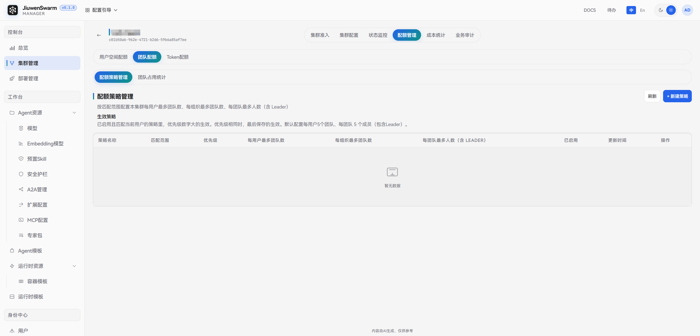
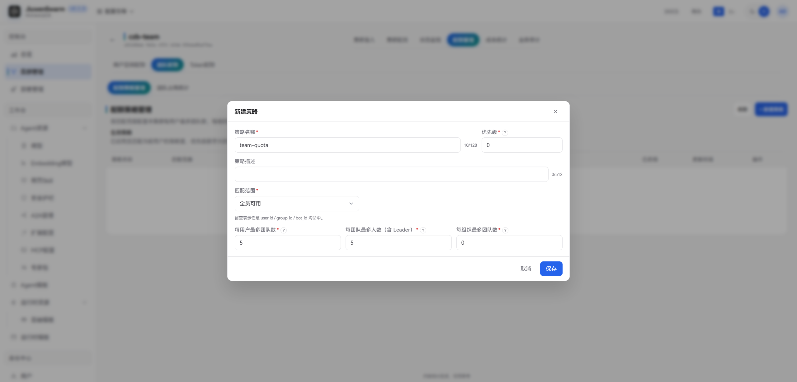
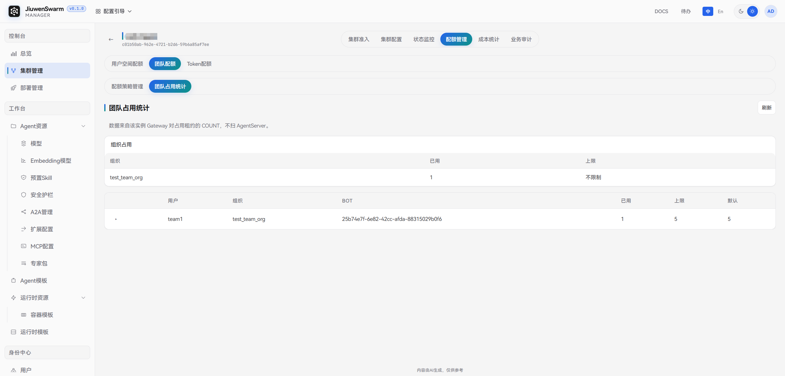
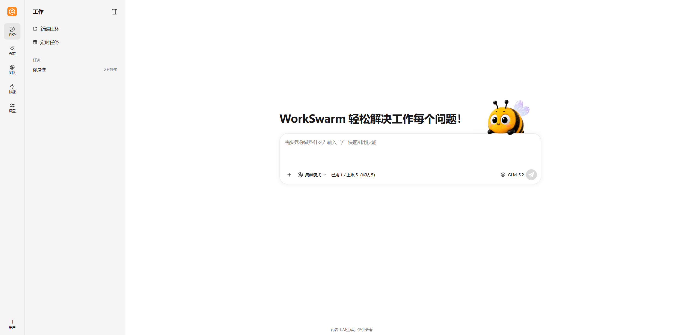
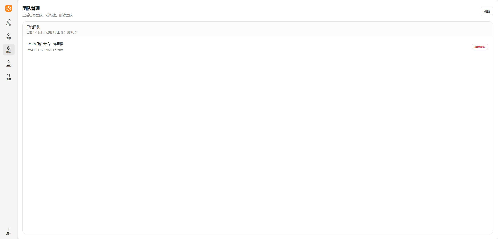

# 管理面团队配额

## 功能说明

**团队配额**用于限制集群模式创建的团队个数，分为三个层次进行管理：每个组织可以创建的团队数量，每个用户可创建的团队数量，以及每个团队可容纳的团队成员。管理员在管理面配置配额策略并下发到运行面后，用户新建团队或继续添加队员时按当前命中的策略校验。达到上限后，系统拒绝本次创建或加人，已有团队和已在队成员保持不变。

计数身份是用户、组织三元组。

配额包含三项：

| 额度 | 默认 | 统计口径 |
| ---- | ---- | ---- |
| **每组织最多团队数** | 0（不限制） | 该组织下所有成员、所有 Bot 作为所有者的活跃团队总和。填 0 表示该组织不封顶。 |
| **每用户最多团队数** | 5 | 该用户作为所有者的团队。加入别人的团队不计入。删除团队后释放名额。 |
| **每团队最多人数（含 Leader）** | 5 | 整队人数，含 Leader。填 5 表示 Leader 加上最多 4 名队员。名额在实际拉起队员时占用，队员退出或下线后释放。上限按**团队所有者**命中的策略计算。 |

未配置任何策略时，按上表默认值执行：每用户 5 个团队、每团队 5 人（含 Leader），组织不限制。

典型用途：

- 为集群配置一条「全员可用」默认策略，统一限制所有用户的团队数和团队规模。
- 按组织或用户配置更具体的策略，例如给研发组织更高的团队数。
- 为指定组织设置团队总数上限，避免单个组织占满集群内的团队资源。

## 使用流程概览

1. 进入目标集群的「配额管理 → 团队配额」。建议先新建一条「全员可用」策略；不建策略时按默认 5 / 5 执行，组织不限制。
2. 策略保存后下发到该集群网关。之后新建团队、按原话指定团队人数、以及拉起队员，都按最新命中的上限校验。
3. 用户在新建团队会话和「团队管理」中查看已用与上限。达到上限后不能再新建团队或添加队员。
4. 管理员在「团队占用统计」查看各组织、各用户及团队内的占用，并可下调或停用策略。已超出新上限的团队不会被删除或踢人，只是不能再新建或加人，直到占用回到上限以内。

## 管理面配置

### 入口

进入「控制台 → 集群管理」，打开目标集群详情后切换到「配额管理」页签，再选择 **团队配额**。页面包含两个子页：

- **配额策略管理**：新建、编辑、启停与删除本集群的配额策略。
- **团队占用统计**：查看本集群当前的组织占用和用户占用。

页面说明当前生效规则：已启用且匹配当前用户的策略里，**优先级数字大的生效**；优先级相同时，最后保存的生效。

### 新建配额略

在「配额策略管理」中点击「新建策略」，填写以下信息后点击 **保存**。保存时先下发到该集群网关，下发成功后再写入管理面。下发失败则本次保存失败，集群仍使用保存前的策略。

| 字段                    | 说明                                                                  |
| --------------------- | ------------------------------------------------------------------- |
| **策略名称**              | 必填，管理面展示用名称，最多 128 个字符。新建时默认 `team-quota`。                          |
| **优先级**               | 必填，整数，**越大越优先**。同一优先级可以有多条；同时命中时，最后保存的一条生效。新建和编辑都会刷新“最后保存”的时间。默认为0； |
| **策略描述**              | 可选，说明用途，最多 512 个字符。                                                 |
| **匹配范围**              | 必填。可选「全员可用」或「部分可用」。部分可用按条件匹配用户、组织，条件之间可用 AND / OR 组合。               |
| **每用户最多团队数**          | 必填，1 到 1000 的整数，默认 5。                                               |
| **每团队最多人数（含 Leader）** | 必填，1 到 1000 的整数，默认 5。                                               |
| **每组织最多团队数**          | 必填，0 到 1000 的整数，默认 0。0 表示不限制。                                       |

### 编辑、停用与删除

- **编辑**：点击行内「编辑」，可修改策略名称、描述、优先级、匹配范围和三项上限。
- **停用**：通过列表中「已启用」列的开关停用。停用后，原本命中该策略的主体改走下一条命中规则；都未命中时回到默认 5 / 5，组织不限制。
- **删除**：点击行内「删除」并确认。删除后的回落规则与停用相同。
- **下调上限**：保存后立即按新上限拦截后续的新建和加人。已经存在的团队和队员保持不变。

### 团队占用统计

切换到「团队占用统计」可查看两类数据，均可点击「刷新」重新读取：

- **组织占用**：按组织列出已用团队数和上限。上限为 0 时显示「不限制」。
- **用户占用**：按用户、组织、Bot 列出已用团队数、当前上限和默认上限。行首可展开该身份名下各团队，查看该团队的已用人数和人数上限。

尚无占用时列表为空。用户创建团队后才会出现记录。

# 用户面

## 集群模式使用

企业版用户在对话里把模式切到集群模式、且当前是新建会话时，输入区展示配额提示：

- 未达上限：`已用 {已用} / 上限 {上限}（默认 {默认}）`。组织设了上限时，后面再接 `组织已用 {已用} / 上限 {上限}`。
- 个人额度已满：`创建失败，一个用户最多有{n}个团队`，本次不能创建新团队。
- 组织额度已满：`创建失败，一个组织最多有{n}个团队`，本次不能创建新团队。
- 暂时读不到配额：显示「配额状态不可用」，不因此拦截输入。

达到人数上限时的表现：

| 场景 | 提示 | 行为 |
| ---- | ---- | ---- |
| 继续添加队员 | `人数已满：该团队最多{n}人（含 Leader），无法再添加队员` | 拒绝本次加人，队内现有成员不变。 |
| 创建时原话要求的整队人数已经超过上限 | `无法创建：你要求的是 {人数} 人团队，该团队最多 {n} 人（含 Leader）。` | 不创建该团队，也不占用团队名额。 |
| 队员校验暂时不可用 | `成员配额校验暂时不可用，本次未创建成员，请稍后重试` | 本次未加人，可稍后重试。 |

删除自己的团队后，个人和组织的团队名额都会释放。队员退出或被移出后，该团队的人数名额释放，可以再添加队员。

## 团队管理页面

- 「已有团队」下的 `当前 {n} 个团队`、个人额度，以及组织设了上限时才出现的组织额度。读不到配额时显示「配额状态不可用」，团队列表仍可查看。
- 每一行的会话、创建时间、状态和人类成员数。
- 删除团队确认后会释放个人和组织的名额，刷新后可以核对。

## 注意事项

- 改策略会立刻影响之后的建队和加人，建议在业务低峰期下调上限。已超出新上限的团队继续保留，只是不能再新建或加人。
