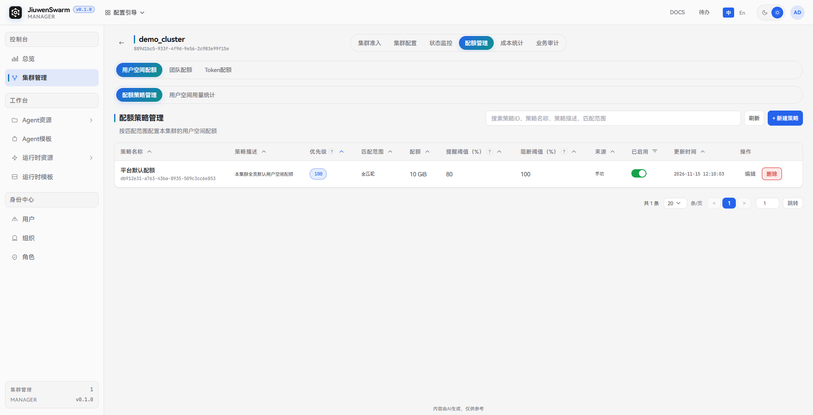
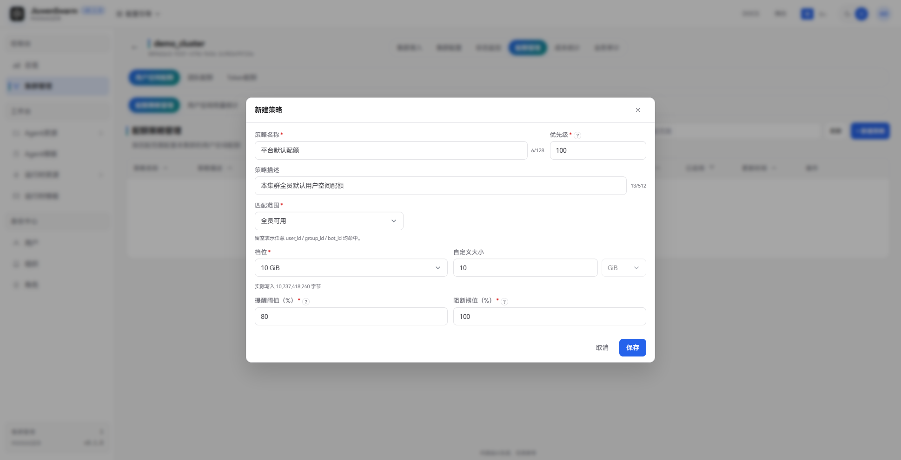
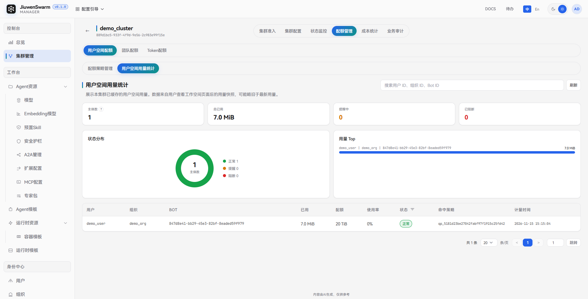
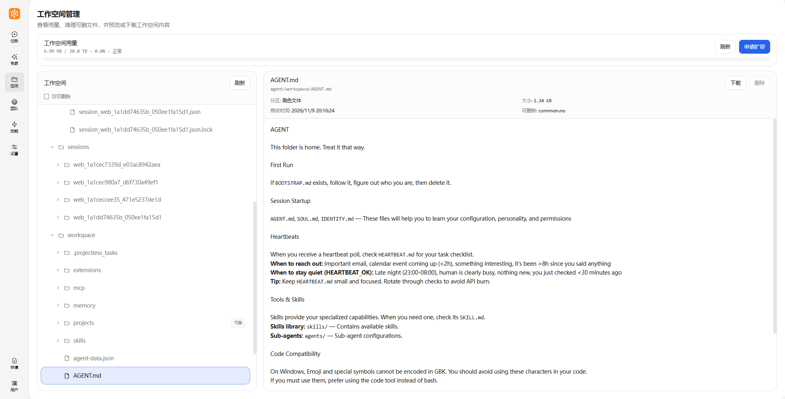
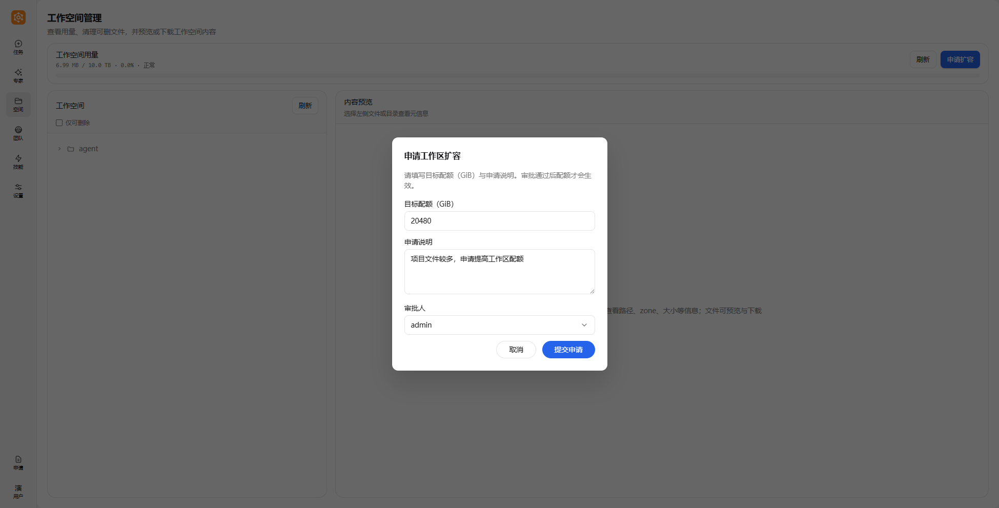
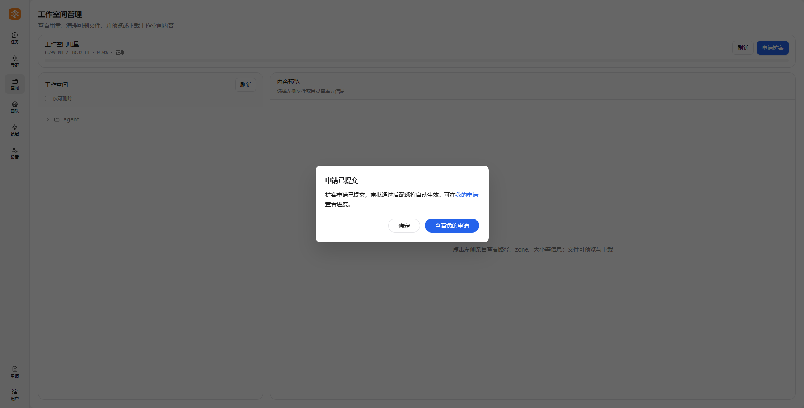
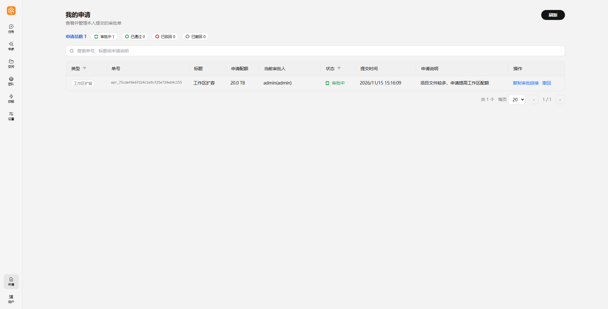
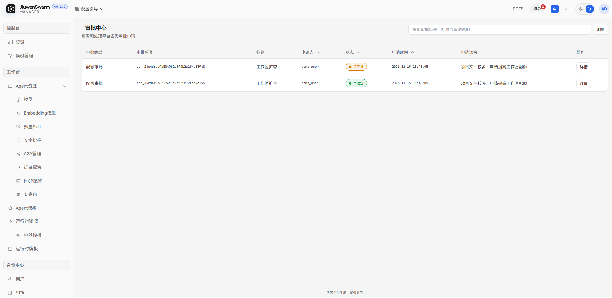
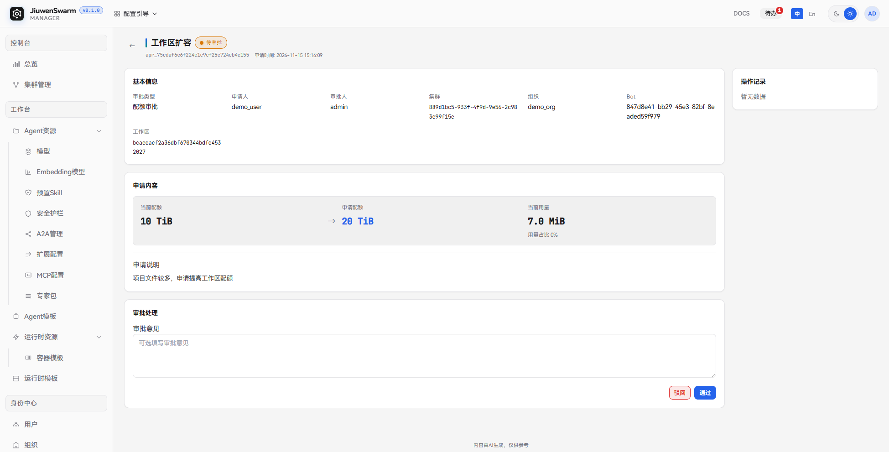
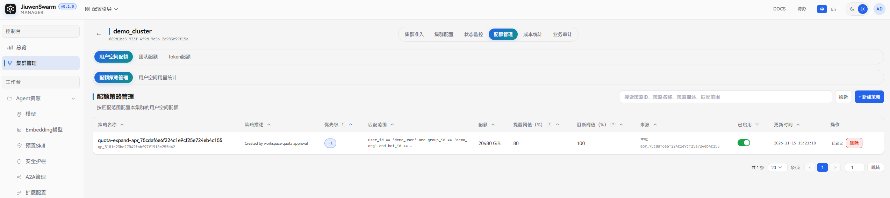

# 用户空间配额

## 功能说明

**用户空间配额**用于按集群限制每个工作区身份（用户 / 组织 / Bot 三元组）可占用的磁盘空间。管理员在管理面配置配额策略并下发到运行面后，用户可在用户面查看用量、清理可删文件。用量接近或达到上限时系统会提醒或阻断继续占用空间的写入，用户也可发起扩容申请，经管理员审批后生效。

典型用途：

- 为集群配置一条「全匹配」默认配额，统一限制所有用户的工作区占用。
- 按组织或用户配置更具体的策略，例如给研发组织更高额度。
- 用户空间不足时，由用户发起扩容，管理员在审批中通过后自动写入更高优先级的个人策略。

### 相关配置项

以下项在企业部署目录的 `.env.custom` 中配置，按部署流程使配置生效，部署与改配步骤见[《集群部署指南》](../../../../快速开始/集群部署指南.md)的「配置 .env.custom」章节。

| 配置项 | 默认值 | 说明 |
| ---- | ---- | ---- |
| `WORKSPACE_QUOTA_ENABLED` | `false` | **用户空间配额**总开关。注入管理面、用户面、Gateway、AgentServer。为 `true` 时启用配额策略、用量、写盘门禁与用户面工作空间页；为 `false` 时上述能力关闭 |

## 使用流程概览

完整生效链路如下：

1. 在企业部署目录的 `.env.custom` 中设置 `WORKSPACE_QUOTA_ENABLED=true`，并按部署流程使配置生效。
2. 进入目标集群的「配额管理 → 用户空间配额」，新建至少一条配额策略（建议先建全匹配默认策略）。
3. 策略保存后下发到网关，用户在用户面查看工作空间用量，并按需清理可删文件。
4. 用量达到提醒阈值时出现提醒，达到阻断阈值后，会拒绝继续增加占用的写盘操作。用户可发起扩容，管理员审批通过后生效。

## 管理面配置

### 入口

进入「控制台 → 集群管理」，打开目标集群详情后切换到「配额管理」页签，再选择 **用户空间配额**。页面包含两个子页：

- **配额策略管理**：新建、编辑、启停与删除本集群的配额策略。
- **用户空间用量统计**：查看本集群已缓存的用量快照（来自用户打开工作空间后的计量结果，可能略旧于最新用量）。

### 新建配额策略

在「配额策略管理」中点击「新建策略」，填写以下信息后点击 **保存**：

| 字段 | 说明 |
| ---- | ---- |
| **策略名称** | 必填，管理面展示用名称，最多 128 个字符。 |
| **优先级** | 必填，整数，**越小越优先**。管理员手写策略须 ≥ 0，且同一集群启用中的非负优先级不可重复。扩容审批通过写入的策略固定为 `-1`（可多条并存），恒优先于管理员策略。|
| **策略描述** | 可选，说明用途，最多 512 个字符。 |
| **匹配范围** | 必填。可选「全员可用」或「部分可用」（按条件匹配 `user_id` / `group_id` / `bot_id`）。选路时在本集群已启用策略中，取命中且优先级最小的一条生效。 |
| **档位** | 必填，配额大小。可选无限制、0（不分配空间）、预设 GiB 档位，或自定义大小与单位。 |
| **提醒阈值（%）** | 必填，默认 80。已用占比达到该值后提醒用户即将超限，仍允许写入。 |
| **阻断阈值（%）** | 必填，默认 100，且须大于提醒阈值。已用占比达到该值后，拒绝会增加用户空间占用的写盘操作。 |

### 编辑、停用与删除

- **编辑**：点击行内「编辑」，可修改策略信息。来源为「审批」的策略已锁定，不可改配额与匹配范围，仅可停用或删除。
- **停用**：通过列表中「已启用」列的开关停用。停用后，原本命中该策略的主体改走下一条命中规则。
- **删除**：点击行内「删除」。删除后，原本命中该策略的主体改走下一条命中规则。
- **下调配额**：若下调后已有主体已用空间超过新上限，保存前会二次确认，确认后这些主体将进入阻断状态，直至清理或再扩容。

### 用户空间用量统计

切换到「用户空间用量统计」可查看主体数、总已用、提醒中、已阻断等汇总，以及按用户 / 组织 / Bot 的用量列表。数据来自用量缓存，用户打开工作空间页面后才会出现记录。

## 用户面使用

开启配额后，用户登录用户面，在侧栏进入 **空间**，打开「工作空间管理」页。顶栏展示用量条与百分比，可刷新用量、浏览目录、清理可删文件，并可发起扩容申请。

用量状态：

| 状态 | 条件 | 行为 |
| ---- | ---- | ---- |
| **正常** | 已用 &lt; 提醒阈值 | 可正常写入。 |
| **提醒** | 已用 ≥ 提醒阈值，且 &lt; 阻断阈值 | 提示即将超限，仍可写入。 |
| **阻断** | 已用 ≥ 阻断阈值 | 拒绝会增加磁盘占用的操作，列目录、删除、只读预览与发起扩容仍可用。 |

可勾选「仅可删除」过滤列表。可删内容主要包括会话任务产物、会话待办，以及聊天附件等 artifact 类文件。角色设定、技能包、记忆库、会话历史元数据等受保护路径不可删。会话历史需通过删除会话等方式清理，不能在工作空间中直接删单文件。

### 申请扩容

当空间不足或需要更高额度时，可在工作空间页点击 **申请扩容**：

1. 填写 **目标配额（GiB）**（须大于当前生效配额）、**申请说明**，并选择 **审批人**。
2. 点击 **提交申请**。提交成功后可前往「我的申请」查看进度。

3. 在侧栏 **申请** 打开「我的申请」，可查看状态（审批中 / 已通过 / 已驳回 / 已撤回），并可撤回审批中的申请。

4. 管理员登录管理面，在顶栏 **待办** 进入「审批中心」，打开对应「工作区扩容」单据，填写审批意见后点击 **通过** 或 **驳回**。

5. 审批通过后，系统写入优先级为 `-1` 的个人配额策略并下发；用户侧生效配额更新，无需重新部署。可在「配额策略管理」中查看该策略（来源为「审批」，已锁定，仅可停用或删除）。

## 注意事项

- 改配额策略会下发到网关并影响写盘门禁，建议在业务低峰期调整；下调额度可能导致已超限主体立即被阻断。
- 用量统计依赖用户打开工作空间后的缓存快照，管理面列表可能略旧于磁盘实时占用。
- 审批来源策略不可在管理面直接改额度；需通过扩容审批调整。
