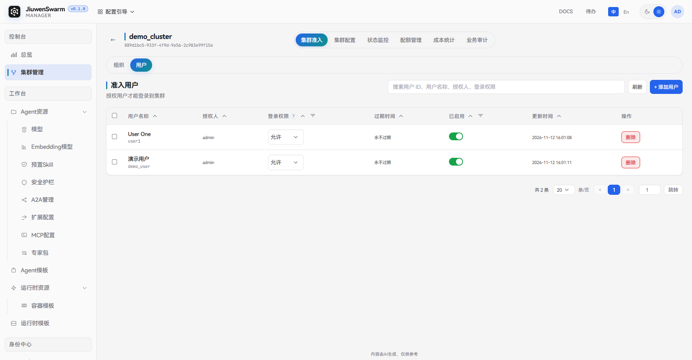
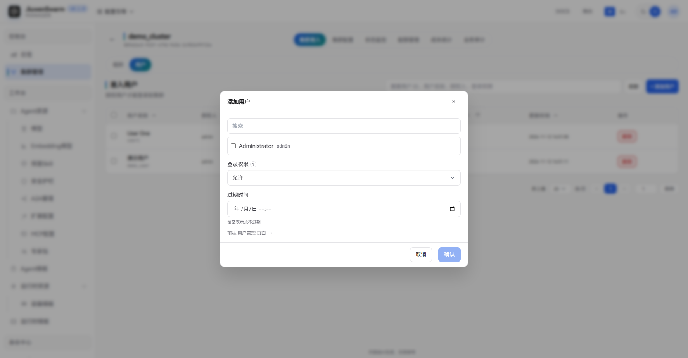

# 集群准入

## 功能说明

**集群准入**用于控制哪些用户可以登录某个集群的用户面。管理员可以按组织或按用户授予准入，并为每条准入设置登录权限（允许或拒绝）和过期时间。

集群准入只决定用户能否进入该集群。用户要在集群中正常对话，还需同时满足以下条件：

1. 已被集群准入。
2. 至少有一个 Agent 的授权范围覆盖该用户。
3. 至少有一个运行时的授权范围覆盖该用户。

后两项在集群的「集群配置」中设置。

典型用途：

- 按组织批量开通，让整个部门的成员都能使用某个集群。
- 为临时用户设置过期时间，到期后自动失去登录权限。
- 在已准入的组织中，对个别用户设置「拒绝」，禁止其登录。

## 准入规则

用户登录集群时，系统会汇总该用户本人的准入记录，以及其所在组织的准入记录，按以下规则判定：

- 只有「已启用」且未过期的准入记录才会参与判定。
- 只要有一条记录的登录权限为「拒绝」，用户就无法登录，**拒绝优先级高于允许**。
- 没有「拒绝」记录时，只要有一条记录为「允许」，用户即可登录。
- 没有任何有效记录时，用户无法登录。

例如，组织 A 已准入且登录权限为「允许」，其成员张三单独添加了一条「拒绝」的准入记录，则组织 A 的其他成员可以登录，张三无法登录。

## 管理面配置

### 入口

进入「控制台 → 集群管理」，点击目标集群卡片上的「准入」，或打开集群详情后切换到「集群准入」页签。页面分为「组织」和「用户」两个子页签，分别管理准入组织和准入用户，两者操作方式相同。

### 添加准入

在「组织」或「用户」子页签中，点击「添加组织」或「添加用户」，填写以下信息后点击「确认」：

| 字段 | 说明 |
| ---- | ---- |
| **选择组织 / 用户** | 必选，可多选，列表中仅显示尚未添加到本集群的组织或用户。若暂无选项，可点击弹框底部的链接，前往「身份中心」中的组织或用户页面创建。 |
| **登录权限** | 必选，可选「允许」或「拒绝」，默认「允许」。拒绝优先级高于允许。 |
| **过期时间** | 可选，到期后该准入记录自动失效。留空表示永不过期。 |

### 修改与移除

- **修改登录权限**：在列表的「登录权限」列中直接切换「允许」或「拒绝」。
- **启用 / 禁用**：通过列表中「已启用」列的开关启用或禁用。禁用后，该准入记录不再参与判定，但保留配置，可随时重新启用。
- **删除**：点击行内「删除」，或勾选多条记录后点击页头的「删除」批量移除。

## 注意事项

- 准入的修改即时生效。用户被移除、禁用或准入过期后，再次访问该集群时会被拒绝，无需重新部署。
- 组织准入对该组织的所有成员生效，成员变化后无需重新配置准入。
- 未被任何集群准入的用户登录用户面时，会提示「当前账号没有可访问的集群，请联系管理员开通准入」。
