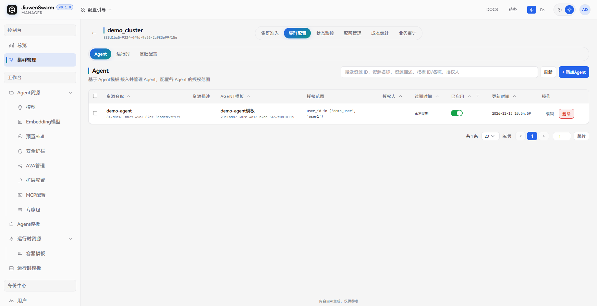
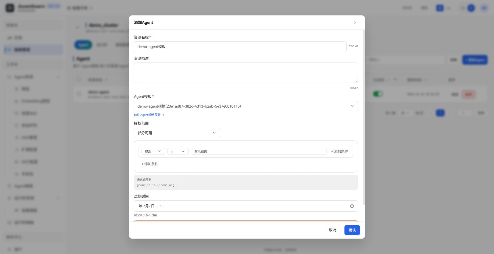
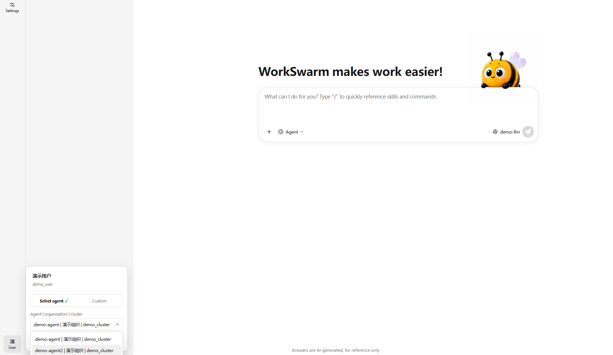

# Agent

## 功能说明

**Agent** 是把管理面中的 **Agent 模板** 配置到某个集群后的实例化结果。管理员在集群上选择 Agent 模板、填写资源名称，并设置授权范围。配置下发后，被授权的用户才能在该集群的用户面使用对应 Agent 进行对话。Agent 本身不定义模型、Skill、MCP 等内容，这些能力来自它所引用的Agent模板。同一Agent 模板可以配置到多个集群，也可以在同一集群中添加多次（例如用不同的授权范围分别开放给不同组织或用户）。

典型用途：

- 按组织或用户限制可用 Agent，例如客服组织只能使用客服助手，研发组织使用研发助手。
- 为临时开放设置过期时间，到期后自动失效。

## 使用流程概览

完整生效链路如下：

1. 在「工作台 → Agent资源」中准备模型等资源，并在「工作台 → Agent模板」中创建 Agent 模板。
2. 在「控制台 → 集群管理」为目标集群配置集群准入。
3. 在集群的「集群配置 → Agent」中添加该 Agent 模板，并设置授权范围。
4. 在「集群配置 → 运行时」中添加运行时，并确保授权范围同样覆盖目标用户。
5. 用户登录用户面后，即可使用已授权的 Agent 对话。

## 管理面配置

### 入口

进入「控制台 → 集群管理」，点击目标集群卡片上的「配置」，或打开集群详情后切换到「集群配置」页签，再选择 **Agent** 子页。

列表展示本集群已添加的 Agent，包括资源名称、资源描述、引用的 Agent 模板、授权范围、授权人、过期时间、启用状态和更新时间。

### 添加 Agent

点击「添加Agent」，填写以下信息后点击「确认」：

| 字段 | 说明 |
| ---- | ---- |
| **资源名称** | 必填，本集群内该 Agent 的展示名称，用户面可见，最多 128 个字符。选择 Agent 模板后，若尚未填写名称，会自动带入模板名称，可再修改。 |
| **资源描述** | 可选，说明用途，最多 512 个字符。 |
| **Agent模板** | 必填，选择要接入本集群的 Agent 模板。下拉列表来自「工作台 → Agent模板」。若暂无选项，可点击下方「前往 Agent模板 页面」去创建。添加后可在编辑时更换；更换后资源 ID 保持不变。 |
| **授权范围** | 可选，控制哪些用户可以使用该 Agent，默认为「全员可用」。详见下方「授权范围」 |
| **过期时间** | 可选，到期后该 Agent 授权自动失效。留空表示永不过期。 |

### 授权范围

授权范围决定：在本集群已准入的用户中，谁可以使用该 Agent。

- **全员可用**：本集群中所有已准入用户均可使用该 Agent。
- **部分可用**：按条件匹配。可选字段为「群组」（对应身份中心中的**组织**）和「用户」，运算符支持 `in` / `not in`，可添加多条条件。页面下方会显示表达式预览，例如 `group_id in ('demo_org')` 或 `user_id in ('demo_user', 'user1')`。

说明：

- 授权范围只约束「能否使用该 Agent」，不替代集群准入。用户仍须先被准入，才能登录用户面。
- 选择「部分可用」并按组织或用户填写匹配条件时，系统会按条件中的组织 / 用户自动补齐对应的集群准入记录（若尚不存在），减少重复配置。
- 「全员可用」不会自动添加准入对象，仍需在「集群准入」中单独配置。

### 编辑、禁用与删除

- **编辑**：点击行内「编辑」，可修改资源名称、资源描述、绑定的 Agent 模板、授权范围和过期时间。更换模板时资源 ID 保持不变，配置会重新下发到网关。
- **禁用**：通过列表中「已启用」列的开关启用或禁用。禁用后，用户面不再提供该 Agent，配置仍保留，可随时重新启用。
- **删除**：点击行内「删除」，或勾选多条后点击页头「删除」批量移除。

## 用户面使用

用户登录用户面后，系统会按该用户被授权的 Agent 列出可选项。用户选择某个 Agent 后，对话按该 Agent 所引用的 Agent 模板运行（模型、Skill、MCP 等均来自模板）。

## 注意事项

- 添加、修改、禁用或删除 Agent 后，配置会下发到网关并触发运行时强制刷新（`config_refresh`）：该运行时下全部 AgentServer Pod 会优雅下线并按新配置重建。已有会话不受影响；重建期间新会话启动可能变慢，短时间内连续修改可能被容量保护暂时拒绝，稍后会自动恢复。建议在业务低峰期变更。
- Agent 只决定「谁能用哪套 Agent 模板」；模板内模型、Skill 等内容的修改，在「工作台 → Agent模板」中完成，保存后同样会下发并刷新运行时。
- 仅配置 Agent 不够，还需同时配置[运行时](./运行时.md)，且两者的授权范围都要覆盖目标用户。
