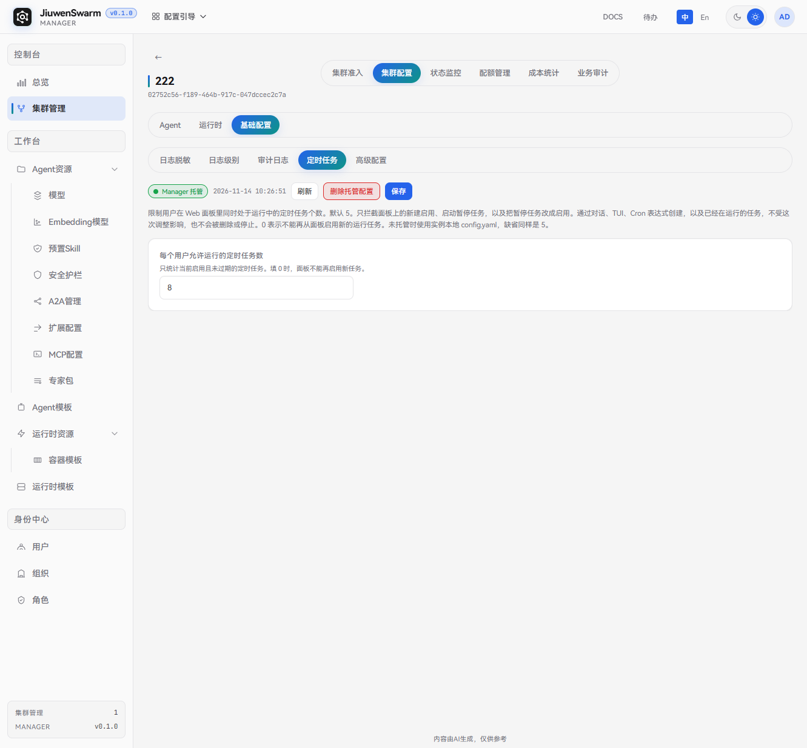
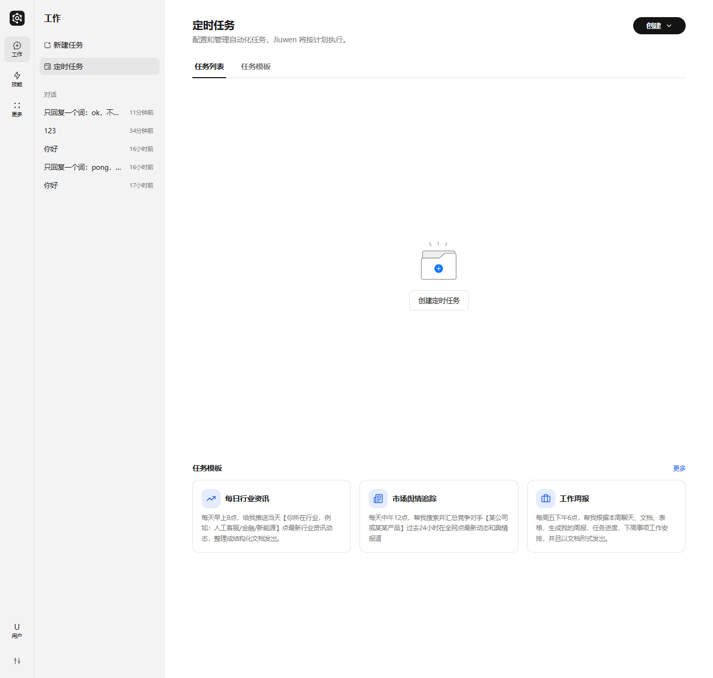
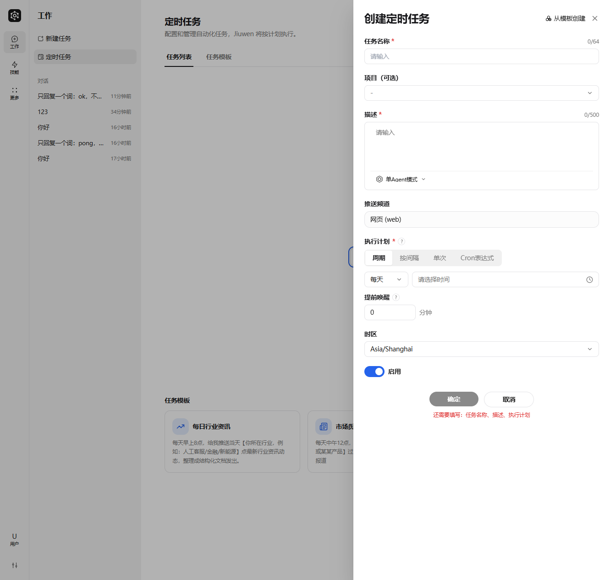

# 定时任务

## 功能说明

**定时任务**本页配置的是企业版集群中「每个用户允许同时处于运行中的定时任务个数」上限，不是用来在管理面直接创建、编辑或删除用户的定时任务。

用户真正创建与管理定时任务的地方在用户面 **Web 定时任务面板**（也可通过对话、TUI、Cron 表达式等方式创建）。管理面保存的上限会写入 Manager，并下发到 Gateway；未托管时 Gateway 使用实例本地 `config.yaml`，缺省同样为 **5**。

本页限制的作用范围：

| 行为 | 是否受本页上限约束 |
| ---- | ---- |
| Web 面板新建并**启用**任务 | 是 |
| Web 面板启动已暂停任务、或把暂停任务改为启用 | 是 |
| 通过对话、TUI、Cron 表达式创建的任务 | 否 |
| 已经在运行中的任务 | 否（不会因调低上限被删除或停止） |

统计口径：只统计当前**启用且未过期**的定时任务。填 **0** 表示不能再从 Web 面板启用任何新的运行中任务。

典型用途：

- 控制单用户在 Web 面板上堆积过多启用态定时任务，避免调度与资源压力过大。
- 按环境统一托管上限：测试环境可设得较低，生产环境按容量调整。
- 临时将上限设为 `0`，禁止用户再从面板启用新任务，同时保留已有运行中任务。

## 使用流程概览

完整链路如下：

1. 在管理面「控制台 → 集群管理」进入目标集群，打开「集群配置 → 基础配置 → 定时任务」，填写每个用户允许运行的定时任务数并保存。
2. Manager 先推送 Gateway `PUT /api/v1/cron-policy`，再落库；页面显示「Manager 托管」。
3. 用户登录用户面，在「工作 → 定时任务」中创建、启用或管理任务；面板侧启用类操作会受到该上限约束。
4. 若需回退，可在本页删除托管配置，Gateway 将使用本地 `config.yaml` 中的缺省策略。

## 管理面配置

### 入口

进入「控制台 → 集群管理」，打开目标集群的 **集群配置**，再选择 **基础配置 → 定时任务**。

页头可 **刷新**、**保存**。若已存在 Manager 托管配置，还会显示「Manager 托管」及最近更新时间，并可 **删除托管配置**。

### 配置项

| 字段 | 说明 |
| ---- | ---- |
| **每个用户允许运行的定时任务数** | 必填，非负整数。默认展示 `5`。只统计当前启用且未过期的定时任务；`0` 表示面板不能再启用新任务 |

说明：

- 输入须为大于或等于 `0` 的整数，否则无法保存。
- 调低上限**不会**自动停用或删除已经在运行的任务；已超出新上限的存量任务会继续运行，只是用户无法再从面板继续启用更多任务。
- 通过对话、TUI、Cron 表达式创建的任务不计入本页的「面板启用」拦截逻辑，也不会因本页调整被删除或停止。

### 保存、托管与删除

- **保存**：经校验后先推送到 Gateway，再写入 Manager。成功后显示「Manager 托管」及更新时间。
- **未托管**：尚未保存过托管配置时，页面展示默认值 `5`；运行侧使用实例本地 `config.yaml`（缺省同样是 5）。
- **删除托管配置**：先通知 Gateway 删除策略，再清除 Manager 库中的记录。删除后 Gateway 回退到 `config.yaml`。

## 用户面使用

定时任务的创建与日常管理在用户面完成，不在管理面本页操作。

1. 用户登录用户面后，进入左侧「工作 → **定时任务**」。
2. 在 **任务列表** 中查看已有任务，或点击 **创建 / 创建定时任务** 新建；也可从底部 **任务模板** 快速创建。

3. 在创建抽屉中填写任务名称、描述、推送频道、执行计划（周期 / 按间隔 / 单次 / Cron 表达式）、时区，并选择是否启用后确认。

说明：

- 当用户当前「启用且未过期」的任务数已达到管理面配置的上限时，Web 面板上的新建启用、启动暂停任务、将暂停改为启用会失败；对话、TUI 等其它创建路径不受本页上限拦截。
- 企业版用户按被授权的 Agent / 项目使用定时任务能力，无需在管理面为本页单独授权模型或模板。

## 注意事项

- 本页只配置**个数上限策略**，不展示、不编辑用户的具体定时任务列表。
- 保存依赖 Gateway 可达：推送失败时不会落库，页面也不会变为「Manager 托管」。
- 删除托管配置后回退到 `config.yaml`，不会清空用户已经创建的任务。
- 调低上限对存量运行中任务无破坏性影响；若需减少实际运行任务数，请到用户面暂停或删除对应任务。
- 多副本 Gateway 建议开启配置轮询，以便各副本及时拿到最新策略。
