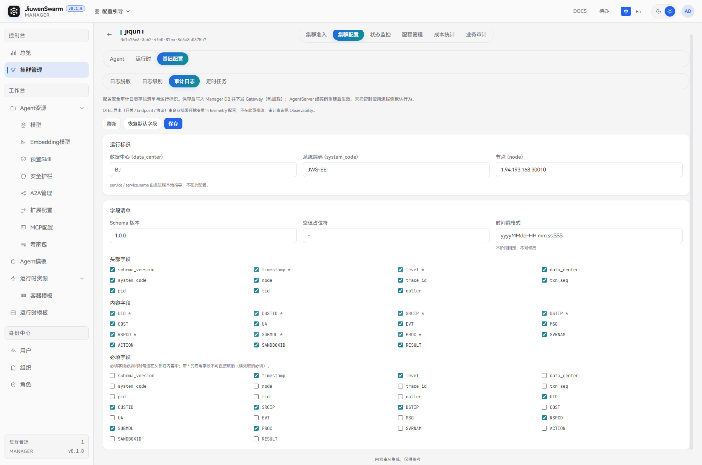
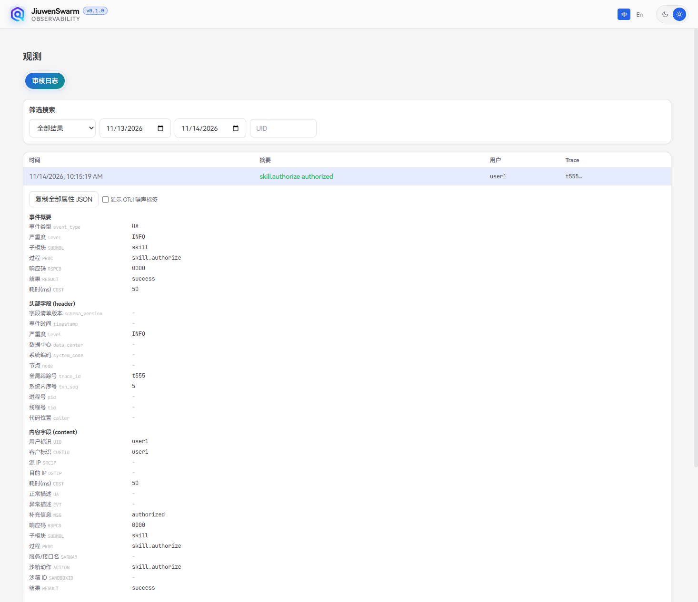

# 审计日志

## 功能说明

**审计日志**用于记录企业版集群中用户接入、会话、文件、沙箱、技能授权等关键行为的安全审计事件。事件按可配置的**字段清单**和**运行标识**组装为结构化属性，经 OpenTelemetry Logs 上报，由采集链路写入 Loki，再在 **Observability（观测）** 界面查询。

本页配置的是**审计字段与运行标识**，不是应用文本日志。与「日志级别」「日志脱敏」的区别：

| 能力 | 作用对象 | 本页是否配置 |
| ---- | ---- | ---- |
| **审计日志** | 安全/行为审计事件（UA / EVT） | 是：字段清单、运行标识 |
| **日志级别** | 应用 `logging` 文本日志级别 | 否（见「日志级别」） |
| **日志脱敏** | 应用日志中的敏感信息替换 | 否（见「日志脱敏」） |

配置保存后写入 Manager，并下发到 Gateway（热加载）；AgentServer 经实例重建后生效。OTEL 导出的开关、Endpoint、协议由企业部署环境变量与 telemetry 配置，**不在本页修改**。`service` / `service.name` 由各进程本地推导，也不在此配置。

典型用途：

- 为审计事件统一标注数据中心、系统编码、节点等运行标识，便于跨环境关联。
- 按企业规范裁剪头部字段、内容字段与必填字段，控制上报内容。
- 在 Observability 中按事件类型、时间范围、用户标识检索正常（UA）与异常（EVT）审计记录。

## 使用流程概览

完整链路如下：

1. 在管理面「控制台 → 集群管理」进入目标集群，打开「集群配置 → 基础配置 → 审计日志」，填写运行标识与字段清单并保存。
2. Gateway 热加载新配置；AgentServer 在配置刷新触发重建后按新配置写出。
3. 确保部署侧已开启 OTEL Logs 导出，并将日志接入 Loki。
4. 打开 Observability「审核日志」页，按结果类型、时间、UID 筛选并查看详情。

## 管理面配置

### 入口

进入「控制台 → 集群管理」，打开目标集群的 **集群配置**，再选择 **基础配置 → 审计日志**。

页头可 **刷新**、**恢复默认字段**、**保存**。若已存在 Manager 托管配置，还会显示「Manager 托管」及最近更新时间，并可 **删除托管配置**。

### 运行标识

| 字段 | 说明 |
| ---- | ---- |
| **数据中心 (data_center)** | 可选，最多 32 个字符，默认 `N` |
| **系统编码 (system_code)** | 可选，最多 64 个字符，默认 `-` |
| **节点 (node)** | 可选，最多 128 个字符，建议填写 `IP:PORT` |

`service` / `service.name` 由 Gateway、AgentServer 等进程本地推导（如 `jiuwenclaw-gateway`），不在本页配置。

### 字段清单

| 字段 | 说明 |
| ---- | ---- |
| **Schema 版本** | 必填，字段清单版本号，默认 `1.0.0` |
| **空值占位符** | 必填，缺省字段写入的占位值，默认 `-` |
| **时间戳格式** | 固定为 `yyyyMMdd-HH:mm:ss.SSS`，本阶段不可修改 |
| **头部字段** | 勾选写入审计头部的字段；带 `*` 的字段表示当前仍为必填，不可直接取消启用 |
| **内容字段** | 勾选写入审计内容的字段 |
| **必填字段** | 勾选为必填的字段，必须同时出现在头部或内容中；勾选必填时若未启用，会自动加入对应启用列表 |

默认头部字段：`schema_version`、`timestamp`、`level`、`data_center`、`system_code`、`node`、`trace_id`、`txn_seq`、`pid`、`tid`、`caller`。

默认内容字段：`UID`、`CUSTID`、`SRCIP`、`DSTIP`、`COST`、`UA`、`EVT`、`MSG`、`RSPCD`、`SUBMDL`、`PROC`、`SVRNAM`、`ACTION`、`SANDBOXID`、`RESULT`。

默认必填字段：`timestamp`、`level`、`UID`、`CUSTID`、`SRCIP`、`DSTIP`、`RSPCD`、`SUBMDL`、`PROC`。

点击 **恢复默认字段** 仅重置页面勾选为上述默认集，需再点 **保存** 才会下发。

### 保存、托管与删除

- **保存**：经校验后写入 Manager，并先推送到 Gateway，再落库。Gateway 对本进程立即热加载；AgentServer 通过配置刷新重建后生效。
- **未托管**：尚未保存过托管配置时，页面展示默认表单；运行侧按进程默认行为处理，企业版在无托管配置行时通常不写出审计事件。
- **删除托管配置**：先通知 Gateway 删除配置，再清除 Manager 库中的记录。删除后企业版停止按托管配置写出审计（与日志级别「回退 config.yaml」不同）。

## 观测面查询

审计事件的查询不在管理面「业务审计」页完成，请打开 Observability：

1. 打开观测界面（部署后的 Observability 入口，例如本环境 `http://<host>:30004/`）。
2. 进入 **审核日志**。
3. 按需筛选：
   - **结果类型**：全部结果 / 正常 (UA) / 异常 (EVT)
   - **时间范围**
   - **UID**：按用户标识过滤
4. 在列表中查看时间、摘要、用户、Trace；打开详情可查看事件概要、头部字段、内容字段与扩展属性，并可复制全部属性 JSON。

说明：

- 事件类型固定写出为 `UA`（正常）或 `EVT`（异常），与内容中的 `UA` / `EVT` 描述字段对应。
- 能否查到数据取决于部署侧 OTEL Logs 是否已导出到 Loki；仅保存本页字段配置、未接通采集链路时，观测页可能一直为空。

## 常见审计范围

运行时在约定挂点写出审计事件，常见包括：

| 类型 | 示例 |
| ---- | ---- |
| **用户接入 / 会话** | 身份解析、停止生成、删除会话等 |
| **文件** | 上传、下载、下发文件给用户等 |
| **沙箱** | 创建、删除沙箱等 |
| **技能授权** | 技能动态授权确认等 |
| **出站调用** | Gateway 向 AgentServer 发送会话请求等 |

成功类事件多为 UA，失败或异常多为 EVT。具体挂点随版本演进，以实际写出与观测结果为准。

## 注意事项

- Gateway 热加载与 AgentServer 重建是两种生效节奏：保存后 Gateway 可立即使用新标识与字段；AgentServer 需等待 Pod 重建完成，其间两端可能短暂不一致。
- 多副本 Gateway 建议开启配置轮询；否则只有收到推送的副本会立即更新。
- OTEL 导出不在本页配置。部署需正确设置 `OTEL_*` 与日志导出，否则观测界面查不到审计数据。
- 时间戳格式本阶段固定为 `yyyyMMdd-HH:mm:ss.SSS`，不可改为其它格式。
- 必填字段必须是已启用（头部或内容）字段的子集；带 `*` 的启用字段需先取消必填，才能取消启用。
- 删除托管配置后不会回退到 `config.yaml` 的审计段；企业版在无托管行时停止写出。
- 管理面「业务审计」页签当前为占位，正式查询请使用 Observability「审核日志」。
