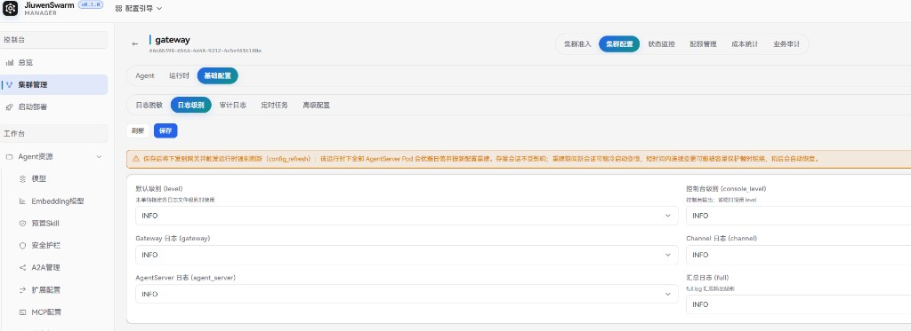

# 日志级别

## 功能说明

**日志级别**用于按集群统一托管 Gateway 与相关组件的日志输出级别，对应实例本地 `config.yaml` 中的 `logging` 段。管理员在管理面保存后，配置会写入 Manager 数据库并下发到 Gateway；Gateway 侧对日志级别做热更新，同时触发运行时 `config_refresh`，使 AgentServer 按新配置重建。

未在管理面托管时，集群继续使用实例本地 `config.yaml`（及环境变量对控制台级别的覆盖）。托管后，管理面配置优先于本地 YAML。

典型用途：

- 生产环境保持 `INFO`，临时将 `gateway` 或 `agent_server` 调为 `DEBUG` 做排障。
- 降低控制台或汇总日志级别，减少磁盘与 stderr 输出。
- 删除托管配置，让集群回退到部署时的 `config.yaml`。

## 使用流程概览

1. 使用管理员账号登录管理面，进入「控制台 → 集群管理」。
2. 打开目标集群，进入「集群配置 → 基础配置 → 日志级别」。
3. 按需调整各通道级别，点击「保存」。
4. 确认页头出现「Manager 托管」标记；排障结束后可将级别改回，或「删除托管配置」回退到 YAML。

## 管理面配置

### 入口

进入「控制台 → 集群管理」，在目标集群卡片上点击「配置」，或打开集群详情后选择「集群配置」。在「基础配置」下切换到「日志级别」页签。

### 配置项

各字段可选：`DEBUG`、`INFO`、`WARNING`、`ERROR`、`CRITICAL`、`NOTSET`。页面初次打开且尚未托管时，表单默认全部为 `INFO`。

| 字段 | 说明 |
| ---- | ---- |
| **默认级别 (level)** | 未单独指定各日志文件级别时使用的基础级别。 |
| **控制台级别 (console_level)** | 控制台（stderr）输出级别；省略时沿用 `level`。环境变量 `LOG_LEVEL` 只影响控制台，不改变各组件日志文件级别。 |
| **Gateway 日志 (gateway)** | 网关组件写入 `gateway.log` 的级别。排障热路径明细时需临时设为 `DEBUG`。 |
| **Channel 日志 (channel)** | 渠道组件写入 `channel.log` 的级别。 |
| **AgentServer 日志 (agent_server)** | AgentServer 组件写入 `agent_server.log` 的级别。 |
| **汇总日志 (full)** | 汇总日志 `full.log` 的输出级别（不含网关组件）。 |

### 保存与托管状态

- 点击「保存」：先推送到 Gateway，成功后再写入 Manager 库。Gateway 对日志级别热加载；同时通知 Runtime 执行 `config_refresh`，该运行时下全部 AgentServer Pod 会优雅日落并按新配置重建。
- 托管成功后，页头显示「Manager 托管」及最近更新时间，并可使用「删除托管配置」。
- 点击「刷新」重新拉取当前托管配置；若尚无托管记录，表单回到默认 `INFO`。

页面上方的提示说明：重建期间存量会话不受影响，新会话可能冷启动变慢；短时间内连续变更可能被容量保护暂时拒绝，稍后会自动恢复。

### 删除托管配置

点击「删除托管配置」并确认后，管理面先通知 Gateway 删除 logging 配置（Gateway 回退到本地 `config.yaml`），再清除 Manager 库中的记录。确认后同样会触发 `config_refresh`。

## 生效说明

| 范围 | 生效方式 |
| ---- | -------- |
| Gateway 进程内日志级别 | 下发后热更新，无需重启 Gateway |
| AgentServer | 经 `config_refresh` 重建后生效 |
| 未托管时 | 使用实例本地 `config.yaml`；控制台级别仍可被环境变量 `LOG_LEVEL` 覆盖 |

## 注意事项

- 仅管理员可读写本页配置；普通用户无此入口。
- `DEBUG` 会显著增加日志量，尤其是 Gateway 热路径；建议仅在排障窗口临时开启，结束后改回 `INFO` 或删除托管配置。
- 保存失败时，以「同步 Gateway 失败」类提示为准；此时 Manager 库不会写入本次变更，需排查 Gateway 连通性后重试。
- 日志脱敏、审计日志与本页相互独立，分别在「基础配置」下的对应页签维护。
