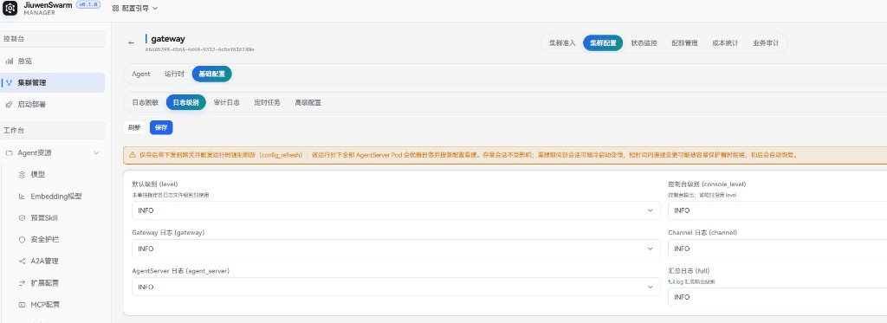

# 日志级别

## 功能说明

**日志级别**用于按集群统一托管 Gateway 与相关组件的**应用文本日志**输出级别。未在管理面托管时，集群使用实例本地 `config.yaml`；托管后，管理面配置优先于本地 YAML。

本页与相邻能力的区别：

| 能力 | 作用对象 | 本页是否配置 |
| ---- | ---- | ---- |
| **日志级别** | 应用文本日志的输出级别 | 是 |
| **日志脱敏** | 应用日志中的敏感信息替换 | 否（见[日志脱敏](日志脱敏.md)） |
| **审计日志** | 安全/行为审计事件字段与运行标识 | 否（见[审计日志](审计日志.md)） |

典型用途：

- 生产环境保持 `INFO`；排障时仅临时将 `gateway` 或 `agent_server` 调为 `DEBUG`，结束后改回或删除托管配置。
- 降低控制台或汇总日志级别，减少 stderr 与磁盘输出。
- 删除托管配置，让集群回退到部署时的本地 `config.yaml`。

## 使用流程概览

1. 使用管理员账号打开目标集群的「集群配置 → 基础配置 → 日志级别」。
2. 按需调整各通道级别并保存；页头出现「Manager 托管」即表示已由管理面接管。
3. Gateway 侧级别立即热更新；AgentServer 在运行时配置刷新并重建后按新级别写出。
4. 排障结束后将级别改回，或「删除托管配置」回退到本地 YAML。

## 管理面配置

### 入口

进入「控制台 → 集群管理」，打开目标集群的 **集群配置**，再选择 **基础配置 → 日志级别**。

页头可 **刷新**、**保存**。若已存在 Manager 托管配置，还会显示「Manager 托管」及最近更新时间，并可 **删除托管配置**。

### 配置项

各字段可选：`DEBUG`、`INFO`、`WARNING`、`ERROR`、`CRITICAL`、`NOTSET`。页面初次打开且尚未托管时，表单默认全部为 `INFO`。

| 字段 | 说明 |
| ---- | ---- |
| **默认级别 (level)** | 未单独指定各日志文件级别时使用的基础级别。 |
| **控制台级别 (console_level)** | 控制台（stderr）输出级别；省略时沿用 `level`。环境变量 `LOG_LEVEL` 只影响控制台，不改变各组件日志文件级别。 |
| **Gateway 日志 (gateway)** | 网关组件写入 `gateway.log` 的级别。排障热路径明细时需临时设为 `DEBUG`。 |
| **Channel 日志 (channel)** | 渠道组件写入 `channel.log` 的级别。 |
| **AgentServer 日志 (agent_server)** | AgentServer 组件写入 `agent_server.log` 的级别。 |
| **汇总日志 (full)** | 汇总日志 `full.log` 的输出级别（不含网关组件）。 |

说明：

- `NOTSET` 表示不在该通道单独覆盖级别，实际输出随上级/默认级别解析；不确定时优先使用明确的 `INFO` / `WARNING` 等取值。
- 生产建议整体保持 `INFO`；仅对正在排查的组件临时调高，避免全通道长期 `DEBUG`。

### 保存、托管与删除

- **保存**：先推送到 Gateway，成功后再写入管理面。Gateway 对日志级别热加载；同时触发运行时配置刷新，该运行时下 AgentServer Pod 会优雅下线并按新配置重建。重建期间存量会话不受影响，新会话可能冷启动变慢；短时间内连续变更可能被容量保护暂时拒绝，稍后会自动恢复。
- **未托管**：尚未保存过托管配置时，页面展示默认 `INFO`；运行侧使用实例本地 `config.yaml`，控制台级别仍可被环境变量 `LOG_LEVEL` 覆盖。
- **刷新**：重新拉取当前托管配置；若尚无托管记录，表单回到默认 `INFO`。
- **删除托管配置**：先通知 Gateway 删除 logging 配置（回退到本地 `config.yaml`），再清除管理面记录；同样会触发运行时配置刷新与 AgentServer 重建。

## 生效说明

### 配置优先级

| 来源 | 优先级 | 说明 |
| ---- | ---- | ---- |
| 管理面托管配置 | 最高 | 覆盖实例本地 `config.yaml` 中的 logging 配置 |
| 实例本地 `config.yaml` | 未托管时使用 | 部署时写入的默认日志配置 |
| 环境变量 `LOG_LEVEL` | 仅控制台 | 只影响 stderr 控制台级别，不改变各组件日志文件级别 |

### 生效方式

| 范围 | 生效方式 |
| ---- | -------- |
| Gateway 进程内日志级别 | 下发后热更新，无需重启 Gateway |
| AgentServer | 经运行时配置刷新并重建后生效 |
| 如何确认 | Gateway 变更后即可在 `gateway.log` / 控制台观察；AgentServer 需待对应 Pod 重建完成后再查看 `agent_server.log` |

## 注意事项

- 仅管理员可读写本页配置；普通用户无此入口。
- `DEBUG` 会显著增加日志量，尤其是 Gateway 热路径；建议仅在排障窗口临时开启，结束后改回 `INFO` 或删除托管配置。
- 保存失败时，以「同步 Gateway 失败」类提示为准；此时管理面不会写入本次变更，需排查 Gateway 连通性后重试。
- 多副本 Gateway 建议开启配置轮询，以便各副本及时拿到最新级别。
- 日志脱敏、审计日志与本页相互独立，分别在「基础配置」下的对应页签维护。

## 相关文档

- [日志脱敏](日志脱敏.md)：按规则掩码应用日志中的敏感信息。
- [审计日志](审计日志.md)：配置审计事件字段与运行标识，并在 Observability 中查询。
