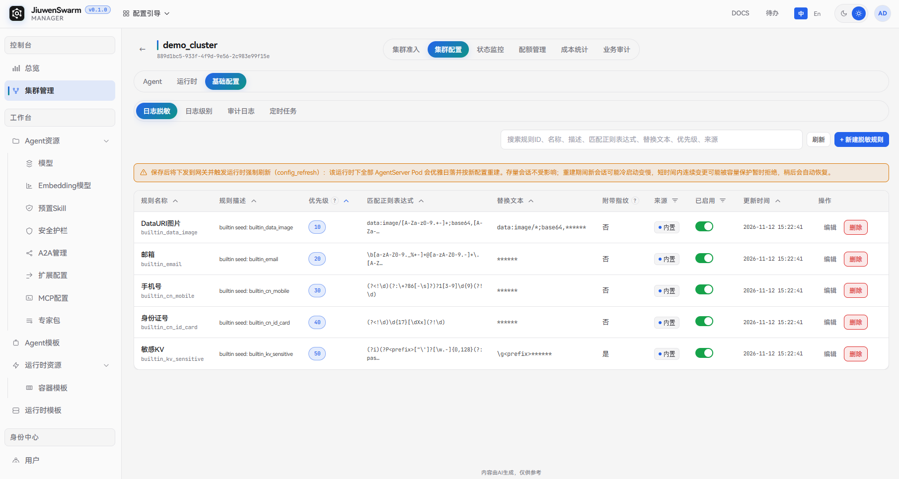
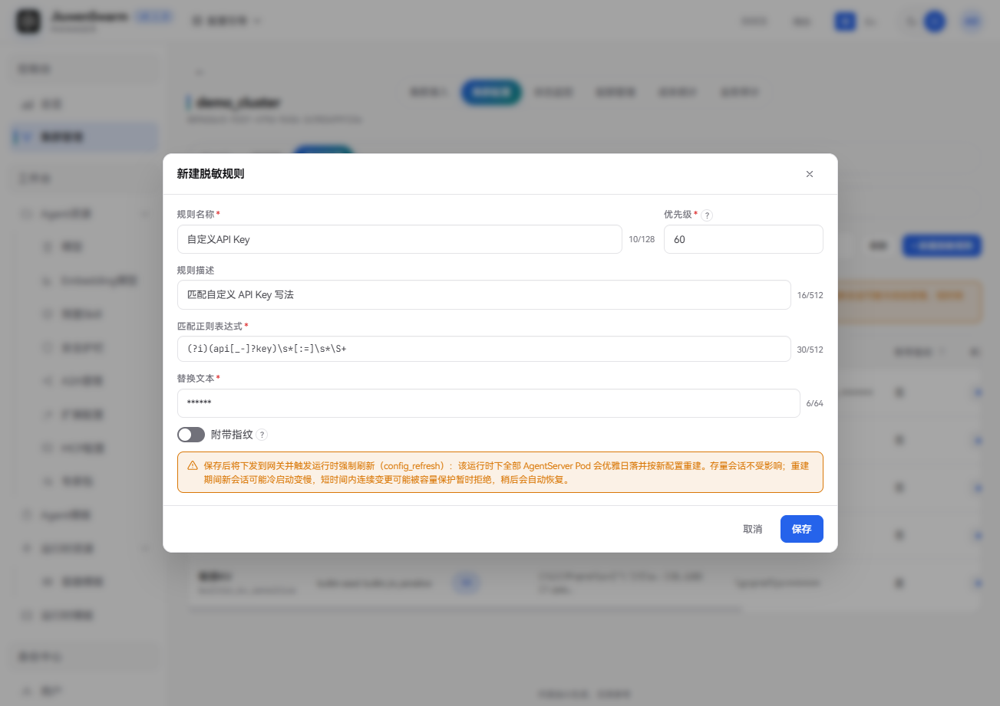

# 日志脱敏

## 功能说明

**日志脱敏**用于在运行面写入日志时，按正则规则把敏感内容替换为掩码（或掩码加指纹），降低 API Key、口令、手机号、身份证号等敏感信息落入日志的风险。

规则由管理员在管理面按集群维护，保存后下发到网关并随运行时配置生效。新建集群时，系统会自动写入一组**内置**规则，也可按需新增**自定义**规则。

典型用途：

- 对日志中的邮箱、手机号、身份证号等个人敏感信息进行统一掩码。
- 对 `password`、`api_key`、`token` 等键值对中的敏感字段脱敏，并可选附带指纹以便排查时关联同一敏感值。
- 屏蔽日志里体积很大的 Base64 图片 Data URI，避免日志膨胀。

### 脱敏范围

脱敏作用在运行面各组件**新写入**的日志上，管理面只维护规则、不执行脱敏。脱敏生效的组件包括：

| 组件 | 说明 |
| ---- | ---- |
| **Gateway** | Gateway 写出的日志会按已启用规则脱敏 |
| **AgentServer** | AgentServer 写出的日志会按已启用规则脱敏 |

说明：

- 仅对规则变更之后新产生的日志生效，不会回溯改写已落盘的历史日志。
- 仅**已启用**的规则参与脱敏，并按优先级从小到大依次应用。
- 业务侧总开关关闭时，Gateway / AgentServer 均不执行本页规则脱敏（见下方「相关配置项」）。

### 下发与生效

管理面保存（新建 / 修改 / 禁用 / 删除）时，先把规则同步到 Gateway，再写入管理面库。Gateway 与 AgentServer 的更新方式不同：

#### Gateway

1. 接收管理面推送的规则，写入本集群企业库（`log_masking_rule`）。
2. **进程内热加载**：立即从企业库重载已启用规则到本进程的脱敏引擎，Gateway 侧后续新写的日志按新规则脱敏，无需重启 Gateway。
3. 另有配置轮询作为自愈：周期从企业库同步 `log_masking_rule`，再次刷新本进程引擎。

#### AgentServer

AgentServer **不做进程内热更新**：Gateway 写库并完成本进程热加载后，会通过 Runtime 优雅下线对应 Agentserver Pod 并按新配置重建，已有会话不受影响，新拉起的 AgentServer 按最新配置运行。

### 相关配置项

以下项在企业部署目录的 `.env.custom` 中配置，按部署流程使配置生效，部署与改配步骤见[《集群部署指南》](../../../../快速开始/集群部署指南.md)的「配置 .env.custom」章节。

| 配置项 | 默认值 | 说明 |
| ---- | ---- | ---- |
| `LOG_MASK_ENABLED` | `true` | **业务应用内置日志脱敏**总开关。注入 Gateway、AgentServer。为 `true` 时，写日志按本页已启用规则脱敏；为 `false` 时业务侧不脱敏。 |

## 使用流程概览

1. 进入目标集群的「集群配置 → 基础配置 → 日志脱敏」。
2. 确认内置规则是否满足需要；不需要的规则可禁用或删除。
3. 按需新建自定义脱敏规则（匹配正则、替换文本、优先级等）。
4. 保存后配置下发到网关并触发运行时刷新，之后新产生的日志按规则脱敏。

## 管理面配置

### 入口

进入「控制台 → 集群管理」，点击目标集群卡片上的「配置」，或打开集群详情后切换到「集群配置」页签，再选择 **基础配置 → 日志脱敏**。

### 内置规则

集群首次就绪时，系统会自动下发以下内置规则（来源为「内置」），默认全部启用：

| 规则名称 | 规则 ID | 默认优先级 | 附带指纹 | 作用说明 |
| ---- | ---- | ---- | ---- | ---- |
| **DataURI图片** | `builtin_data_image` | 10 | 否 | 将 `data:image/...;base64,...` 替换为短占位，避免大段 Base64 写入日志 |
| **邮箱** | `builtin_email` | 20 | 否 | 掩码常见邮箱地址 |
| **手机号** | `builtin_cn_mobile` | 30 | 否 | 掩码中国大陆手机号（可带 `+86` 前缀） |
| **身份证号** | `builtin_cn_id_card` | 40 | 否 | 掩码 18 位身份证号 |
| **敏感KV** | `builtin_kv_sensitive` | 50 | 是 | 掩码 password、api_key、token、authorization 等键值对中的敏感值，并附带指纹 |

内置规则可编辑、禁用或删除，与自定义规则操作方式相同。

### 新建脱敏规则

点击「新建脱敏规则」，填写以下信息后点击 **保存**：

| 字段 | 说明 |
| ---- | ---- |
| **规则名称** | 必填，管理面展示用名称，最多 128 个字符。 |
| **优先级** | 必填，整数。启用中的规则按优先级**从小到大**依次应用；同一集群内，启用中的规则不能使用相同优先级。 |
| **规则描述** | 可选，说明用途，最多 512 个字符。 |
| **匹配正则表达式** | 必填，用于匹配待脱敏内容的正则，最多 512 个字符。须为合法正则；含明显不安全嵌套通配（如 `(.*)*`）或探测样例上过慢的表达式会被拒绝。 |
| **替换文本** | 必填，命中后写入日志的替换内容，默认 `******`，最多 64 个字符，不能包含换行。可使用正则回引（如 `\g<prefix>******`）保留键名、只掩码值 。|
| **附带指纹** | 可选，默认关闭。开启后，脱敏结果会在替换文本基础上附带不可逆指纹，便于在日志中判断多处出现的是否为同一敏感值；关闭则仅使用替换文本。 |

新建规则的来源为「自定义」。

### 编辑、禁用与删除

- **编辑**：点击行内「编辑」，可修改名称、描述、正则、替换文本、优先级和是否附带指纹。
- **禁用**：通过列表中「已启用」列的开关启用或禁用。禁用后该规则不再参与脱敏，但配置保留，可随时重新启用。重新启用时，若优先级与其他已启用规则冲突，保存会失败。
- **删除**：点击行内「删除」。删除后不可恢复；若仍需类似规则，请重新新建。

## 注意事项

- Gateway 侧规则变更可即时热加载；AgentServer 侧依赖 Pod 重建，建议在业务低峰期批量调整规则。
- 自定义正则应尽量精准，避免过宽匹配导致正常业务字段被误掩码，也避免复杂回溯型表达式影响写日志性能。
- 「敏感KV」等已开启「附带指纹」的规则，指纹用于关联同一敏感值，不可逆向还原原文。
