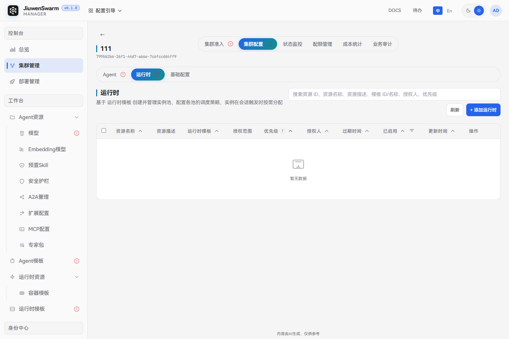
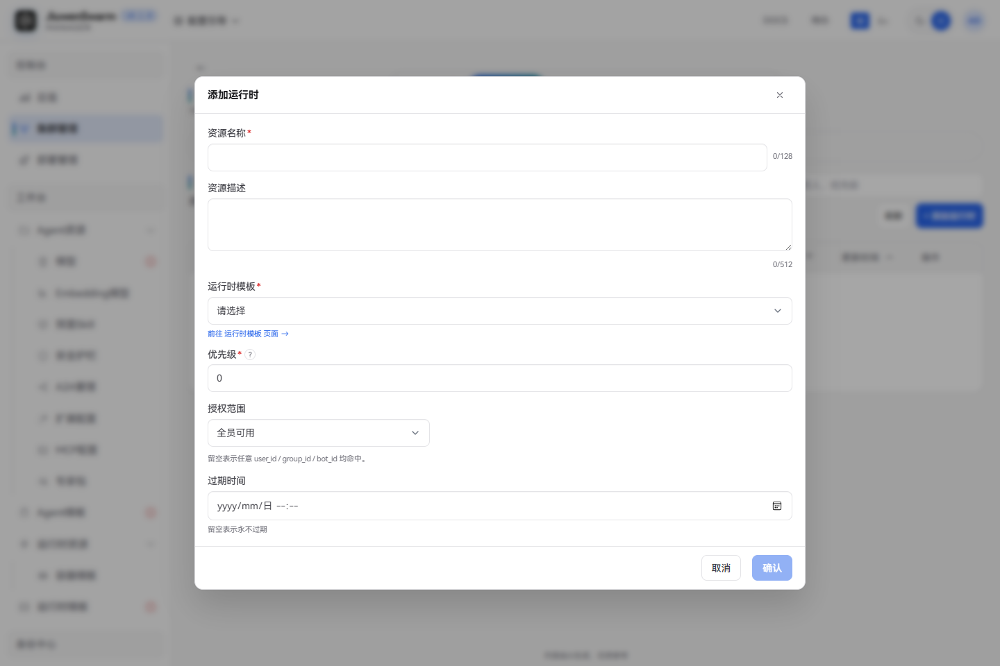

# 运行时

## 功能说明

**运行时**是把管理面中的[运行时模板](../../运行时模板.md)配置到某个集群后的实例化结果。每个运行时基于一个运行时模板在集群内创建并维护一个 AgentServer 实例池：会话触发时按需拉起 Pod，空闲时自动回收（见[资源弹性](../../../资源弹性.md)）。

运行时本身不定义容器规格和池参数，这些内容来自它引用的运行时模板。同一个运行时模板可以配置到多个集群，也可以在同一集群中添加多次，用不同授权范围开放给不同用户。

成员能够正常对话，须同时满足：已被集群准入、至少一个 Agent 授权覆盖该成员、至少一个**运行时**授权覆盖该成员（见[Agent](./Agent.md)）。

## 使用流程概览

1. 在「工作台 → 运行时资源」准备容器模板与运行时模板。
2. 在集群的「集群配置 → Agent」中添加 Agent 模板。
3. 在集群的「集群配置 → 运行时」中添加运行时模板，并设置授权范围与优先级。
4. 授权用户发起会话时，系统按优先级匹配运行时，在其实例池中分配 Pod。

## 管理面配置

### 入口

进入「控制台 → 集群管理」，点击目标集群卡片上的「配置」，或打开集群详情后切换到「集群配置」页签，再选择 **运行时** 子页。

列表展示本集群已添加的运行时，包括资源名称、资源描述、引用的运行时模板、授权范围、优先级、授权人、过期时间、启用状态和更新时间。

### 添加运行时

点击「添加运行时」，填写以下信息后点击 **确认**：

| 字段 | 说明 |
| ---- | ---- |
| **资源名称** | 必填，本集群内该运行时的展示名称，最多 128 个字符。选择运行时模板后，若尚未填写名称，会自动带入模板名称，可再修改 |
| **资源描述** | 可选，说明用途，最多 512 个字符 |
| **运行时模板** | 必填，选择要接入本集群的运行时模板，下拉列表来自「工作台 → 运行时资源 → 运行时模板」。添加后可在编辑时更换；更换后资源 ID 保持不变 |
| **优先级** | 必填，越小越优先。同一集群里，启用中的运行时不能使用相同优先级 |
| **授权范围** | 可选，控制哪些用户的会话使用该运行时，默认「全员可用」，详见下方说明 |
| **过期时间** | 可选，到期后该授权自动失效。留空表示永不过期 |

### 授权范围与匹配规则

- **全员可用**：本集群中所有已准入用户均可使用该运行时。
- **部分可用**：按条件匹配，字段可选「用户」「群组」（对应身份中心中的组织）、「Agent」，运算符支持 `in` / `not in`，可添加多条条件并用 AND / OR 组合，页面下方显示表达式预览。

用户发起会话时，系统在本集群启用的运行时中按**优先级从小到大**找第一个授权范围命中的运行时，使用其运行时模板的实例池。因此不同运行时可用优先级区分使用人群，例如高配池给指定组织、普通池全员兜底。

### 编辑、禁用与删除

- **编辑**：点击行内「编辑」，可修改资源名称、资源描述、绑定的运行时模板、优先级、授权范围和过期时间。更换模板时资源 ID 保持不变，配置会重新同步到 Runtime。
- **禁用**：通过「已启用」列的开关控制。禁用后不再参与匹配，配置仍保留。
- **删除**：点击行内「删除」，或勾选多条后批量移除。

## 注意事项

- 添加、修改、禁用或删除运行时后，配置会下发到网关并触发运行时刷新。已有会话不受影响；变更期间新会话启动可能变慢，短时间内连续修改可能被容量保护暂时拒绝，稍后会自动恢复。建议在业务低峰期变更。
- 运行时只决定「谁用哪个实例池」；容器规格与池参数在「工作台 → 运行时资源 → 运行时模板」中修改。
- 仅配置 Agent 不够，还需同时配置运行时，且两者的授权范围都要覆盖目标用户。
